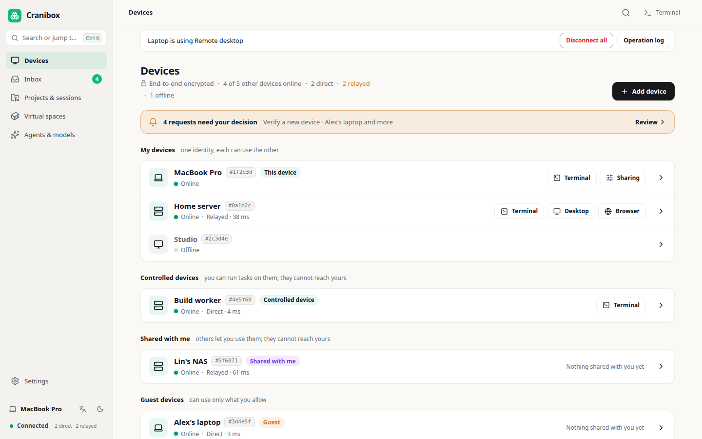
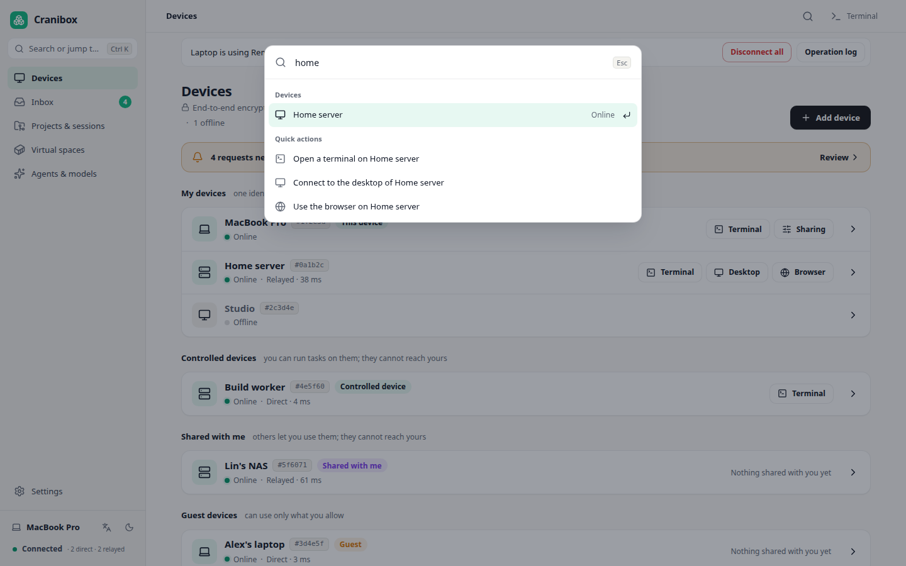
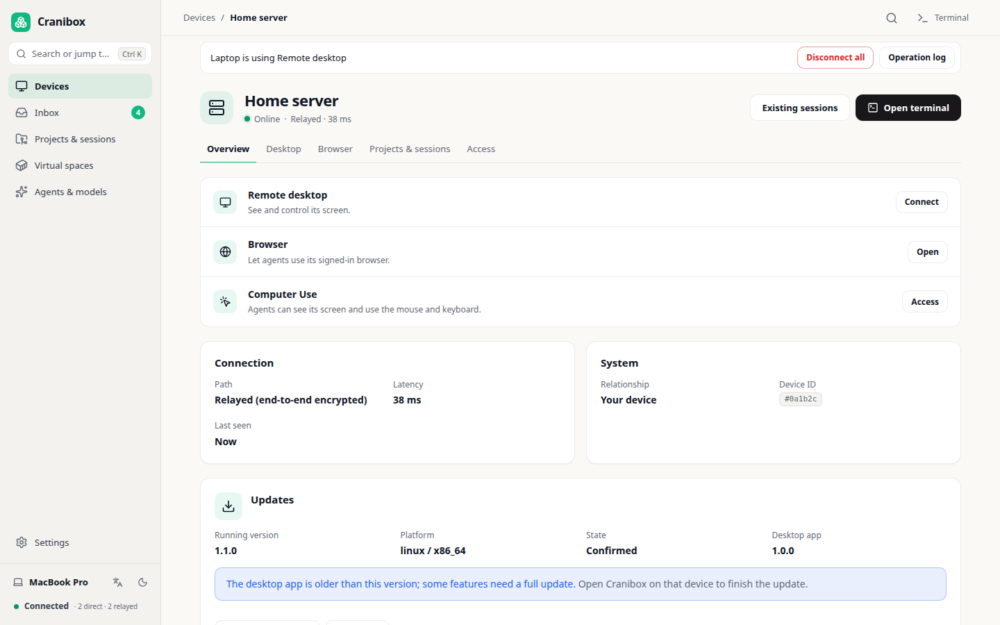
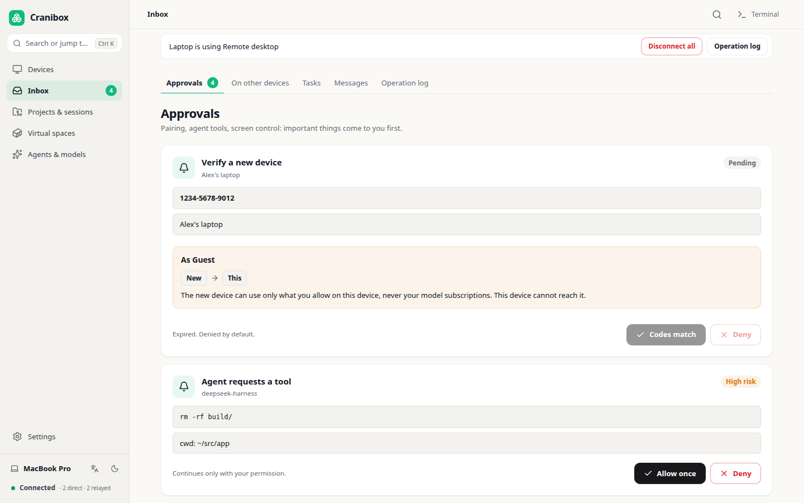
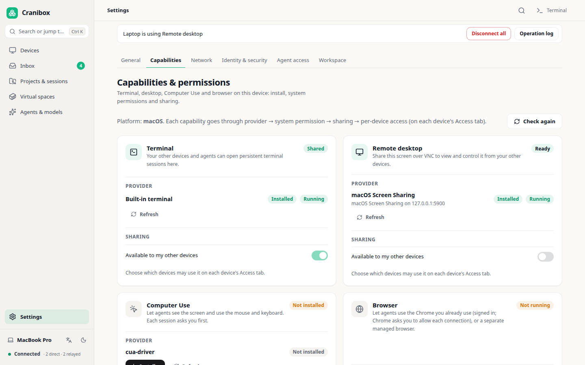
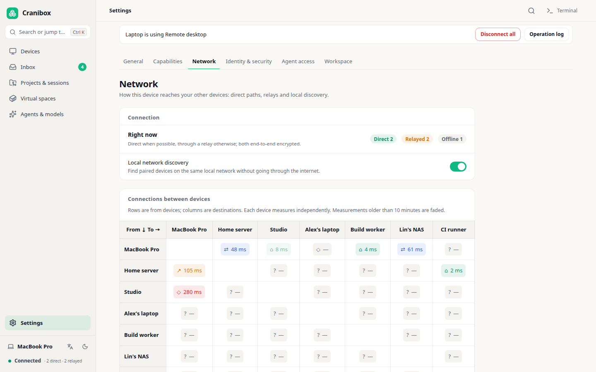
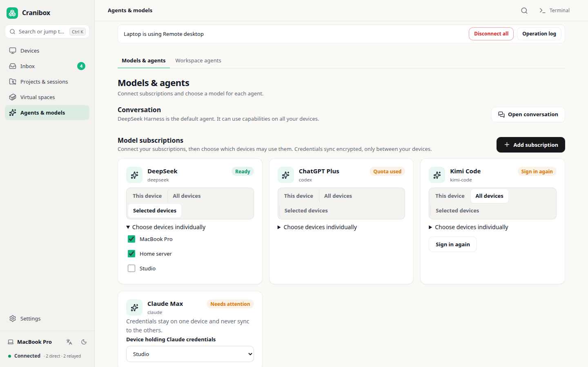

<div align="center">
  <h1>Cranibox</h1>
  <p><b>Give your agents hands on every device you own.</b></p>
  <p>Claude Code or Codex on one machine can run commands on your Mac, Windows PC and Linux servers, copy files between them, and see or operate their desktops and browsers. Every device decides what it allows, and anything risky waits for you. Devices connect peer to peer, end-to-end encrypted. No account, no cloud.</p>
  <p>
    <a href="README.md">English</a> &bull;
    <a href="README.zh-CN.md">中文</a>
  </p>
  <p>
    <a href="https://github.com/fliaping/cranibox/releases/latest"></a>
    <a href="https://www.npmjs.com/package/@fliaping/cranibox"></a>
    <a href="LICENSE"></a>
    
    
  </p>
  <p>
    <a href="https://github.com/fliaping/cranibox/releases/latest"></a>
    <a href="https://github.com/fliaping/cranibox/releases/latest"></a>
    <a href="https://github.com/fliaping/cranibox/releases/latest"></a>
  </p>
</div>

<!-- Hero demo: replace this screenshot with the launch GIF. -->
<p align="center">
  <a href="images/screenshots/app/en/devices.png"></a>
</p>

## Why

Coding agents are good at the work, but each one is stuck on the machine it started on. The moment a task needs your Windows box, the Mac with the signed-in browser, or the server in the closet, you are back to SSH, screen sharing and copy-paste.

- ✅ **Your agent reaches every device.** One MCP server, one CLI: run a command on Windows, pull a log from a Mac, open a terminal or desktop on a Linux server.
- ✅ **Nothing happens without your say.** Each device grants each capability on its own: off, ask every time, or allow for a while. Risky operations wait for your approval, and every use is logged on the device that was used.
- ✅ **No account, no cloud.** Devices pair with a link or QR code and talk directly over [iroh](https://github.com/n0-computer/iroh) (QUIC, hole punching, relay fallback), end-to-end encrypted. There is no Cranibox server to hold your data.
- ✅ **Keeps working when your laptop is closed.** Run the agent on an always-on machine, such as a Mac mini, a server or the [Agent Workspace](https://github.com/fliaping/agent-workspace) container, and check in from whatever device you are holding.

## Quick start

**1. Install on each device.** Download the desktop app from [Releases](https://github.com/fliaping/cranibox/releases/latest) (macOS `.dmg`, Windows `.exe`, Linux `.deb` / `.AppImage`), or install the CLI with npm (Node.js 22+):

```bash
npm install -g @fliaping/cranibox@latest
cranibox            # runs this device's node; the UI listens on 127.0.0.1:7377 only
```

**2. Pair them.** On the Devices page choose **Add device**, then open the `cranibox://` link or scan the QR code on the new device. A headless server can also be added by its address and approved in the Inbox.

**3. Allow what the agent may do.** On each device, under Settings → Capabilities, turn on what other devices may use, for example commands set to *ask every time*. Everything except messages and tasks starts off.

**4. Hand them to your agent.** The desktop app can write Cranibox into installed agents' MCP config with one click, or do it yourself:

```bash
claude mcp add cranibox -- cranibox mcp     # Claude Code
codex mcp add cranibox -- cranibox mcp      # Codex
```

For Claude Code there is also a plugin with the MCP server and a skill that teaches the agent how to use your devices safely:

```
/plugin install cranibox --marketplace fliaping/cranibox
```

For Codex, copy [`plugins/cranibox/skills/cranibox`](plugins/cranibox/skills/cranibox/SKILL.md) to `~/.codex/skills/cranibox`.

Then ask, for example: *"Run the test suite on my Windows PC and pull the report back here."*

The same operations work from a shell:

```bash
cranibox nodes                                   # devices your agents can use
cranibox exec --node <NodeID> -- uname -a
cranibox push --node <NodeID> ./build.zip /tmp/build.zip   # chunked, SHA-256 verified, atomic
cranibox pull --node <NodeID> /var/log/system.log ./system.log
```

## What your agent can do

| Capability | How |
|---|---|
| Run commands on any device | `workspace_exec` / `workspace_job` / `workspace_cancel`, or `cranibox exec` |
| Move files and folders | `workspace_push` / `workspace_pull`, verified by SHA-256 |
| Use your signed-in Chrome | Chrome DevTools Protocol to the Chrome you already use (Chrome asks you each time). See [Browser Use](docs/browser-use.md) |
| Operate a desktop | Your real macOS desktop through cua-driver, or the agent's own Linux desktop in a virtual space. See [Computer Use](docs/computer-use.md) |
| Terminals and remote desktop for you | Multi-tab terminals and desktops of authorized devices in the app. See [Remote desktops](docs/remote-desktops.md) |
| Hand off work | Durable tasks and messages between devices that retry while one is offline. See [Device tasks](docs/device-tasks.md), [Device messages](docs/device-messages.md) |
| Projects and sessions | Find project folders and terminal sessions across devices, and run non-interactive agents in the background. See [Projects and sessions](docs/project-session-catalog.md) |
| Isolated Linux workspaces | Virtual spaces from the [Agent Workspace](https://github.com/fliaping/agent-workspace) image, with their own terminal, browser and desktop. See [Virtual spaces](docs/virtual-spaces.md) |

## Safety model

Letting an agent touch real machines is only acceptable if you stay in charge.

- **The target device decides.** Permissions are stored and checked on the device being used; a requester cannot widen them.
- **Default deny.** A newly paired device gets messages and tasks only. Commands, terminals, desktop, Computer Use and browser are turned on one by one.
- **Ask, then allow for a while.** High-risk capabilities default to asking every time; you can grant them for a limited time.
- **Approve from another device.** Approvals reach your other devices; remote approvals are confirmed with your recovery passphrase.
- **Audit.** Each use is logged on the device that was used, with who, what and when, and shown there as it happens.

Details: [device access control](docs/device-access-control.md), [node identity and E2E encryption](docs/node-identity-and-e2e.md), [security review](docs/security-review-2026-10-23.md).

## How it compares

| | Cranibox | Grok Bot alternatives (OpenMausBot, Codync…) | Claude Code Remote Control, Codex in the ChatGPT app | SSH and screen sharing |
|---|---|---|---|---|
| Where the agent works | Every device you pair: Mac, Windows, Linux, containers | A cloud VM or the one computer it runs on | The one computer it runs on | Wherever you log in by hand |
| Network | P2P over iroh, E2E encrypted, no account | Vendor cloud or your own machine | Vendor relay, account required | Open ports, a VPN or a tunnel |
| Per-device, per-capability permissions | Off, ask, or allow for a while; audit on the device | Allow or deny prompts | Per-session prompts | All or nothing |
| Works with | Any MCP agent (Claude Code, Codex, Hermes…) | Their app; some bring any agent | That vendor's agent | Anything, by hand |
| Polished phone app | Not yet ([Android node in progress](docs/android-node.md)) | Yes | Yes | No |

Cranibox is not a chat app. It is what lets the agent you already use reach the rest of your machines, safely.

## Screenshots

The desktop app and the CLI serve the same interface (preview mode with sample data; click for full size):

<table>
  <tr>
    <td align="center" width="50%"><a href="images/screenshots/app/en/palette.png"></a><br><sub>Command palette: Ctrl/⌘ K finds and opens any device, page or action</sub></td>
    <td align="center" width="50%"><a href="images/screenshots/app/en/device.png"></a><br><sub>Device: terminal, desktop, browser, projects and access</sub></td>
  </tr>
  <tr>
    <td align="center" width="50%"><a href="images/screenshots/app/en/inbox.png"></a><br><sub>Inbox: pairing, risky agent operations and screen control go through you</sub></td>
    <td align="center" width="50%"><a href="images/screenshots/app/en/capabilities.png"></a><br><sub>Capabilities: what this device offers and to whom</sub></td>
  </tr>
  <tr>
    <td align="center" width="50%"><a href="images/screenshots/app/en/network.png"></a><br><sub>Network: direct or relayed, and how fast</sub></td>
    <td align="center" width="50%"><a href="images/screenshots/app/en/models.png"></a><br><sub>Agents and models: subscriptions and which devices may use them</sub></td>
  </tr>
</table>

## Platforms

| Platform | Status |
|---|---|
| macOS (Apple Silicon) | Desktop app and CLI. The app is self-signed: after the first launch, allow it once under System Settings → Privacy & Security |
| Windows x64 | Desktop app and CLI |
| Linux x64 (glibc) | Desktop app (`.deb`, `.AppImage`) and CLI; also works as a relay |
| Docker | [Agent Workspace](https://github.com/fliaping/agent-workspace): a Linux computer for your agents with a desktop, browser and toolchain, with Cranibox built in |
| Android | In progress: a controller by default, optionally a controlled device. See [Android node](docs/android-node.md) |

Checksums are in `SHA256SUMS` in each release. In mainland China, install through the npm mirror: `npm install -g @fliaping/cranibox@latest --registry=https://registry.npmmirror.com`.

### Updates

Installed devices update without Node.js: Settings → General → Updates, or `cranibox update apply latest` (`next` for prereleases, `dev` for main builds). Any device of your identity can update the others (`--node <NodeID>`); a version that does not come up within 20 seconds is rolled back. See [remote node update](docs/node-remote-update.md) and [distribution](docs/distribution.md).

### Servers and relays

Open a remote server's UI through an SSH tunnel: `ssh -L 7377:127.0.0.1:7377 server`. To make it a relay for your devices, add `--public-url https://relay.example.com` (behind a reverse proxy) or `--relay-listen 0.0.0.0:7378` (serves only the relay and the read-only identity; the UI stays on loopback). See [the device network](docs/iroh-network.md) and [desktop client and device mesh](docs/node-desktop-and-device-mesh.md).

## Documentation

- Design: [docs/design](docs/design/README.md) and [implementation status](docs/design/IMPLEMENTATION-STATUS.md)
- Network and identity: [iroh network](docs/iroh-network.md), [node identity and E2E](docs/node-identity-and-e2e.md), [direct peers](docs/direct-node-peers.md), [other networks (EasyTier, Tailscale)](docs/device-networks.md)
- Agent work: [agent sessions](docs/agent-sessions.md), [agent executions](docs/agent-executions.md), [device tasks](docs/device-tasks.md), [federated activity](docs/federated-activity.md)

## Contributing

Issues and pull requests are welcome; see [CONTRIBUTING](CONTRIBUTING.md). Issues labelled [`good first issue`](https://github.com/fliaping/cranibox/labels/good%20first%20issue) are a good place to start. If Cranibox is useful to you, a ⭐ helps others find it.

## License

Cranibox is licensed under the [Apache License 2.0](LICENSE). Copyright © 2026 fliaping (see [NOTICE](NOTICE)). Bundled third-party components keep their own licenses; see [docs/licenses](docs/licenses/).

Cranibox = cranium + box. It was formerly named Agent Workspace; that name now belongs to the [workspace image](https://github.com/fliaping/agent-workspace), and in-container commands such as `agent-workspace-manager` and `AGENT_WORKSPACE_*` variables keep it.
