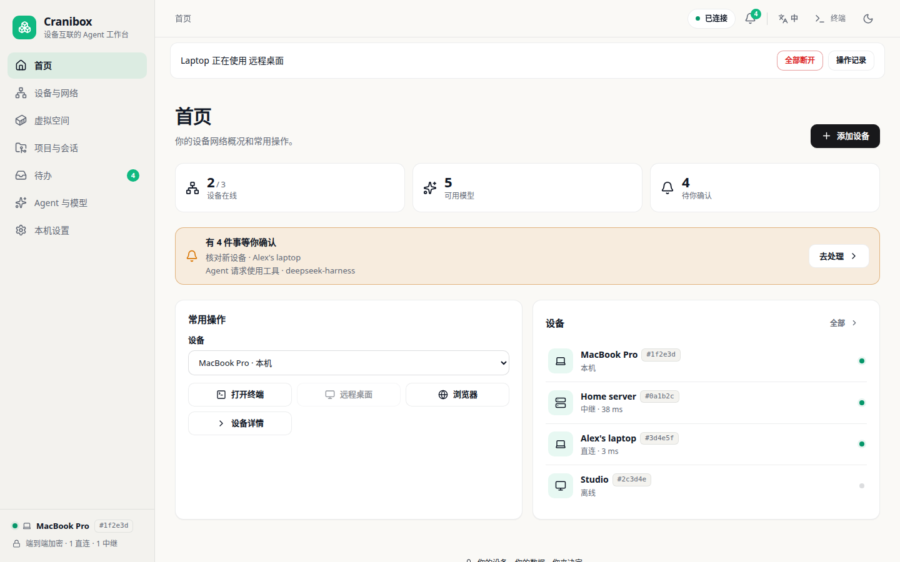
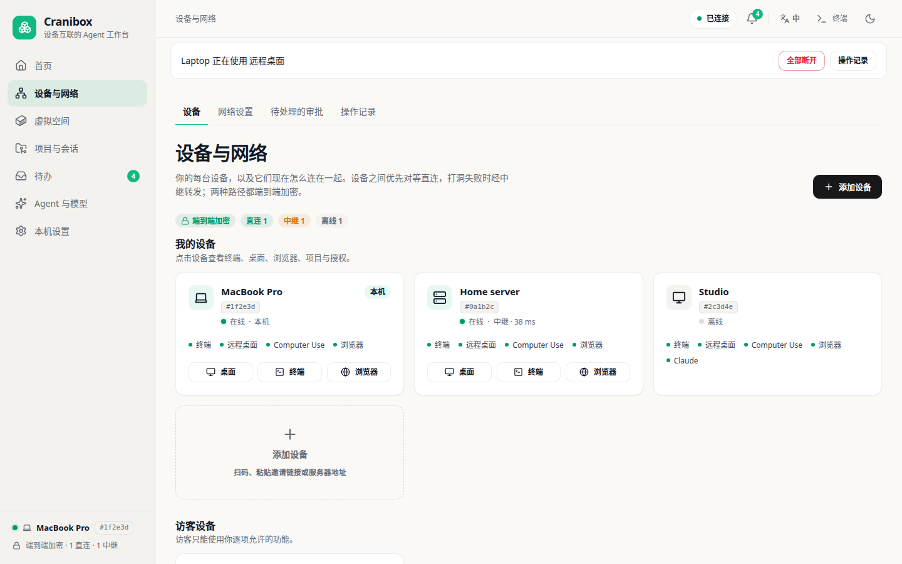
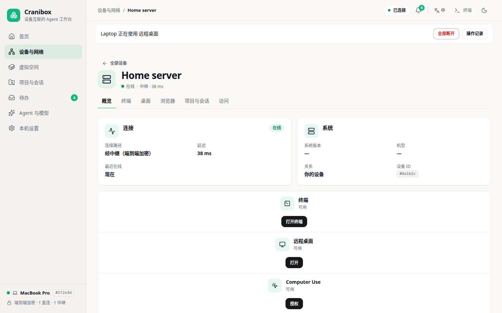
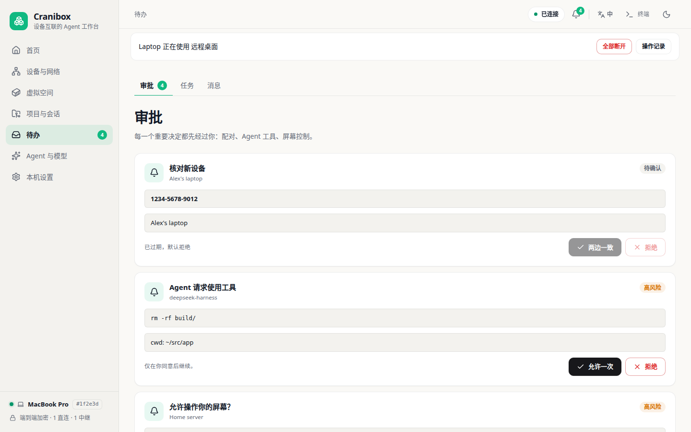
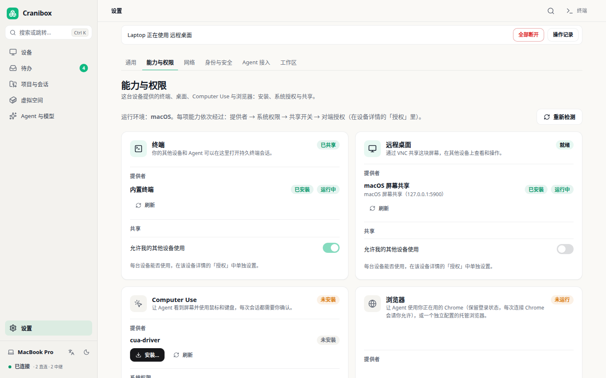
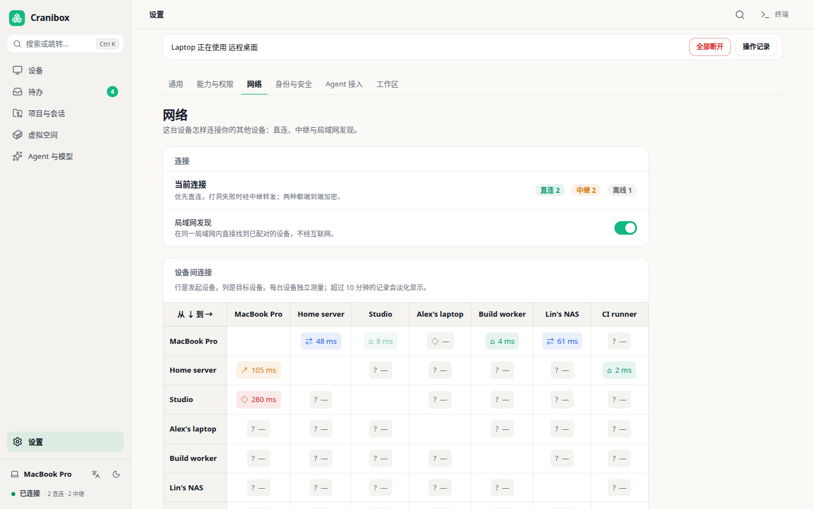
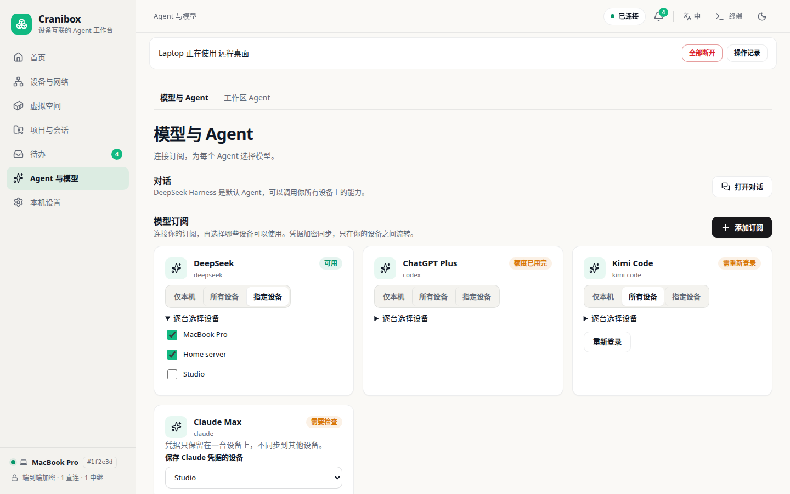

<div align="center">
  <h1>Cranibox</h1>
  <p><b>让你的 Agent 用上你的每一台设备。</b></p>
  <p>一台电脑上的 Claude Code 或 Codex，可以在你的 Mac、Windows 和 Linux 服务器上执行命令、互传文件、查看和操作它们的桌面与浏览器。每台设备自己决定允许什么，有风险的操作先等你批准。设备之间对等直连、端到端加密，不需要账号，没有云。</p>
  <p>
    <a href="README.md">English</a> &bull;
    <a href="README.zh-CN.md">中文</a>
  </p>
  <p>
    <a href="https://github.com/fliaping/cranibox/releases/latest"></a>
    <a href="https://www.npmjs.com/package/@fliaping/cranibox"></a>
    <a href="LICENSE"></a>
    
    
  </p>
  <p>
    <a href="https://github.com/fliaping/cranibox/releases/latest"></a>
    <a href="https://github.com/fliaping/cranibox/releases/latest"></a>
    <a href="https://github.com/fliaping/cranibox/releases/latest"></a>
  </p>
</div>

<!-- 首屏演示：发布前把这张截图换成演示动图。 -->
<p align="center">
  <a href="images/screenshots/app/zh/home.png"></a>
</p>

## 为什么

编程 Agent 很能干，但每个都被困在启动它的那台电脑上。一旦任务需要你的 Windows、那台登录着浏览器的 Mac，或者机柜里的服务器，你又得回到 SSH、屏幕共享和来回复制粘贴。

- ✅ **Agent 能用上每台设备。** 一个 MCP 服务器、一个命令行：在 Windows 上跑命令，从 Mac 取日志，在 Linux 服务器上开终端或桌面。
- ✅ **不经你同意什么都不会发生。** 每台设备逐项决定开放哪些能力：关闭、每次询问、或限时允许。有风险的操作等你批准，每次使用都记录在被使用的那台设备上。
- ✅ **不需要账号，没有云。** 设备用链接或二维码配对，经 [iroh](https://github.com/n0-computer/iroh)（QUIC、打洞直连、失败时 relay 中转）端到端加密通信。没有任何 Cranibox 服务器保管你的数据。
- ✅ **合上笔记本，Agent 也不停。** 把 Agent 放在常开的机器上（Mac mini、服务器或 [Agent Workspace](https://github.com/fliaping/agent-workspace) 容器），用手边任何一台设备随时查看。

## 快速开始

**1. 在每台设备上安装。** 从 [Releases](https://github.com/fliaping/cranibox/releases/latest) 下载桌面客户端（macOS `.dmg`、Windows `.exe`、Linux `.deb` / `.AppImage`），或用 npm 安装命令行版（需要 Node.js 22+）：

```bash
npm install -g @fliaping/cranibox@latest
# 国内：二进制包含在 npm 平台包中，不再从 GitHub 下载
npm install -g @fliaping/cranibox@latest --registry=https://registry.npmmirror.com
cranibox            # 运行本机节点；界面只监听 127.0.0.1:7377
```

**2. 配对。** 在“网络”页点“添加设备”，在新设备上打开 `cranibox://` 链接或扫描二维码。无界面的服务器也可以填写地址加入，再在“待办”里批准。

**3. 决定 Agent 能做什么。** 在每台设备的“本机设置 → 能力与权限”里，打开允许其他设备使用的能力，例如把“执行命令”设为“每次询问”。除消息与任务外，所有能力默认关闭。

**4. 交给你的 Agent。** 桌面客户端可以一键把 Cranibox 写入已安装 Agent 的 MCP 配置，也可以手动添加：

```bash
claude mcp add cranibox -- cranibox mcp     # Claude Code
codex mcp add cranibox -- cranibox mcp      # Codex
```

Claude Code 还可以安装插件，里面包含 MCP 服务器和一个教 Agent 安全使用你设备的 Skill：

```
/plugin install cranibox --marketplace fliaping/cranibox
```

Codex 用户把 [`plugins/cranibox/skills/cranibox`](plugins/cranibox/skills/cranibox/SKILL.md) 复制到 `~/.codex/skills/cranibox`。

然后直接说，例如：*“在我的 Windows 上跑一遍测试，把报告拿回来。”*

同样的操作也可以在终端里做：

```bash
cranibox nodes                                   # Agent 可以使用的设备
cranibox exec --node <NodeID> -- uname -a
cranibox push --node <NodeID> ./build.zip /tmp/build.zip   # 分块传输、SHA-256 校验、原子替换
cranibox pull --node <NodeID> /var/log/system.log ./system.log
```

## Agent 能做什么

| 能力 | 方式 |
|---|---|
| 在任意设备上执行命令 | `workspace_exec` / `workspace_job` / `workspace_cancel`，或 `cranibox exec` |
| 传文件和文件夹 | `workspace_push` / `workspace_pull`，SHA-256 校验 |
| 用你已登录的 Chrome | 经 Chrome DevTools Protocol 连接你正在用的 Chrome（每次由 Chrome 弹窗请你同意），见 [Browser Use](docs/browser-use.md) |
| 操作桌面 | 经 cua-driver 操作你真实的 macOS 桌面，或操作虚拟空间里 Agent 自己的 Linux 桌面，见 [Computer Use](docs/computer-use.md) |
| 给你用的终端和远程桌面 | 在客户端里打开已授权设备的多标签终端和桌面，见[跨设备桌面](docs/remote-desktops.md) |
| 委托工作 | 设备之间的持久任务和消息，对方离线时自动重试，见[跨设备任务](docs/device-tasks.md)、[设备消息](docs/device-messages.md) |
| 项目与会话 | 汇总各设备的项目目录和终端会话，在后台运行非交互 Agent，见[项目与会话](docs/project-session-catalog.md) |
| 隔离的 Linux 工作区 | 基于 [Agent Workspace](https://github.com/fliaping/agent-workspace) 镜像创建虚拟空间，有独立的终端、浏览器和桌面，见[虚拟空间](docs/virtual-spaces.md) |

## 安全模型

让 Agent 动真机器，前提是你始终说了算。

- **目标设备说了算。** 权限存在被使用的设备上，也在那里检查；请求方无法放宽。
- **默认拒绝。** 新配对的设备只有消息与任务。命令、终端、桌面、Computer Use 和浏览器需要逐项打开。
- **先询问，再限时允许。** 高风险能力默认每次询问，也可以限时授权。
- **在别的设备上批准。** 审批会发到你的其他设备；远程批准需要输入恢复口令确认。
- **审计。** 每次使用都记录在被使用的设备上（谁、做了什么、什么时候），并在那台设备上实时提示。

详见[设备访问控制](docs/device-access-control.md)、[节点身份与端到端加密](docs/node-identity-and-e2e.md)、[安全审查](docs/security-review-2026-10-23.md)。

## 和其他方案对比

| | Cranibox | Grok Bot 开源替代（OpenMausBot、Codync…） | Claude Code Remote Control、ChatGPT App 里的 Codex | SSH 与屏幕共享 |
|---|---|---|---|---|
| Agent 在哪里干活 | 你配对的每台设备：Mac、Windows、Linux、容器 | 云 VM 或它所在的那台电脑 | 它所在的那台电脑 | 你手动登录的地方 |
| 网络 | iroh P2P，端到端加密，无账号 | 厂商云或你自己的电脑 | 厂商中继，需要账号 | 开端口、VPN 或隧道 |
| 按设备、按能力授权 | 关闭、询问或限时允许；设备上留审计 | 允许或拒绝弹窗 | 按会话弹窗 | 全有或全无 |
| 支持的 Agent | 任何 MCP Agent（Claude Code、Codex、Hermes…） | 它们自己的 App；部分支持任意 Agent | 该厂商的 Agent | 都行，全靠手动 |
| 成熟的手机 App | 还没有（[安卓节点开发中](docs/android-node.md)） | 有 | 有 | 无 |

Cranibox 不是聊天 App。它让你已经在用的 Agent 安全地用上你其余的机器。

## 界面截图

桌面客户端和命令行版使用同一套界面（截图为预览模式的示例数据，点击查看原图）：

<table>
  <tr>
    <td align="center" width="50%"><a href="images/screenshots/app/zh/devices.png"></a><br><sub>设备：每台设备的连接方式和能力</sub></td>
    <td align="center" width="50%"><a href="images/screenshots/app/zh/device.png"></a><br><sub>设备详情：终端、桌面、浏览器、项目与访问授权</sub></td>
  </tr>
  <tr>
    <td align="center" width="50%"><a href="images/screenshots/app/zh/inbox.png"></a><br><sub>待办：配对、Agent 的高风险操作和屏幕控制都先经过你</sub></td>
    <td align="center" width="50%"><a href="images/screenshots/app/zh/capabilities.png"></a><br><sub>能力与权限：本机提供哪些能力、给谁用</sub></td>
  </tr>
  <tr>
    <td align="center" width="50%"><a href="images/screenshots/app/zh/network.png"></a><br><sub>网络：直连还是中继、延迟多少</sub></td>
    <td align="center" width="50%"><a href="images/screenshots/app/zh/models.png"></a><br><sub>Agent 与模型：连接订阅，选择哪些设备可以使用</sub></td>
  </tr>
</table>

## 支持的平台

| 平台 | 状态 |
|---|---|
| macOS（Apple Silicon） | 桌面客户端和命令行版。客户端为自签名：首次打开后，到“系统设置 → 隐私与安全性”点一次“仍要打开” |
| Windows x64 | 桌面客户端和命令行版 |
| Linux x64（glibc） | 桌面客户端（`.deb`、`.AppImage`）和命令行版，也可以兼作 relay |
| Docker | [Agent Workspace](https://github.com/fliaping/agent-workspace)：给 Agent 的一台 Linux 电脑，带桌面、浏览器和开发工具链，内置 Cranibox |
| 安卓 | 开发中：默认是控制端，可选开启被控，见[安卓手机节点](docs/android-node.md) |

文件校验值见每个 Release 中的 `SHA256SUMS`。

### 更新

已安装的设备无需 Node.js：在“本机设置 → 通用 → 更新”里检查和安装，或执行 `cranibox update apply latest`（预发布用 `next`，main 开发构建用 `dev`）。同一身份的任意设备都能更新其他设备（`--node <NodeID>`）；新版本 20 秒内没有正常运行就自动回滚。见[节点远程更新](docs/node-remote-update.md)和[客户端分发](docs/distribution.md)。

### 服务器与 relay

用 SSH 隧道打开远程服务器的界面：`ssh -L 7377:127.0.0.1:7377 server`。要让它兼作你设备的 relay，加上 `--public-url https://relay.example.com`（经反向代理）或 `--relay-listen 0.0.0.0:7378`（只提供 relay 与只读身份，界面仍只在回环）。见[设备组网](docs/iroh-network.md)和[客户端与设备组网](docs/node-desktop-and-device-mesh.md)。

## 文档

- 设计：[docs/design](docs/design/README.md) 与[实现核对与缺口](docs/design/IMPLEMENTATION-STATUS.md)
- 网络与身份：[iroh 组网](docs/iroh-network.md)、[节点身份与端到端加密](docs/node-identity-and-e2e.md)、[节点直连](docs/direct-node-peers.md)、[其他组网（EasyTier、Tailscale）](docs/device-networks.md)
- Agent 协作：[Agent 会话](docs/agent-sessions.md)、[后台执行](docs/agent-executions.md)、[跨设备任务](docs/device-tasks.md)、[协作记录](docs/federated-activity.md)

## 参与贡献

欢迎提 Issue 和 Pull Request，见 [CONTRIBUTING](CONTRIBUTING.md)。可以从标记为 [`good first issue`](https://github.com/fliaping/cranibox/labels/good%20first%20issue) 的 Issue 开始。如果 Cranibox 对你有用，点个 ⭐ 能让更多人发现它。

## 许可证

Cranibox 采用 [Apache License 2.0](LICENSE) 授权，版权所有 © 2026 fliaping（见 [NOTICE](NOTICE)）。捆绑的第三方组件保留各自的许可证，见 [docs/licenses](docs/licenses/)。

Cranibox = cranium（脑壳）+ box。项目原名 Agent Workspace，这个名字现在属于[工作区镜像](https://github.com/fliaping/agent-workspace)；容器内命令（如 `agent-workspace-manager`）和 `AGENT_WORKSPACE_*` 环境变量沿用旧名。
