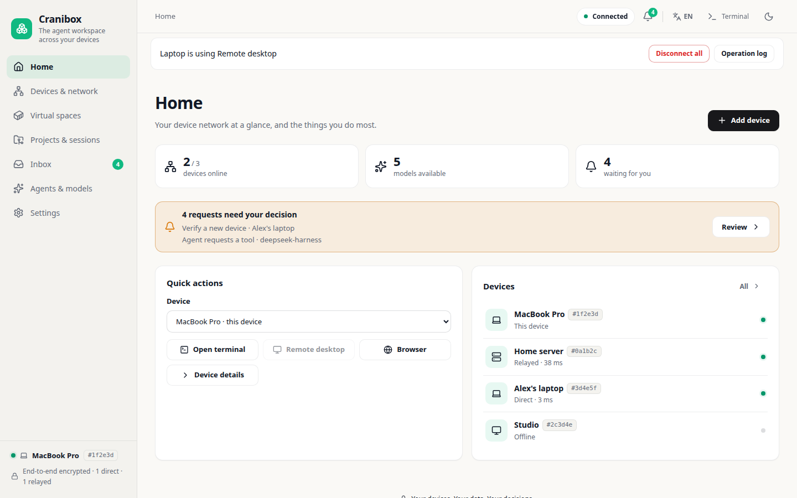
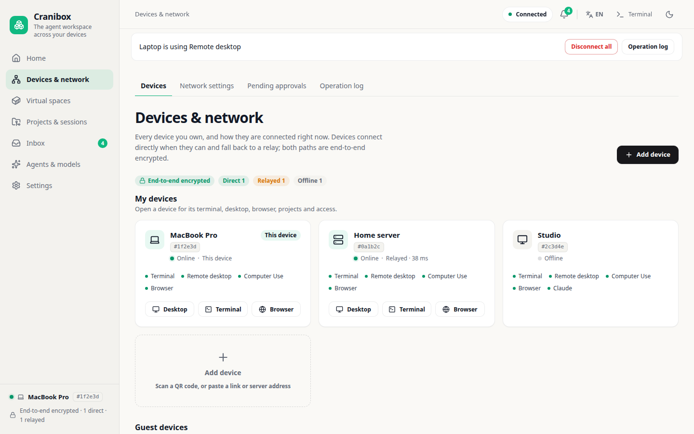
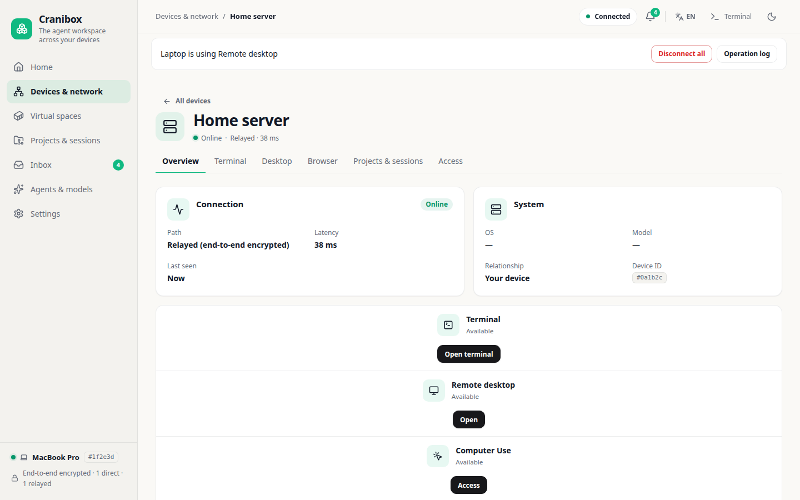
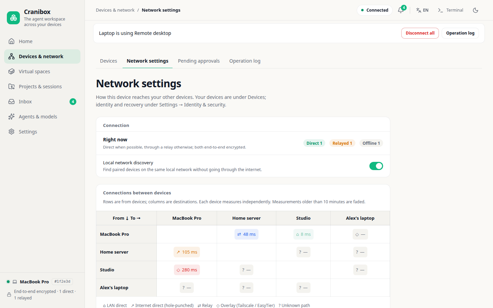
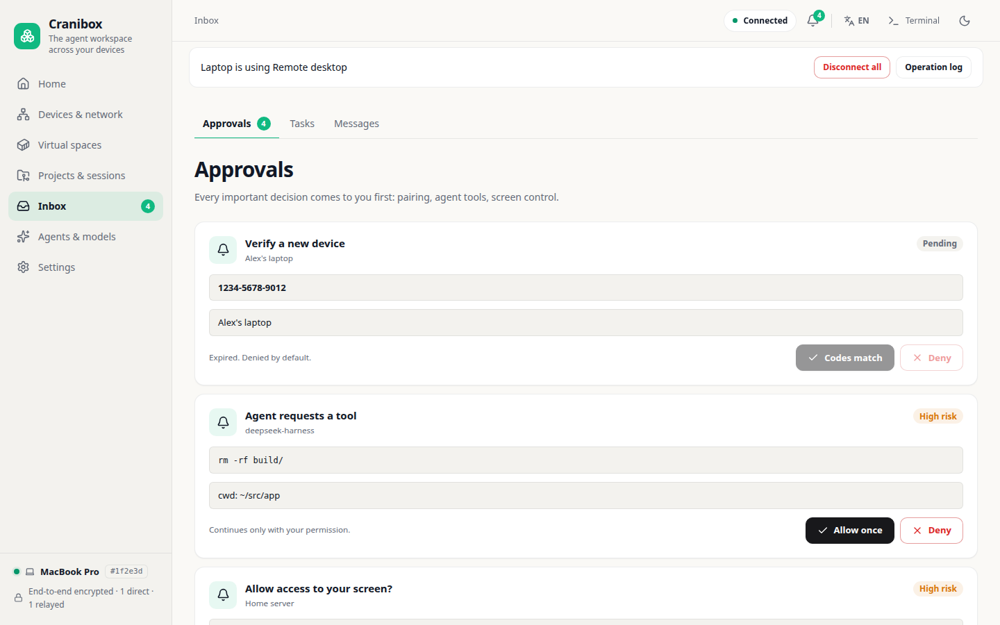
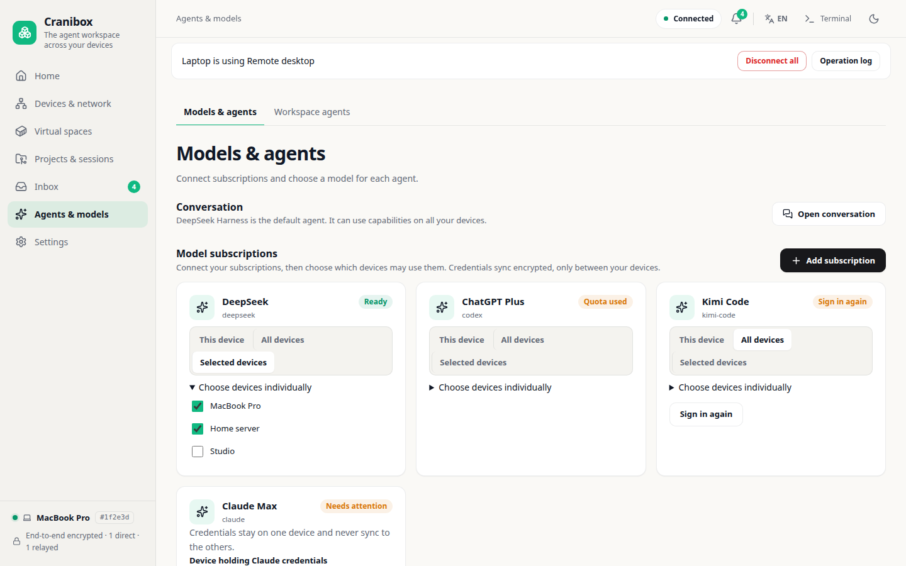
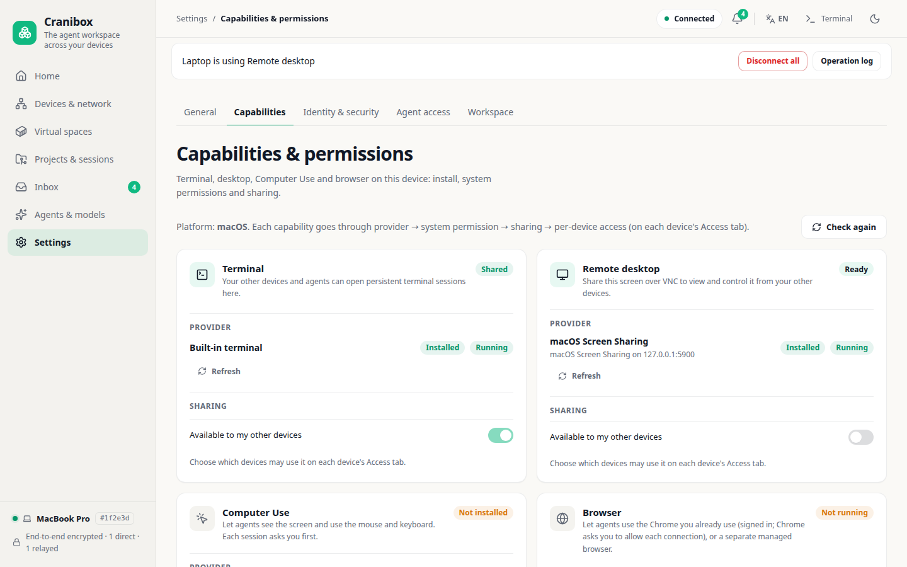
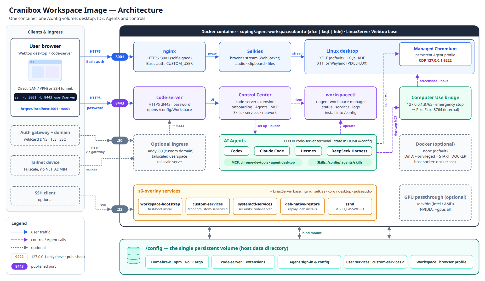
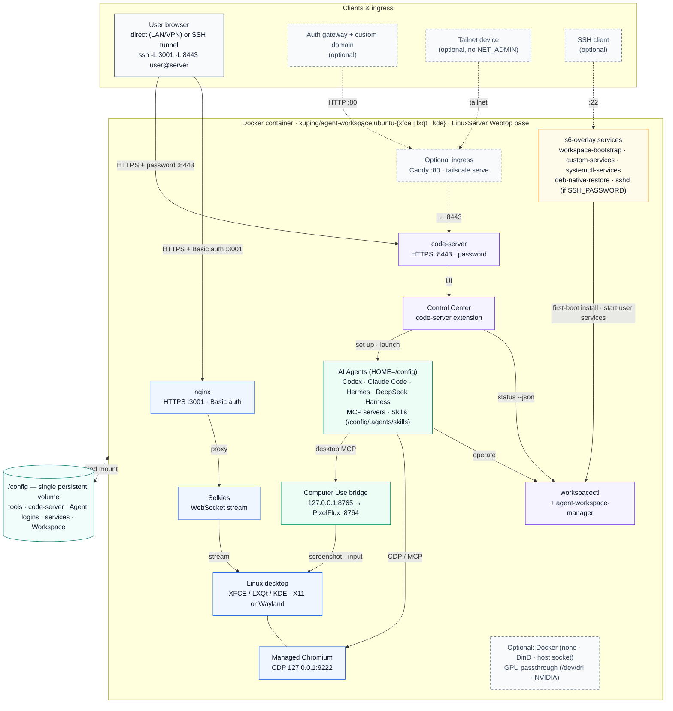

<div align="center">
  <h1>Cranibox</h1>
  <p><b>An Agent workbench across your devices</b></p>
  <p>Every device you own becomes a workbench for your Agents: terminal, desktop, browser and Computer Use, end-to-end encrypted and peer to peer.</p>
  <p><sub>Cranibox = cranium + box. The project was formerly Agent Workspace; the workspace image (<code>xuping/agent-workspace</code>), in-container commands such as <code>agent-workspace-manager</code> and <code>AGENT_WORKSPACE_*</code> variables keep their names for now.</sub></p>
  <p>
    <a href="README.md">中文</a> &bull;
    <a href="README_en.md">English</a>
  </p>
  <p>
    <a href="https://github.com/fliaping/cranibox/releases/latest"></a>
    <a href="https://hub.docker.com/r/xuping/agent-workspace"></a>
    <a href="https://hub.docker.com/r/xuping/agent-workspace/tags"></a>
  </p>
</div>

---

Cranibox connects your computers, servers and containers into a device network of your own, so AI Agents can work on any of them: open a terminal, see and drive the desktop, and use the browser you are already signed in to.

- **Every device is an equal peer** — Windows, macOS, Linux and the workspace container run the same Cranibox node, with no central server; devices connect directly over iroh (QUIC) with hole punching and fall back to a relay, end-to-end encrypted throughout
- **One identity, many devices** — no account to register. The first device creates the identity, new devices join when paired, and devices of the same identity see each other; the recovery code is only for removing a lost device
- **One entry point for Agents** — `cranibox nodes|exec|mcp` and the MCP tools run commands, open terminals, and drive browsers and desktops on any device that granted access
- **You keep the data and the permissions** — a remote command has only the permissions of the account running the target node; each device decides what it grants to whom and can revoke it at any time

## Install

Download desktop installers or standalone CLI binaries from [GitHub Releases](https://github.com/fliaping/cranibox/releases/latest). Node runtimes are distributed and updated through npm:

| Form | Files | For |
|------|-------|-----|
| Desktop app | macOS `.dmg`, Windows `.exe`, Linux `.deb` / `.AppImage` | Everyday computers: tray icon, start at login, a native terminal window; it is also the `cranibox` command |
| Command line | `cranibox-macos-arm64`, `cranibox-linux-x86_64`, `cranibox-windows-x86_64.exe` | Node runtimes without a GUI: the same interface in a browser, and they can serve as a relay |
| Workspace image | `xuping/agent-workspace:ubuntu-xfce` and others | A Linux computer for your Agents with a desktop, browser and toolchain; see [Deploy the workspace image](#deploy-the-workspace-image) |

Checksums are in `SHA256SUMS` in the same release.

The desktop app is also the `cranibox` command: the Linux package and the Windows installer put it on PATH; on macOS choose Install command line tool under This device → Settings → Desktop app. With arguments it runs as the command line; without them it opens the window.

You can also install or upgrade the command-line build through npm (Node.js 22+):

```bash
npm install -g @fliaping/cranibox@latest
# Mainland China: the native binary is included in the npm platform package.
npm install -g @fliaping/cranibox@latest --registry=https://registry.npmmirror.com
cranibox --version
```

The npm package name is `@fliaping/cranibox`. Mirror synchronization may lag behind
a release. npm packages cover macOS Apple Silicon, Windows x64 and glibc Linux x64.

### Updates

Installed devices update without Node.js or npm: check and install under Settings → General → Updates, or run `cranibox update apply latest` (stable), `next` (prerelease) or `dev` (main builds).

- **This device**: updating from the desktop app replaces both the runtime and the desktop app, then restarts Cranibox.
- **Other devices**: any device of the same identity can update the others (`--node <NodeID>` or the device page). Only the runtime is replaced, and a version that does not come up within 20 seconds is rolled back.

An older desktop app cannot update itself; install the new version once by hand. See [remote node update](docs/node-remote-update.md) for how it works and the [distribution guide](docs/distribution.md) for packages and publishing.

Command-line usage:

```bash
cranibox                 # run this device's node; the interface listens on loopback only (default 127.0.0.1:7377)
cranibox ui-url          # print the interface link with a one-time sign-in token
cranibox nodes           # list devices your Agents can use
cranibox exec --node <NodeID> -- uname -a
cranibox push --node <NodeID> ./app.dmg /tmp/app.dmg    # send a file (chunked, SHA-256 verified, replaced atomically)
cranibox pull --node <NodeID> /var/log/system.log ./system.log
cranibox mcp             # the same operations as an MCP stdio server
```

Open a remote server's interface through an SSH tunnel: `ssh -L 7377:127.0.0.1:7377 server`. To make it a relay for your devices, add
`--public-url https://relay.example.com` (behind a reverse proxy) or `--relay-listen 0.0.0.0:7378` (a direct listener that serves only the relay and the read-only identity; the interface stays on loopback). See [the device network](docs/iroh-network.md) and [desktop client and device mesh](docs/node-desktop-and-device-mesh.md).

### Add a device

On the Network page, choose Add device, then either:

- **Pairing link**: create a `cranibox://` link or QR code on an existing device and paste it on the new one;
- **Server address**: on the new device, enter the address of a server running the command-line version (for example `https://relay.example.com`), then compare the fingerprint and approve it in the server's Inbox.

Once paired, the device appears on the network map with its path (direct or relayed), latency and last-seen time.

## Features

- **Network and devices** — a live network map shows whether each device is reached directly or through a relay, and its latency; device details show connection, system and capabilities as cards; known devices on the LAN are discovered automatically
- **Browser Use with the Chrome you already use** — no extension: Cranibox connects to your current Chrome over the Chrome DevTools Protocol (Chrome 144+, enabled once at `chrome://inspect/#remote-debugging`) and works with your signed-in sessions; Chrome asks you to approve each connection. A separate managed browser is also available; see [Browser Use](docs/browser-use.md)
- **Computer Use with two targets** — your real desktop (cua-driver on macOS, with approval for sensitive actions) or the Agent's own computer (the desktop inside a virtual space); with more than one target the Agent must name one; see [Computer Use](docs/computer-use.md)
- **Remote desktop and terminal** — view and control the desktops of devices that granted access; the terminal has tabs, opens in its own native window in the desktop app and as a floating window on the web, and works with CJK input methods; see [remote desktops](docs/remote-desktops.md)
- **Virtual spaces** — isolated Linux workspaces on this device, built from the workspace image; Agents use their terminal, browser and desktop, and data is kept when a space is stopped or archived; see [virtual spaces](docs/virtual-spaces.md)
- **Projects and sessions** — project folders and terminal sessions from every device in one place, so you can return to the original shell; file copies between devices and non-interactive Agent runs; see [projects and sessions](docs/project-session-catalog.md)
- **Inbox, messages and tasks** — pairing requests and Agent approvals and questions in one Inbox; messages and delegated tasks between devices, retried while a device is offline; see [device messages](docs/device-messages.md) and [device tasks](docs/device-tasks.md)
- **Agents and models** — manage local Agents, models and MCP configuration; the desktop app can add Cranibox to the MCP configuration of installed Agents in one click
- **Settings** — General (language, theme, start at login), Capabilities, Identity & security (identity code, recovery code, removing a lost device) and Agent access; switch between Chinese and English from the top bar
- **Other networks, optionally** — EasyTier and Tailscale remain as advanced options; see [device networks](docs/device-networks.md)

The workspace image's own capabilities (Selkies browser desktop, code-server and Control Center, managed Chromium, desktop Computer Use, the `.deb` installer, Docker modes, GPU acceleration, toolchain and single-volume persistence) are described under [Workspace image](#workspace-image) below.

### Screenshots

The desktop app and the command-line build share one interface (preview data; click to enlarge):

<table>
  <tr>
    <td align="center" width="50%"><a href="images/screenshots/app/en/home.png"></a><br><sub>Home: devices online, decisions waiting for you and quick actions</sub></td>
    <td align="center" width="50%"><a href="images/screenshots/app/en/devices.png"></a><br><sub>Devices &amp; network: how each device is connected and what it offers</sub></td>
  </tr>
  <tr>
    <td align="center" width="50%"><a href="images/screenshots/app/en/device.png"></a><br><sub>Device details: terminal, desktop, browser, projects and access</sub></td>
    <td align="center" width="50%"><a href="images/screenshots/app/en/network.png"></a><br><sub>Network settings: direct or relayed, and the latency between devices</sub></td>
  </tr>
  <tr>
    <td align="center" width="50%"><a href="images/screenshots/app/en/inbox.png"></a><br><sub>Inbox: pairing, risky Agent actions and screen control wait for you</sub></td>
    <td align="center" width="50%"><a href="images/screenshots/app/en/models.png"></a><br><sub>Agents &amp; models: connect subscriptions and choose which devices use them</sub></td>
  </tr>
  <tr>
    <td align="center" width="50%"><a href="images/screenshots/app/en/capabilities.png"></a><br><sub>Capabilities: what this device offers and whether it is shared</sub></td>
    <td></td>
  </tr>
</table>

## Workspace image

The workspace image is a Linux computer for your Agents: a container on your server, NAS or WSL2 host where Codex, Claude Code and Hermes get a real desktop, browser and terminal, reachable from the browser on any device. It includes the Cranibox node and joins your other devices as a peer; virtual spaces are built from it.

- **Every device** — the Selkies desktop and code-server open in any browser, phone, tablet or laptop; join Tailscale with one command for private HTTPS without opening public ports
- **Your data stays yours** — a single `/config` volume holds agents, logins, MCP, Skills and settings; back up or move it by copying one folder
- **Trusted boundaries** — managed Chromium CDP listens only on container loopback `127.0.0.1:9222`; desktop Computer Use has an emergency stop; `.deb` installs show the risk and wait for your approval
- **Agents know their home** — built-in `AGENTS.md` / `CLAUDE.md` and `workspacectl` tell agents where state lives and how to check services, ports and logs
- **Full toolchain** — Node.js 22, Go 1.22, Rust, Python 3, Homebrew, uv and tmux, with NVIDIA / Intel / AMD GPU acceleration; Docker can be off, DinD, or the host socket

It is built on [LinuxServer Webtop](https://docs.linuxserver.io/images/docker-webtop/) (Selkies browser desktop streaming), with XFCE (default), LXQt or KDE.

### Workspace image screenshots

Captured from a real `ubuntu-xfce` container deployed with `remote-up.sh`, showing the desktop, code-server and Control Center inside the container (click to enlarge):

<table>
  <tr>
    <td align="center" width="50%"><a href="images/screenshots/webtop-desktop.png"></a><br><sub>Webtop desktop (XFCE)</sub></td>
    <td align="center" width="50%"><a href="images/screenshots/code-server-workspace.png"></a><br><sub>code-server workspace</sub></td>
  </tr>
  <tr>
    <td align="center" width="50%"><a href="images/screenshots/control-center-overview.png"></a><br><sub>Control Center · Overview & guide</sub></td>
    <td align="center" width="50%"><a href="images/screenshots/control-center-agents.png"></a><br><sub>Control Center · Agents</sub></td>
  </tr>
  <tr>
    <td align="center" width="50%"><a href="images/screenshots/control-center-mcp-skills.png"></a><br><sub>Control Center · MCP & Skills</sub></td>
    <td align="center" width="50%"><a href="images/screenshots/control-center-services.png"></a><br><sub>Control Center · Services</sub></td>
  </tr>
  <tr>
    <td align="center" width="50%"><a href="images/screenshots/control-center-network.png"></a><br><sub>Control Center · Network</sub></td>
    <td align="center" width="50%"><a href="images/screenshots/control-center-diagnostics.png"></a><br><sub>Control Center · Diagnostics</sub></td>
  </tr>
</table>

## What Is Ready After Deployment?

This table describes the recommended `remote-up.sh` (`docker-compose.remote.yml`) deployment. A plain
`docker run` or `docker-compose.yml` start without `AGENT_WORKSPACE_BOOTSTRAP` only starts the Webtop
desktop; see [Deployment Options](#deployment-options).

| Area | Ready after deployment | What the user still does |
|------|------------------------|--------------------------|
| Workspace | Webtop, code-server, Control Center, and `workspacectl` | Open the generated URL in a browser |
| Preferred Agent | CLI and matching IDE entry | Complete official account sign-in or API/model configuration |
| Daily management | UI for Agents, MCP, Skills, services, desktop, networking, and diagnostics | Add resources or enable services as the project requires |
| Remote access | Local HTTPS endpoints and an SSH-tunnel path | Optionally enable a custom domain, authenticated gateway, or Tailscale |

The shortest path is: run `remote-up.sh` → open code-server → sign in to one Agent → let that Agent configure anything else you need.

## Architecture

The diagram shows the inside of the workspace image (the container).

<p align="center">
  <a href="images/architecture.svg"></a>
  <br><sub>Click the image for the zoomable SVG version</sub>
</p>

| Layer | Components | Notes |
|-------|------------|-------|
| Access | Browser, SSH tunnel, optional auth gateway + Caddy, optional Tailscale | Only `3001` (desktop) and `8443` (code-server) are published; SSH `22` and Caddy `80` are optional |
| Desktop | nginx → Selkies → XFCE / LXQt / KDE, managed Chromium | nginx provides HTTPS and Basic auth; Selkies streams the desktop over WebSocket; Chromium CDP listens only on `127.0.0.1:9222` |
| IDE / Control Center | code-server, Control Center extension, `workspacectl`, `agent-workspace-manager` | code-server uses password auth; Control Center reads `workspacectl status --json`; the manager installs application capabilities into `/config` |
| Agents | Codex, Claude Code, Hermes, DeepSeek Harness, MCP and Skills, Computer Use bridge | Agents run in the code-server terminal and use MCP to drive the managed browser (CDP) and the desktop (bridge on `127.0.0.1:8765`) |
| Services | s6-overlay: `workspace-bootstrap`, `custom-services`, `systemctl-services`, `deb-native-restore`, `sshd` | First-boot installation, `/config/custom-services.d` registration, and user services (code-server, bridge, …) |
| Persistence | The single `/config` volume | Toolchains, code-server, Agent sign-in state, user services, and the workspace all live under `/config` |

Docker (disabled / DinD / host socket) and GPU passthrough are optional; see [Docker Modes](#docker-modes) and [GPU Acceleration](#gpu-acceleration).

<details>
<summary>Mermaid version</summary>



</details>

## Deploy the Workspace Image

### Secure Remote Start (Recommended)

```bash
git clone https://github.com/fliaping/cranibox.git
cd cranibox
./scripts/remote-up.sh
```

The script asks for one preferred Agent (Codex by default), creates a user-only
`.env.remote`, and starts the container from `docker-compose.remote.yml`
(with `AGENT_WORKSPACE_BOOTSTRAP=remote`). First boot installs code-server, the
workspace extensions, and that Agent; follow progress with
`docker logs -f agent-workspace`. It prints the endpoints and credentials (the
username is always `agent`; the password is random and shared by the desktop and
code-server). The first code-server session opens Control Center's five-step
guide for Agent sign-in, workspace access, remote access, and optional capabilities:

```text
https://localhost:3001  # Webtop desktop
https://localhost:8443  # code-server
```

Here, `localhost` means the Docker host. From another machine, use the server
hostname/IP when the ports are reachable. If a firewall, WSL, or NAT keeps them
private, create an SSH tunnel from the client:

```bash
ssh -N -L 3001:127.0.0.1:3001 -L 8443:127.0.0.1:8443 user@server
```

Then open the same `localhost` URLs in the client browser.

The defaults use self-signed certificates. For Internet exposure, put the
workspace behind a reverse proxy, VPN, or zero-trust gateway with strong TLS and
authentication.

See [Remote Workspace Profiles](docs/remote-workspace.md) for the direct and
authenticated-gateway architectures.

### Interactive Install

Interactive script with 9-step guided setup (language, desktop, Docker mode, registry, version, data dir, port, agents, agent ports).
It starts the Webtop desktop with `docker run` and can install Codex, Claude Code, Hermes, OpenClaw, Openfang,
or Zeroclaw inside the container. Agents are installed as the container's non-root user (`abc`,
`HOME=/config`), so their logins persist under `/config`. It only publishes the desktop port and does not
install code-server or Control Center; add them later as described in [Deployment Options](#deployment-options).

**Linux / macOS**
```bash
# China users (GitCode mirror)
curl -fsSL https://raw.gitcode.com/fliaping0/agent-workspace/raw/main/install.sh | bash

# International users (GitHub)
curl -fsSL https://raw.githubusercontent.com/fliaping/cranibox/main/install.sh | bash
```

**Windows (PowerShell)**
```powershell
# China users (GitCode mirror)
irm https://raw.gitcode.com/fliaping0/agent-workspace/raw/main/install.ps1 -OutFile install.ps1; .\install.ps1

# International users (GitHub)
irm https://raw.githubusercontent.com/fliaping/cranibox/main/install.ps1 -OutFile install.ps1; .\install.ps1
```

### Docker CLI

```bash
docker run -d --name agent-workspace \
  --restart unless-stopped --shm-size 2gb \
  -e PUID=1000 -e PGID=1000 \
  -e TZ=Asia/Taipei \
  -e CUSTOM_USER=agent \
  -e PASSWORD='replace-with-a-long-random-password' \
  -e SELKIES_ENABLE_RATE_CONTROL=true \
  -e SELKIES_RATE_CONTROL_MODE=crf,cbr \
  -e SELKIES_CONGESTION_CONTROL=false \
  -e SELKIES_ENABLE_RESIZE=true \
  -e AGENT_WORKSPACE_BOOTSTRAP=remote \
  -e AGENT_WORKSPACE_AGENT=deepseek-harness \
  -p 3001:3001 -p 8443:8443 \
  -v ~/agent-workspace-data:/config \
  xuping/agent-workspace:ubuntu-xfce
```

Access the desktop at **https://localhost:3001**. After the first-boot bootstrap
finishes (`docker logs -f agent-workspace`), open code-server at
**https://localhost:8443** with the same `PASSWORD`. For a desktop-only container,
drop `AGENT_WORKSPACE_BOOTSTRAP`, `AGENT_WORKSPACE_AGENT`, and `-p 8443:8443`.

> China mirror: `registry.cn-hangzhou.aliyuncs.com/fliaping/agent-workspace:ubuntu-xfce`

### Docker Compose

```bash
git clone https://github.com/fliaping/cranibox.git
cd cranibox
# Edit docker-compose.yml as needed
docker compose up -d
```

`docker-compose.yml` is mainly for custom builds: it publishes only `3001`, keeps
`CUSTOM_USER` / `PASSWORD` commented out, and does not set
`AGENT_WORKSPACE_BOOTSTRAP`. For code-server and Control Center, prefer
`remote-up.sh`, or enable authentication, add `AGENT_WORKSPACE_BOOTSTRAP=remote`,
and publish `8443:8443` in that file.

### Deployment Options

| Method | Published ports | Authentication | First boot installs code-server / Control Center / Agent |
|--------|-----------------|----------------|-----------------------------------------------------------|
| `scripts/remote-up.sh` (recommended) | `3001`, `8443` | user `agent` + random password | Yes (`AGENT_WORKSPACE_BOOTSTRAP=remote`, Codex by default) |
| The `docker run` example above | `3001`, `8443` | `CUSTOM_USER` / `PASSWORD` | Yes (the example sets `AGENT_WORKSPACE_BOOTSTRAP=remote`) |
| Default `docker-compose.yml` | `3001` | Disabled by default | No |
| `install.sh` / `install.ps1` | Desktop port | Chosen in the wizard | No; optional Agent installs only |

An existing container can install the application layer at any time (run as the container user `abc`):

```bash
docker exec -u abc -e HOME=/config agent-workspace agent-workspace-manager update
docker exec -u abc -e HOME=/config agent-workspace agent-workspace-manager install foundation
```

code-server listens on `0.0.0.0:8443` by default, so publish `8443` when creating the container.

## Image Tags

| Tag | Description |
|-----|-------------|
| `ubuntu-xfce` | XFCE desktop (default, recommended) |
| `ubuntu-lxqt` | LXQt desktop (lightest) |
| `ubuntu-kde` | KDE desktop |

Each release also publishes pinned tags such as `ubuntu-xfce-1.0.35`; see
[Docker Hub Tags](https://hub.docker.com/r/xuping/agent-workspace/tags). Use a pinned tag for reproducible deployments.

## Environment Variables

| Variable | Default | Description |
|----------|---------|-------------|
| `PUID` / `PGID` | `1000` | Container user/group ID |
| `CUSTOM_USER` / `PASSWORD` | unset | Webtop HTTP Basic authentication; required for remote access |
| `TZ` | `Asia/Taipei` | Timezone |
| `LC_ALL` | - | Locale (e.g., `zh_CN.UTF-8`) |
| `START_DOCKER` | `false` | Enable Docker inside container (requires `--privileged`) |
| `USE_CHINA_MIRROR` | `false` | Switch to China mirrors at runtime |
| `AGENT_WORKSPACE_BOOTSTRAP` | unset | `remote` (or `foundation` / `base`) installs code-server, Control Center, and desktop integration on first boot; `remote-up.sh` sets `remote` |
| `AGENT_WORKSPACE_AGENT` | `deepseek-harness` | First-boot Agent: `codex`, `claude-code`, `pi`, `hermes`, `deepseek-harness`, `openclaw`, or `none`; only used when `AGENT_WORKSPACE_BOOTSTRAP` is set |
| `CODE_SERVER_BIND` / `CODE_SERVER_AUTH` / `CODE_SERVER_CERT` | `0.0.0.0:8443` / `password` / `true` | code-server listen address, authentication, and self-signed certificate; the password defaults to `PASSWORD` |
| `SSH_PASSWORD` | unset | Set to enable SSH service (container port 22), value is abc user password; the compose files do not publish it, add e.g. `-p 2222:22` |
| `NODE_OPTIONS` | - | Node.js options (e.g., `--max-old-space-size=2048`) |
| `AGENT_WORKSPACE_BROWSER_PROFILE` | `/config/.config/agent-browser` | Persistent profile for the default managed desktop Chromium |
| `AGENT_WORKSPACE_BROWSER_PROFILE_NAME` | `Cranibox (Managed)` | Visible Chromium profile name that makes an accidentally opened unmanaged browser easy to spot |
| `AGENT_WORKSPACE_BROWSER_PORT` | `9222` | Container-internal Chrome DevTools port bound only to `127.0.0.1` |
| `AGENT_WORKSPACE_BROWSER_DISPLAY` | auto-detected | Override the X display used by Chromium when needed, such as `:0` |
| `SELKIES_ENABLE_RATE_CONTROL` | `true` | Enable CRF/CBR rate-control switching |
| `SELKIES_RATE_CONTROL_MODE` | `crf,cbr` | Available modes, with CRF selected by default |
| `SELKIES_CONGESTION_CONTROL` | `false` | Disable GCC adaptation that can reduce quality during motion |
| `SELKIES_ENABLE_RESIZE` | `true` | Synchronize desktop resolution with the browser window |
| `CRANIBOX_DESKTOP` | `on` | Whether the graphical desktop starts with the container. `off` boots without a desktop to save memory; the desktop web page still opens and can switch it on at any time. See [Desktop On/Off (Save Memory)](#desktop-onoff-save-memory) |
| `PIXELFLUX_WAYLAND` | `true` (new images) | Runs the desktop in upstream Wayland (labwc) mode, which desktop Computer Use requires; set to `false` to fall back to X11 (Xvfb). In the published `ubuntu-xfce-1.0.35` and older images it is unset and the desktop defaults to X11; set it to `true` explicitly for Computer Use |
| `PIXELFLUX_CU` | `8764` | Native Selkies Computer Use internal port (Wayland mode only). The source Dockerfile sets it; older images such as `ubuntu-xfce-1.0.35` do not, so add `-e PIXELFLUX_CU=8764`. Upstream binds the container interface, so never publish it |
| `XFCE_PANEL_SCALING` | `true` | Keep XFCE panel rows and icons in step with Wayland scaling; set to `false` to disable |
| `TAILSCALE_AUTHKEY` / `TS_AUTHKEY` | unset | Tailscale auth key; when set, first boot installs Tailscale and joins the tailnet. It is removed from the container environment at startup, handed to `tailscale up --auth-key=file:` as a `0600` file, and deleted after login; it never appears in logs or `workspacectl status` |
| `TAILSCALE_AUTHKEY_FILE` | unset | In-container path to a key file (for example the Docker secret `/run/secrets/tailscale-authkey`); safer than a plain environment variable |
| `TAILSCALE_HOSTNAME` | `agent-workspace` | Device name in the tailnet |
| `TAILSCALE_ADVERTISE_TAGS` / `TAILSCALE_EXTRA_ARGS` | unset | Passed to `tailscale up` as `--advertise-tags` and extra arguments (for example `--ssh`) |
| `TAILSCALE_SERVE` | `false` | Set to `true` to run `workspacectl tailscale serve` after login (Serve/HTTPS must be enabled in the tailnet admin console first) |

## Desktop On/Off (Save Memory)

The graphical desktop (Wayland compositor, XFCE, the desktop browser, audio and the video stream) is the heaviest part of the image. Switch it off when nobody needs to look at it; agents, terminals, code-server, Control Center, the node and the gateway keep running, and the container is not restarted.

- **On the desktop web page**: the desktop page (default `https://<host>:3001`) always opens. With the desktop off it shows "桌面已关闭" (Desktop is off) and a **开启桌面** (Turn on) button; with the desktop on, a small **关闭桌面** (Turn off) tab sits on the right edge and asks for confirmation. Starting usually takes a few seconds to about twenty.
- **Boot without a desktop**: `-e CRANIBOX_DESKTOP=off` (same variable in compose). A container restart returns to this boot setting.
- **CLI** (inside the container): `workspacectl desktop on`, `workspacectl desktop off`, `workspacectl desktop power --json`, or `cranibox-desktop on|off|status`.
- **Control Center**: the Desktop page shows a "图形桌面" card with state, memory and on/off buttons.

Turning the desktop off closes every desktop window and the desktop browser; unsaved work is lost, and desktop Computer Use pauses until the desktop is back. Headless browsers and CLI tools are unaffected.

Measured on `ubuntu-xfce` (idle desktop, no desktop browser open, reclaimable file cache excluded): about 260 MiB with the desktop on and about 78 MiB with it off, saving about 180 MiB; more with the desktop browser open.

## Docker Modes

| Mode | Configuration | Description |
|------|---------------|-------------|
| Disabled | Default | No Docker functionality |
| DinD | `--privileged` + `START_DOCKER=true` | Standalone Docker engine inside container |
| Host Socket | `-v /var/run/docker.sock:/var/run/docker.sock` | Share host Docker daemon |

## GPU Acceleration

| GPU Type | Configuration |
|----------|---------------|
| NVIDIA | `--gpus all -e NVIDIA_VISIBLE_DEVICES=all -e NVIDIA_DRIVER_CAPABILITIES=all --device /dev/dri:/dev/dri` |
| Intel/AMD | `--device /dev/dri:/dev/dri -e DRINODE=/dev/dri/renderD128 -e DRI_NODE=/dev/dri/renderD128` |

> The install script auto-detects GPU and configures accordingly.
>
> The image and compose files set `SELKIES_ENABLE_RATE_CONTROL=true`, `SELKIES_RATE_CONTROL_MODE=crf,cbr` (constant-quality CRF by default, CBR still selectable in the sidebar), `SELKIES_CONGESTION_CONTROL=false`, and `SELKIES_ENABLE_RESIZE=true`, so the desktop resolution follows the browser window. Images built from the current Dockerfile run the desktop on Wayland by default (`PIXELFLUX_WAYLAND=true`); set `-e PIXELFLUX_WAYLAND=false` to fall back to X11 (Xvfb) if you hit a compatibility issue. In the published `ubuntu-xfce-1.0.35` and older images the default is still X11 until a new release is published, so set `-e PIXELFLUX_WAYLAND=true` explicitly.

## Built-in Toolchain

| Tool | Version | Notes |
|------|---------|-------|
| Node.js | 22 LTS | + npm; new images install pnpm and TypeScript under `/usr/local`, independent of how `/config` is mounted. In the published `ubuntu-xfce-1.0.35` and older images they live in `/config/.npm-global` and are hidden by a bind-mounted host directory; run `npm i -g pnpm typescript` there |
| Go | 1.22.4 | |
| Rust | stable | + Cargo |
| Python 3 | System | + pip, venv, uv |
| Homebrew | Latest | Linux version, persisted to data dir |
| tmux | System package | Persistent terminal sessions for remote Agent work |
| docker-systemctl-replacement | Latest | systemd replacement for agent process management |

## Application Capability Management

The image focuses on stable system dependencies, desktop/runtime tooling, and
base s6 services. Faster-moving application capabilities such as proxy routing,
code-server extensions, and Agent installers are managed by the workspace manager,
`agent-workspace-manager` (the command keeps its old name for now), and installed under the persistent `/config` volume.

Run it inside the container to open the TUI:

```bash
agent-workspace-manager
```

The TUI supports Up/Down selection and Enter to run actions. Download and
installation output stays in the in-app log panel instead of writing back to the
raw terminal. Agent installation is handled by the manager flow itself; it does
not launch a nested TUI.

Common commands:

```bash
# Update application source to /config/agent-workspace-manager/source
agent-workspace-manager update

# Install the secure remote foundation: code-server, extensions, custom s6 registration
agent-workspace-manager install foundation

# Optional: configure a custom domain (installs the Caddy backend automatically)
workspacectl network domain dev.example.com

# Optional: private Tailscale networking without NET_ADMIN
agent-workspace-manager install tailscale
workspacectl tailscale login
workspacectl tailscale serve   # uses an https+insecure:// upstream when code-server TLS is enabled (default)
# Unattended: create the container with TAILSCALE_AUTHKEY or TAILSCALE_AUTHKEY_FILE to log in at first boot (see the environment table)

# Show application capability status
agent-workspace-manager status
```

Set `AGENT_WORKSPACE_SOURCE_DIR` to use an existing checkout while developing.
By default, source is persisted at `/config/agent-workspace-manager/source`.
See the [workspace manager](docs/agent-workspace-manager.md).

## Agent Software

`agent-workspace-manager install agents` installs Codex by default, or accepts
one or more explicit Agent names:

```bash
agent-workspace-manager install agents codex
agent-workspace-manager install agents claude-code hermes deepseek-harness openclaw
```

| Agent | Type | Installer | Post-install setup |
|-------|------|-----------|--------------------|
| Codex | Interactive CLI | [Official OpenAI installer](https://learn.chatgpt.com/docs/codex/cli) | `codex` |
| Claude Code | Interactive CLI | [Official Anthropic installer](https://code.claude.com/docs/en/quickstart) | `claude` |
| Hermes Agent | Interactive CLI | [Official Nous Research installer](https://hermes-agent.nousresearch.com/docs/) | `hermes setup --portal` |
| DeepSeek Harness | Web Agent, port 3080 | [Official DeepSeek npm package](https://github.com/deepseek-ai/deepseek-harness) | Open `/proxy/3080/` on the code-server origin |
| OpenClaw | Daemon, port 18789 | npm | `openclaw onboard` |
| Openfang | Daemon, port 4200 | Official shell installer | `openfang init` |
| ZeroClaw | Daemon, port 42617 | brew | `zeroclaw onboard` |

When Codex or Claude Code is installed and code-server is available, the manager
also installs the official `openai.chatgpt` or `Anthropic.claude-code` extension.
If an Agent was installed before code-server, running
`agent-workspace-manager install code-server-extensions` fills the gap.

Codex, Claude Code, and Hermes run directly in a project terminal and are not
registered as background services. DeepSeek Harness and other daemon-style
Agents use the user service manager. All four Agents receive workspace instructions and can
operate the current container through one stable command surface:

```bash
workspacectl info
workspacectl status --json
workspacectl services
workspacectl service restart openclaw
workspacectl agent update openclaw
workspacectl s6 status svc-selkies
workspacectl logs openclaw
workspacectl ports   # merges user and sudo views, including root-owned nginx on 3000/3001
workspacectl browser status
workspacectl desktop status

# Configure the global Chrome DevTools MCP and start the default managed browser
workspacectl browser setup

# Configure same-screen desktop Computer Use for every installed Agent
workspacectl desktop setup

# Once one Agent works, ask it to install another as needed
workspacectl install agent claude-code
```

The default desktop browser starts through `/config/bin/agent-workspace-browser`
and persists its profile under `/config/.config/agent-browser`. Its Chrome
DevTools endpoint listens only on container loopback at `127.0.0.1:9222`; it is
not published through Docker, Caddy, or Tailscale and does not require repeated
per-Agent approval. Configured container Agents can read and operate every tab,
cookie, and signed-in session, so managed mode is intended for trusted Agents in
a single-user workspace.

Native desktop applications use `/config/bin/agent-desktop-mcp`. This requires
the Wayland desktop mode (`PIXELFLUX_WAYLAND=true` with `PIXELFLUX_CU=8764`). New images
meet this by default; with the published `ubuntu-xfce-1.0.35` and older images set both variables when creating the container.
Check it with `workspacectl desktop status`. The safety
bridge is loopback-only at `127.0.0.1:8765`. Upstream PixelFlux currently binds
its internal port `8764` to the container interface, so never publish it through
Docker, Caddy, or Tailscale, and do not join an untrusted Docker network. The bridge provides screenshot, click,
drag, scroll, key, text, window focus, session state, and emergency stop.
Web tasks continue to prefer managed Chromium CDP. Run
`workspacectl desktop emergency-stop` to block all Agent desktop input and
`workspacectl desktop resume` only after it is safe to continue.

`.deb` files in the desktop file manager open with the Cranibox Software
Installer by default. It shows the package name, version, architecture, source
path, and privileged-install warning before using `apt` to resolve dependencies.
Logs are stored in `/config/.local/log/agent-workspace/deb-installer.log`. Agents
can preview changes with
`agent-workspace-deb-installer --dry-run /path/to/package.deb`, and should add
`--yes` for unattended installation only after explicit user approval.

On an existing installation, the first managed launch copies a closed legacy
`/config/.config/chromium` profile into the managed directory and keeps the old
directory intact for rollback.
If Chromium still displays `Work`, that is the internal profile name;
`chrome://version` should show `/config/.config/agent-browser/Default` as the
Profile Path.

`/config` is the only persistence boundary. Seeded `/config/Workspace/AGENTS.md`
and `CLAUDE.md` files explain it to Agents without overwriting existing user
files. Mounting the host Docker socket gives an Agent high privilege outside the
container; `workspacectl info` makes that boundary explicit.
Agent sign-in state and configuration are written beneath `HOME=/config`, so
they persist with the single `/config` data volume.

## Optional Capability Modules

The repository includes optional modules that can be installed into a running
workspace when needed. Use `agent-workspace-manager` for normal installation;
the module source remains available for development:

| Module | Path | Description |
|--------|------|-------------|
| code-server | `addons/code-server` | Official standalone runtime, password authentication, and persistent user service |
| Control Center | `extensions/control-center` | Unified onboarding plus Agents, resources, services, desktop, networking, and diagnostics; "Open desktop" opens Selkies through code-server's `/proxy/3000/` |
| Custom-domain routing | `addons/proxyctl` | Caddy backend installed automatically by `workspacectl network domain` for deployments with existing DNS, TLS, and gateway authentication |
| Selkies Desktop | `extensions/selkies-desktop` | code-server extension that opens the Selkies desktop in one click through the same-origin `/proxy/3000/` route; also available in Restricted Mode (untrusted workspaces) |
| Desktop Computer Use | `addons/desktop-bridge` | Same-screen control, global MCP, loopback boundary, and emergency stop |
| Tailscale network | `addons/tailscale` | Userspace private networking and Tailnet Serve without `NET_ADMIN` |
| DeepSeek Harness | `addons/deepseek-harness` | Official `dsh`, persistent state, same-origin Web UI, and global resource bridge |
| Custom s6 services | `scripts/register-config-services.sh` | Automatically register `/config/custom-services.d/<name>/run` with s6 |

Install the code-server extensions:

```bash
agent-workspace-manager install code-server-extensions
```

The installer migrates the old standalone Services and Caddy sidebar entries
to one Cranibox entry. Users and Agents operate everything through
`workspacectl`; the Caddy routing backend stays decoupled but does not need to
be used directly.

See `addons/proxyctl/README.md` for routing-backend implementation details and [code-server Extensions](docs/code-server-extensions.md) for extension usage.

## Data Persistence

The container's `/config` directory is mapped to the host data directory. Persisted data includes:

- Homebrew packages (`/config/.linuxbrew`; `/home/linuxbrew/.linuxbrew` is only a compatibility symlink and does not need a separate mount)
- npm global packages (`/config/.npm-global`)
- Go workspace (`/config/go`)
- Cargo packages (`/config/.cargo`)
- pip/uv cache (`/config/.cache`)
- Desktop settings and user files
- code-server runtime and configuration (`/config/opt/code-server`, `/config/.config/code-server`)
- Custom s6 services (`/config/custom-services.d/<name>/run`, automatically registered into `/run/service` at startup)

### Custom s6 Services

At startup, the built-in `custom-services` s6 service scans `/config/custom-services.d` after the base `init` service completes and registers services with s6.

Create services as:

```text
/config/custom-services.d/<service-name>/run
```

The `run` file must be executable. After container recreation, services are automatically registered and started as long as `/config` is persisted. See [Persistent Custom s6 Services](docs/custom-s6-services.md).

## Custom Build

The base follows the latest official `linuxserver/webtop:ubuntu-{desktop}` tag. Release and local builds pull the base image for updates and inherit the official Selkies and PulseAudio startup scripts.

```bash
git clone https://github.com/fliaping/cranibox.git
cd cranibox

# Default build (XFCE + international mirrors)
docker compose build --pull

# KDE desktop
DESKTOP=kde docker compose build --pull

# China mirrors for faster build
USE_CHINA_MIRROR=true docker compose build --pull
```

## Common Commands

```bash
# View logs
docker logs -f agent-workspace

# Enter container
docker exec -it agent-workspace bash

# Stop/Start
docker stop agent-workspace
docker start agent-workspace
```

## Notes

- Without `CUSTOM_USER` / `PASSWORD`, Webtop has no application-level authentication. For Internet exposure, use strong credentials plus a reverse proxy, VPN, or zero-trust gateway.
- Homebrew is persisted to `/config/.linuxbrew`; do not mount `/home/linuxbrew/.linuxbrew` separately.
- LinuxServer automatically initializes the `/config` directory on first startup.

## Known Limitations and Troubleshooting

- **Self-signed certificates and webviews**: code-server uses a self-signed HTTPS
  certificate by default. Chrome refuses to register service workers for untrusted
  certificates, so webviews such as Control Center can fail with
  `Could not register service worker ... SSL certificate error`
  (see [coder/code-server#5671](https://github.com/coder/code-server/issues/5671)).
  Use a certificate the browser trusts (for example a custom domain + Caddy behind
  an existing TLS gateway, see [Remote Workspace Profiles](docs/remote-workspace.md))
  or import the certificate into the system/browser trust store. For temporary
  testing, Firefox or Chrome's `--unsafely-treat-insecure-origin-as-secure` option can help.
- **Desktop Computer Use**: the native PixelFlux endpoint only starts in Wayland
  mode. New images enable Wayland by default; the published `ubuntu-xfce-1.0.35` and older images default to X11, where
  `workspacectl desktop status` reports the backend as unavailable, so create the
  container with `PIXELFLUX_WAYLAND=true` and `PIXELFLUX_CU=8764`. Computer Use is
  unavailable if you fall back to X11 with `PIXELFLUX_WAYLAND=false`.
- **Desktop through code-server**: with `CUSTOM_USER` / `PASSWORD` set,
  `/proxy/3000/` still asks for Basic authentication once.
- **pnpm / TypeScript (older images only)**: in the published `ubuntu-xfce-1.0.35` and older images, bind-mounting an empty
  host directory over `/config` hides `/config/.npm-global`; run `npm i -g pnpm typescript`.
  New images install them under `/usr/local`.
- **UI language**: the Control Center language toggle ("中文" / "EN") switches the whole
  code-server UI language and restarts code-server (see
  [code-server Extensions](docs/code-server-extensions.md)); save open edits first.

## Architecture Support

| Architecture | Docker Platform |
|-------------|-----------------|
| x86-64 | `linux/amd64` |
| ARM64 | `linux/arm64` |

## Links

- [LinuxServer Webtop Docs](https://docs.linuxserver.io/images/docker-webtop/)
- [Docker Hub](https://hub.docker.com/r/xuping/agent-workspace)
- [GitHub](https://github.com/fliaping/cranibox)

Browser terminal and unified Rust server: [Persistent browser terminals: React + xterm.js + herdr](docs/web-terminal-and-unified-server.md).

## License

Cranibox source code is licensed under the [Apache License 2.0](LICENSE). Copyright © 2026 fliaping (see [NOTICE](NOTICE)). Third-party components bundled in container images and desktop builds keep their own licenses; see [docs/licenses](docs/licenses/).
