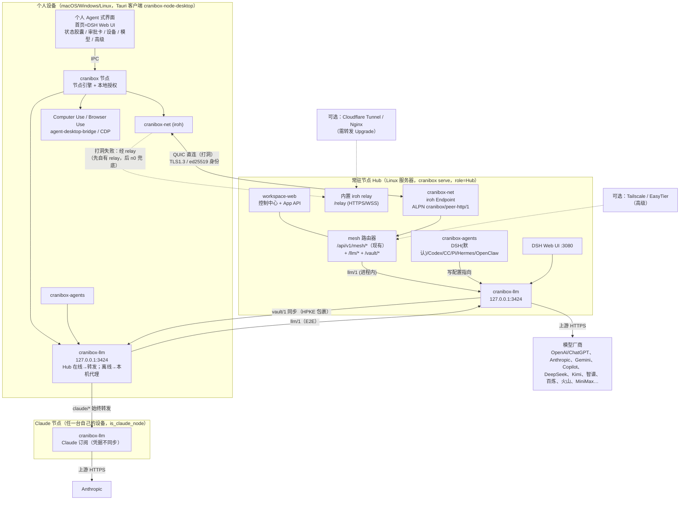

# Cranibox 总体设计（ARCHITECTURE）

> 版本：v1，2026-10-19（北京时间）。基线代码：`fliaping/cranibox` 的 `main@3dec00b`（PR #7–#12 已合并；**#13 `feat/verified-by-default`、#14 `feat/session-discovery` 仍在合并中**，本文假设它们会落到 main）。
> 本文汇总了 iroh 1.3 实测、订阅代理设计、Agent CLI 与 magpie 调研、PR 栈实测验证的结论，并以仓库现有文档为基础：
> - [`docs/decentralized-node-network-design.md`](../decentralized-node-network-design.md)
> - [`docs/node-identity-and-e2e.md`](../node-identity-and-e2e.md)
> - [`docs/remote-workspace-validation-2026-10-18.md`](../remote-workspace-validation-2026-10-18.md)
>
> 分工见 [WORKPLAN.md](./WORKPLAN.md)；每条工作流的任务书见 [tasks/](./tasks/)。

---

## 1. 产品定位

**Cranibox：Anytime, anywhere, every device —— 自托管、高可信的 Agent Brain。**

- **节点**（Cranibox）是「脑壳」，**Agent**（DSH、Codex、Claude Code、Pi、Hermes、OpenClaw）是「大脑」。
- Cranibox 负责四件事：设备互联、人工审批、Computer Use 基础设施、统一的模型订阅代理。
- 机器之间的数据一律**端到端加密**。

### 1.1 目标
1. **面向不懂编程的普通人。** 体验对标 Meta Muse、Grok Bot、Manus Cue、OpenAI Dots 这类 Personal Agent：打开就能对话、交代任务、在卡片上审批。
2. **组网自动完成。** 客户端界面里**没有「连接设置」**：
   - 扫码或点链接配对；
   - 默认走内置 iroh 网络，打洞失败时自动经常驻节点的 relay 中转。
3. **一台固定的常驻节点（Hub）。**
   - 通常是 Linux 服务器上的 `cranibox serve`，提供 relay 和统一的模型代理。
   - 它离线时，各节点用同步过来的订阅在本机起代理。
4. **Agent CLI 只当底层能力。**
   - 默认 Agent 是 **DeepSeek Harness（DSH）**，版本锁定；
   - 可选 Codex、Claude Code、Pi、Hermes、OpenClaw；
   - **现阶段主界面直接用 DSH 自带的 Web UI。**
5. **不同 Agent 共用同一个模型代理。** 订阅只需添加一次，模型会自动注册到每个 Agent。
6. **默认安全。** 设备身份是 ed25519；跨机流量 E2E 加密；能力按设备逐项授权；跨设备的写操作和敏感操作一律走人工审批卡片。
7. **保留必要的高级用法**，统一收在「高级」里：终端、CLI、原始 base URL 和 key、Tailscale、EasyTier、直连地址、路由和日志。

### 1.2 非目标（本期不做）
- 终端和 TUI 不是重点。终端只作为「高级」里的一个工具保留，不再做新的终端功能。
- 不做多台常驻节点的主备，也不做选主。
- 代理服务**不对外开放**：没有公网入口，没有同事 key，没有预算系统。
- Claude 订阅只支持一台节点，不做多节点。
- 暂不自己做对话页，主界面先用 DSH Web UI。
- 插件订阅（Cursor、Kiro 等）、签到、跨提供商回退、额度看板都放到以后。
- 不支持降级到旧版数据格式（现状如此，已写进文档）。

---

## 2. 组件总览



### 2.1 代码地图（现有 → 规划）
| 位置 | 现有职责 | 本期变化 |
|---|---|---|
| `crates/cranibox`（bin `cranibox`） | `serve`、`ctl`、`service`、`runtime` 子命令入口 | `serve` 默认启用 iroh、内置 relay，以 Hub 角色运行 |
| `crates/workspace-web`（`agent-workspace-web`） | 服务端 Web、控制中心、actions | 挂 `/relay`；新增 App API（`/api/v1/app/*`）；Agent 目录改为从 `cranibox-agents` 生成 |
| `crates/workspace-node`（`cranibox-node`） | 独立节点：`peer/`（mesh 路由器、E2E、secure_ws）、`network/`（Tailscale、EasyTier、邀请） | mesh 路由器同时挂到 iroh 上；邀请改成 iroh ticket；新增 `/llm`、`/vault` 子路由 |
| `crates/workspace-runtime` | `peers/`：identity、config（Grant、Permissions、Route）、e2e（Noise IK）、messages、executions、computer、browser… | `Permissions` 加 `llm`、`vault`；`Route` 加 iroh 端点；executions 和 discovery 改为走 Adapter |
| `crates/workspacectl` | inspect（写死的 `AGENTS`）、settings、tailscale… | Agent 目录统一由 `cranibox-agents` 提供 |
| `apps/node-desktop` | Tauri 托盘客户端（目前有「服务端地址 + 节点 Token」表单） | **删掉连接表单**，换成共享的个人 Agent 界面 |
| `addons/control-center/ui` | React 控制中心（Overview、Nodes、NetworkPage、Messages…） | 重排信息架构（§8）；网络和终端相关页面移到「高级」 |
| `addons/deepseek-harness` | 安装 `@deepseek-ai/dsh@latest`，经 `/proxy/3080/` 访问 | **锁定版本**并校验；作为主界面嵌入 |
| **新** `crates/cranibox-contracts` | — | Phase 0 共享契约：类型、trait、常量 |
| **新** `crates/cranibox-net` | — | iroh Endpoint、拨号、路径选择、relay 服务端 |
| **新** `crates/cranibox-llm` | — | 订阅代理（§7） |
| **新** `crates/cranibox-agents` | — | 6 个 Agent 适配器，可逆地写入配置 |

---

## 3. 节点角色

| 角色 | 数量 | 运行形态 | 职责 |
|---|---|---|---|
| **Hub（常驻节点）** | **恰好 1 台** | Linux 服务器或 Docker，`cranibox serve` | iroh relay（HTTPS/WSS，可放在 Cloudflare Tunnel 后面）；默认的模型代理执行点；OAuth 刷新的默认持有者；名册的默认签发方；可选 DSH Web UI |
| **Node（普通节点）** | 不限 | Tauri 客户端（macOS/Windows/Linux）、`cranibox` CLI、Docker | 跑本机 Agent，执行 Computer Use 和 Browser Use；本机 `cranibox-llm`：Hub 在线时转发过去，离线时自己代理 |
| **Claude 节点** | 0 或 1 台（属性，不是独立角色） | 任一台主人设备，通常是第一次登录 Claude 的那台 | 保存 Claude OAuth（永不同步），执行本机及其他节点转发来的 Claude 请求 |
| **访客节点**（同事） | 不限 | 已配对、**不在名册里** | 只拿到逐项授予的能力（messages、computer 等）；**永远拿不到 `llm` 和 `vault`** |

- 名册（Roster，§5.3）是「主人的节点」的唯一事实来源。
- Hub 由名册里的 `role: Hub` 指定，不做选举。

---

## 4. 网络层

### 4.1 传输优先级
1. **iroh（默认，内置）**：iroh 1.3，QUIC，先打洞直连，失败时经 relay。iroh spike 实测数据：
   - 只开放 443 的网络环境下，经 n0 relay 8 ms 建连，RTT p50 7.3 ms；
   - 同一网络里直连 RTT 0.8 ms；
   - 内置 relay 经 nginx TLS 反代：4 ms 建连，传输 64 MiB，空闲 95 s 仍保持连接。
2. **可选，收在「高级」里**：Tailscale、EasyTier、直连 HTTP（现有 `Route.url` 和 `alternatives`）。这些传输上继续使用现有的 **Noise IK E2E 帧**（`/e2e/handshake`、`/e2e/call`、secure_ws）。

### 4.2 身份复用
- 节点的 ed25519 签名私钥（PR #7 的 `node-identity.json`）**直接作为 iroh `SecretKey`**。实测确认：同一个 seed 得到的 EndpointId 就是 openssl 算出的 ed25519 公钥。
- 映射关系：`EndpointId = signing_key 公钥`，`NodeId = "node-" + SHA256("cranibox-node-id-v1\0" ‖ pub)[..16]`。
  - 旧版随机 NodeId 靠自签名绑定到签名公钥（现有逻辑），所以同样能得到 EndpointId。
- 对端身份**以 TLS 握手中的 EndpointId 为准**，再与配对时固定的 `Pinned.signing_key` 比对。不一致就拒绝连接。

### 4.3 ALPN 与路由
- **`cranibox/peer-http/1`**：一条 QUIC 双向流上跑一个 HTTP/1.1 连接（支持 Upgrade），**原样承载现有的 `/api/v1/mesh/*` 路由器**（`peer/server.rs`）。spike 已验证 axum 可以跑在 bi-stream 上。
  - iroh 传输层会给请求注入 `Authenticated { node_id, endpoint_id, transport: Iroh, e2e: true }` 扩展；
  - `auth` 中间件看到这个扩展，就按「对端 NodeId + 固定公钥」查找 Grant，**不再要求 bearer**。
- **iroh 上不再叠加 Noise 和帧加密**：QUIC TLS 1.3 本身就是端到端的，relay 只看得到密文。其他传输上 Noise 照旧。
- 新增的 mesh 子路由，所有传输通用：
  - `/api/v1/mesh/nodes/{node}/llm/v1/{chat/completions,responses,messages,messages/count_tokens,models}`：流式 SSE；需要 `Permissions.llm`，并且对端在名册里。
  - `/api/v1/mesh/nodes/{node}/llm/health`
  - `/api/v1/mesh/nodes/{node}/vault/{pull,push,refresh-request,lease}`：需要 `Permissions.vault`，并且对端在名册里。
  - 在非 iroh 传输上，SSE 走现有的 secure_ws 流式通道；这部分由 WS1 实现适配。
- 预留：以后如果需要，可以给大流量单开 ALPN `cranibox/llm/1`，本期不做。

### 4.4 Relay（内置在 `cranibox serve`）
- 和控制中心共用同一个 HTTPS 端口，挂在 `/relay` 路径上（`iroh_relay::http::RELAY_PATH`，spike 里已经实现按请求分发）。另外提供 `/ping`、`/generate_204`，供 QAD 和强制门户检测使用。
- **放在 Cloudflare Tunnel 或 Nginx 后面**：反代必须转发 `Upgrade` 头。不转发时，客户端会陷入「expected HTTP 101, got 400」的重试循环（spike 实测）。
  - 文档要给出 nginx 和 cloudflared 的配置示例；
  - `cranibox serve` 启动时做一次自检，检查 `/relay` 能否返回 101。
  - 开发环境里没法测 cloudflared quick tunnel（出站 7844 端口不通），需要在真实环境验收。
- **访问控制**：把 `AllowAll` 换成 `AccessConfig` 白名单，只放行名册成员和已配对（有 Grant 或 Route）节点的 EndpointId。白名单在名册或 Grant 变化时热更新。
- **客户端的 relay 顺序**：先自有 relay（名册里 Hub 的公开 URL），再 n0 公共 relay 兜底（`presets::N0`）。「高级」里可以关掉 n0 兜底。

### 4.5 发现与地址
- 节点地址 `EndpointAddr = { EndpointId, relay_url, direct_addrs }`。
- 来源有三个：配对 ticket、名册里 Hub 的地址、iroh 默认的 DNS/pkarr 发现（n0）。
- 名册成员的最新地址经 Hub 的 `vault/1` 一起同步（只同步地址，不含能力）。

### 4.6 用户看到什么
- 「设备」页每台设备只显示：在线状态、连接方式小字（「直连」「经中转」）和延迟。
- relay URL、n0 开关、Tailscale、EasyTier、直连地址全部收在「高级 › 网络」里。

---

## 5. 安全模型

### 5.1 信任根
| 对象 | 密钥 | 存放 |
|---|---|---|
| 节点身份 | ed25519（签名、iroh）+ X25519（Noise 静态密钥和 HPKE 接收密钥） | `node-identity.json`（0600），永不导出 |
| 主人（Owner） | ed25519 Owner 密钥，**首次引导时在第一台设备上生成** | 用 HPKE 包裹后同步给名册里的主人设备，由它们签发名册；恢复方式待定（D5） |
| Grant / 授权 | 凭据只存 SHA-256(salt‖secret)，签名并固定公钥（现有） | `peers.json` v2 |

### 5.2 配对（取代手填地址和 Token）
1. 设备 A 点「添加设备」，生成**一次性邀请 ticket**（15 分钟有效，沿用 `network/invitations.rs` 的单次使用语义）：
   ```
   cranibox://pair/<base32(ticket)>     # 同时生成二维码；另有网页版 https://<hub>/pair#<ticket>
   ticket = { v:1, inviter: EndpointAddr, inviter_node_id, secret: 16B, expires_at,
              purpose: OwnerDevice | Guest, hub: Option<EndpointAddr> }
   ```
2. 设备 B 扫码或点开链接，经 iroh 拨号到 A（必要时经 relay），用 `secret` 证明自己持有这张邀请。
3. 两边显示同一个 **SAS 配对码**（沿用 PR #7 和 #13 的码，用双方公钥加 secret 派生），用户在任意一侧点「一致」。
4. 结果分两种：
   - `OwnerDevice`：B 加入名册，名册 epoch+1，由 Owner 密钥签名。默认能力全开，包括 `llm` 和 `vault`；主人自己的设备之间也默认互信。
   - `Guest`：只生成一份 Grant，能力由用户在卡片上勾选，默认只有 `messages`。永远不进名册。
5. 默认保持严格模式（`require_verified: true`，#13）：没核对过配对码的对端一律拒绝。

### 5.3 名册（Roster）
```
Roster { owner_pub, epoch, members: [{ node_id, signing_key, x25519_pub,
         role: Hub|Node, priority, is_claude_node, name, added_at }], sig: ed25519(owner) }
```
- 用途：
  1. 决定谁能拿 `llm` 和 `vault`；
  2. 决定 vault DEK 包裹给谁；
  3. 作为 relay 白名单的一部分；
  4. 决定谁是 Hub 和 Claude 节点。
- **移除设备**：名册 epoch+1，**轮换这台设备见过的所有 DEK**，并在 UI 里提示用户去厂商那边轮换 API key（密文已经在对方手里，撤销收不回）。

### 5.4 端到端加密
- iroh：QUIC TLS 1.3，双方用 ed25519 原始公钥认证，relay 只转发密文。
- 其他传输：Noise `IK_25519_ChaChaPoly_BLAKE2s`（现有）。验证报告里的 pcap 证明线上没有明文 token、命令或内容，只有元数据（路径和大小）。
- vault 静态加密：每条记录一个 DEK（XChaCha20-Poly1305），DEK 用 HPKE（X25519）分别包裹给每个接收节点。
  - 节点私钥优先放系统钥匙串（Keychain、DPAPI、Secret Service），无头环境退回 0600 文件。
  - 内存里的明文用 `zeroize` 清零。

### 5.5 本机边界
- `cranibox-llm` **只绑定 `127.0.0.1` 和 `[::1]:3424`**，每个连接都校验对端确实是 loopback。
  - 带转发头（`Forwarded`、`X-Forwarded-*`、`X-Real-IP`、`CF-Connecting-IP` 等）、Host 不是本机、带 `Origin` 或 `Sec-Fetch-*`（浏览器发起）的请求，一律 403。
  - 本机 key `cbx-<agent>` 只用来区分是哪个 Agent，不算安全边界。
- 管理 API 只走 Unix socket 或 named pipe（`<run>/cranibox-llm.sock`）。
- 控制中心和 App API 继续使用现有的本机鉴权方式；Tauri 走 IPC。

### 5.6 人工审批（Human-in-the-loop）
统一抽象成 **审批卡片 `ApprovalCard`**（契约见 WORKPLAN C6）。卡片的来源：

| 来源 | 现状 | 卡片内容 |
|---|---|---|
| 入站消息被 hold 或循环保护（#9、#12） | 已有 HeldMessages | 「来自 MacBook 的消息」→ 放行 / 拒绝 |
| 新设备配对 | #13 SAS | 「核对配对码 1234-5678-9012」→ 一致 / 不一致 |
| 跨设备能力调用（exec、terminal、computer、browser 首次使用） | Grant 能力 | 「X 想控制这台电脑的屏幕」→ 本次允许 / 总是允许 / 拒绝 |
| Agent 工具审批 | DSH 插件 `dsh-user-approval`、Claude Code 和 Codex hooks | 「DSH 想运行 `rm -rf build/`」→ 允许 / 拒绝 |
| 订阅和模型的写操作（经 DSH MCP） | 新 | 「在所有节点启用 Kimi 账号」→ 确认 |

- 卡片在桌面通知、托盘计数（已有）、首页右上角的铃铛里显示。
- 超时默认拒绝。
- 每次决定都写入审计日志。

### 5.7 Computer Use 基础设施
- 沿用现有的 `peers/computer.rs`、`browser.rs`、agent-desktop-bridge、CDP 经 E2E 代理（验证场景 8 已经 PASS），以及紧急停止。
- 本期新增：
  1. `cranibox-agents` 给 6 个 Agent 都注册 Cranibox MCP（computer、browser、devices、approvals）；
  2. 首次使用某台设备的屏幕时弹审批卡；
  3. 「设备」页显示「正在被 X 操作」并提供紧急停止按钮。

---

## 6. Agent 层（`cranibox-agents`）

### 6.1 Adapter 契约（详见 WORKPLAN C4）
```rust
pub trait AgentAdapter: Send + Sync {
    fn id(&self) -> AgentId;                 // "deepseek-harness" | "codex" | "claude-code" | "pi" | "hermes" | "openclaw"
    fn display(&self) -> AgentDisplay;       // 名称、图标、是否推荐
    fn detect(&self, env: &Env) -> Detection;          // 是否安装、版本、配置目录
    fn install_plan(&self, env: &Env) -> InstallPlan;  // 锁定版本 + 校验
    fn wire(&self, ep: &LocalEndpoint, pick: &ModelPick) -> Result<Applied>;  // 可逆写配置
    fn unwire(&self) -> Result<Restored>;
    fn drift(&self) -> Result<Drift>;        // 启动时只检查不强写
    fn headless(&self, task: &HeadlessTask) -> Result<Launch>;  // 取代 executions.rs 里的 match
    fn sessions(&self, roots: &Roots) -> Vec<SessionRef>;       // 取代 discovery.rs 里的 Roots
    fn register_mcp(&self, mcp: &McpSpec) -> Result<Applied>;   // Cranibox MCP
    fn caps(&self) -> AgentCaps;             // web_ui / acp / rpc / hooks / approval
}
```

### 6.2 六个 Agent
| Agent | 定位 | 写哪些模型配置 | 无头调用 |
|---|---|---|---|
| **DSH（默认）** | 主界面是 DSH Web UI（:3080，经 `/proxy/3080/`）；**锁定一个验证过的版本**，不再用 `@latest` | `~/.dsh/profiles/*/cordis.patch.yml` 里写三条路由：`cranibox`、`cranibox-responses`、`cranibox-anthropic`；`.env` 里写 `CRANIBOX_GATEWAY_KEY`；设置 `agent-default-model` | `dsh --profile headless --json --session-id` |
| Codex | 可选 | `~/.codex/config.toml` 里的 `model_provider` 和 `[model_providers.cranibox]`（`wire_api="responses"`），以及 `cranibox-models.json` | `codex exec` |
| Claude Code | 可选 | `~/.claude/settings.json` 的 env：`ANTHROPIC_BASE_URL`、`ANTHROPIC_AUTH_TOKEN`、`ANTHROPIC_DEFAULT_*`；不写 `ANTHROPIC_MODEL` | `claude -p` |
| Pi | 可选（**新接入**） | `~/.pi/agent/models.json` 的 `providers.cranibox`；`settings.json` 的 `defaultProvider`/`defaultModel` | `pi --mode json` |
| Hermes | 可选 | `~/.hermes/config.yaml` 的 `providers.cranibox`，以及 `model.*` | `hermes chat -q` |
| OpenClaw | 可选 | `openclaw config set` 优先；退回 JSON5 编辑；清理 `agents/main/agent/models.json` 缓存里我们写入的那一项 | `openclaw agent exec --json` |

- **可逆写入**：首次写入前逐字节备份 → `applied.json` 记录写入的键、旧值和写后哈希 → 断开时，文件没被改过就恢复原样，改过就只精确删除我们的键 → 启动时检查漂移。
- 统一 Agent 目录：`workspacectl/inspect.rs` 的 `AGENTS`、`workspace-web/actions.rs` 的 `AGENTS` 和 `MCP_AGENTS` 全部改成从 adapter 注册表生成。同时修复默认 Agent 的不一致：代码里默认是 `codex`，README 写的是 `none`，统一改成 `deepseek-harness`。

---

## 7. 模型订阅代理（`cranibox-llm`）

> 这里只列架构要点和它与其他层的接口；实现细节见任务书 [02](./tasks/02-llm-core.md)、[03](./tasks/03-subscriptions-cn.md)、[04](./tasks/04-claude-node.md)、[06](./tasks/06-multi-node-vault.md)。

### 7.1 端点
- 地址 `127.0.0.1:3424`，提供 `/v1/chat/completions`、`/v1/responses`、`/v1/messages`（含 `count_tokens`）和 `/v1/models`。
- 模型 id 写成 `<provider>/<model>`。
- 注册 Agent 时，每个模型挂在它原生协议的路由上，**能直通就直通**。需要转换时，以 Anthropic Messages 作为中间格式。
- 代码来源：
  - 直接拷 shunt（MIT OR Apache-2.0，commit `9d42ba2`）和 link-assistant（Unlicense）；
  - 移植 magpie（MIT，commit `865b618`），文件头注明出处；
  - submux 只参考，不拷贝。

### 7.2 订阅（MVP）
- **海外**：
  - P1：ChatGPT/Codex OAuth、Claude Pro/Max（只在 Claude 节点）；
  - P2：Gemini Code Assist、GitHub Copilot、API key（OpenAI、Anthropic、xAI、OpenRouter、**自定义提供商**）。
- **国内 P1**：
  - DeepSeek（API key）；
  - Kimi Code（key 或 OAuth 设备码），以及 Moonshot；
  - 智谱 GLM Coding Plan（bigmodel 和 z.ai）；
  - 阿里百炼 Coding Plan、Token Plan，以及 DashScope；
  - 火山方舟 Coding Plan 和 Agent Plan；
  - MiniMax。
- **国内 P2**：阶跃、小米 MiMo、百度千帆、腾讯混元。
- 各家地址和特殊处理全部做成数据表 `presets.toml`。

### 7.3 Claude 订阅
- Claude 订阅只在一台指定的 **Claude 节点**上登录和使用，**凭据永不同步**。
- 其他节点的 `claude/*` 请求**始终经 `llm/1` 转发到 Claude 节点**；Claude 节点离线时返回 503 `claude_node_offline`。
- 兼容性细节单独维护，不在公开文档中描述（见 [tasks/04](./tasks/04-claude-node.md)）。
- 实现方式见 D1：先做 HTTP 方式并验证可行性；不可行时改为在 Claude 节点上调用本机官方 `claude` CLI。

### 7.4 同步、启用与选路
- **同步**：除 Claude 外，所有账号的数据都加密同步到名册里的每个节点。
- **启用**：每个账号默认**只在它的主节点（添加它的那台）上启用**。用户可以逐个节点打开，也可以选「在所有节点启用」，后者对之后加入的节点也生效。
- **选路**，对模型 `p/m` 的每个候选账号依次判断：
  1. 本机已启用 → 直接在本机执行；
  2. 否则转发，顺序是：Hub（已启用且在线）→ 主节点 → 其他已启用的节点（按 priority）；
  3. 都不可用 → 试同一提供商的下一个账号；全部失败返回 503，并说明原因。
- **Hub 离线时**：每个节点都用已同步、并在本机启用的账号起本机代理。Agent 永远只连本机的 3424，**完全感知不到切换**。
- **离线判定**：连续 3 次失败标为离线；恢复需要连续 5 次成功，并且满 30 秒；流式输出中途不切换。
- **租约**：只在 `enabled_on` 的节点之间生效。
  - 只有一个节点启用时，不需要租约。
  - 多个节点启用时：持有者默认是 Hub，其次是主节点；TTL 15 分钟，每 5 分钟续期。
  - 持有者离线时，按 priority 自动接管（D2）。
  - 同一份凭据只刷新一次，然后广播；广播前先 fsync 落盘。
- **现有 CLI 登录**：默认在 Cranibox 里重新登录一次；也可以导入，但原 CLI 的登录可能失效（D3）。

### 7.5 和其他层的接口
| 接口 | 方向 | 契约 |
|---|---|---|
| 本机 HTTP `127.0.0.1:3424` | Agent → llm | OpenAI 和 Anthropic 兼容（C3） |
| 管理 socket `cranibox-llm.sock` | App API、UI、DSH MCP → llm | C3 mgmt |
| mesh `/llm/*`、`/vault/*` | 节点 ↔ 节点 | C2 |
| `RosterView` | llm ← workspace-runtime | C1 |
| `ModelCatalog` | llm → agents | C3/C4 |

---

## 8. UI / UX

### 8.1 原则
1. **先对话，后配置。** 第一屏就是能用的 Agent（DSH Web UI），而不是设备列表。
2. **零网络概念。** 界面上不出现 IP、端口、Token、relay、Tailscale 这些词。用户只需要知道「我的设备」以及它们在不在线。
3. **一切需要人做决定的事，都是卡片**：审批、配对码核对、额度提醒、需要重新登录。
4. **一个开关就能完成的事，不做成表单。** 高级参数默认折叠在「高级」里。
5. **可撤销。** 断开、移除、停用都能一键恢复；破坏性操作要二次确认。
6. **视觉风格**：暖白和深色两套主题，大圆角卡片，留白充足；每屏只有一个主操作按钮；有状态时用柔和的色点表示（绿、黄、灰）。沿用现有 `design-system/` 的配色变量，并新增「卡片」「胶囊」「底部表单」三个组件。
7. 中文和英文双语（现有的 `index.zh-cn.html` 和 `index.en.html`）。

### 8.2 信息架构
```
┌ 顶栏：[设备切换 ▾ 这台 MacBook]   [状态胶囊]   [🔔 审批 3]   [头像/设置]
├ 主导航（桌面左侧图标栏 / 窄屏底部 Tab）
│   1. 首页（对话）   —— DSH Web UI 嵌入；右侧抽屉显示「任务」
│   2. 收件箱          —— 审批卡片 + 设备消息 + 任务回执
│   3. 设备            —— 我的设备 / 访客设备 / 添加设备
│   4. 模型            —— 订阅与 key / 各 Agent 用哪个模型
│   5. 设置            —— 通用 / Agent / 隐私与安全 / 高级 ›
└ 高级（二级页面，默认不在主导航）
    网络（relay、n0 兜底、Tailscale、EasyTier、直连地址）· 终端 · 服务与进程 ·
    原始模型路由与日志 · Agent 配置导出/还原 · 诊断 · 资源与性能 · 项目同步 · 虚拟空间
```
现有页面去向：

| 现有页面 | 新位置 |
|---|---|
| `Overview` | 拆掉：关键信息并入首页和状态胶囊 |
| `Nodes`、`devices/*` | 「设备」页；`DirectAccessPanel`、`DirectPathsPanel`、`DirectListenerPanel` 等移到「高级 › 网络」 |
| `NetworkPage`、`Tailscale*`、`NetworkProvidersView`、`NetworkInvitations` | 「高级 › 网络」；邀请功能并入「添加设备」 |
| `Messages`、`HeldMessages` | 「收件箱」 |
| `Agents` | 「设置 › Agent」和「模型」页 |
| `TerminalPage`、`Services`、`Resources`、`Performance`、`Diagnostics`、`History`、`Projects`、`Spaces`、`Desktop`、`Browser` | 「高级」 |
| `Onboarding` | 改写为新的引导流程（§8.3.1） |
| Tauri `main.tsx` 的「服务端地址 / 节点 Token」表单 | **删除** |

### 8.3 关键界面

#### 8.3.1 引导与配对
- **第一台设备（通常是装好 Hub 后，在 Mac 上第一次打开）**：
  1. 欢迎页：「你的私人 Agent 大脑，在你所有设备上」→ [开始]
  2. 「连接你的常驻节点」：扫 Hub 控制台上显示的二维码，或粘贴链接。`cranibox serve` 首次启动时会在日志和网页里给出一次性的 Owner 邀请。
  3. 双方显示 SAS 配对码 → [一致]
  4. 「选一个模型」：直接进入「添加订阅」底部表单（§8.3.3），可以跳过；跳过时 DSH 用自带的 DeepSeek 设置。
  5. 「你的 Agent 已就绪」→ 进入首页。
- **后续设备**：「设备 › 添加设备」，有三种方式：
  - 二维码（推荐）；
  - 复制链接（通过微信、邮件发给自己）；
  - 「这是同事的设备」，生成访客邀请，并选择能给它的能力。
- 新设备打开链接，等对方核对 SAS 后就完成配对，没有其他步骤。

```
┌──────────── 添加设备 ────────────┐
│   [  二维码  ]                    │
│   用另一台设备扫码，或打开链接      │
│   cranibox://pair/K7…  [复制]     │
│   ○ 这是我的设备（推荐）            │
│   ○ 这是别人的设备（访客）          │
│   15 分钟内有效 · 只能用一次        │
└──────────────────────────────────┘
```

#### 8.3.2 首页
- 主体是 DSH Web UI 的 iframe 或 webview，经 `/proxy/3080/`，鉴权同源。
- 嵌入后保留 Cranibox 的外框：顶栏（设备切换、状态胶囊、审批铃铛）和右侧「任务」抽屉（跨设备任务和回执）。
- 「设备切换」的意思是**换成另一台设备上的 Agent**，即打开那台设备经 E2E 代理过来的 DSH。
- DSH 没装或没启动时，显示一张卡片：「正在准备你的 Agent…」，带安装进度条。
- 「设置 › Agent」里可以把首页换成其他 Agent 的 Web 界面（如果有），或者终端模式（高级）。

#### 8.3.3 添加订阅（底部表单 / 模态）
```
添加模型
[ 用账号登录 ]  ChatGPT · Claude · Gemini · GitHub Copilot · Kimi
[ 国内套餐   ]  DeepSeek · Kimi Code · 智谱 GLM · 阿里百炼 · 火山方舟 · MiniMax · 更多…
[ 粘贴 Key   ]  自动识别厂商和协议；也可以粘贴一整条 curl 命令
[ 自定义     ]  名称 + Base URL + Key（高级字段折叠）
```
- **OAuth**：在本机浏览器打开厂商登录页，回调到 loopback；登录完成后卡片变绿，显示「已可用 · N 个模型」。在服务器或无图形界面的设备上，退回到「粘贴回调地址」。
- **设备码**（Copilot、Kimi）：显示代码，旁边有 [复制并打开] 按钮。
- **选 Claude** 时多一步：「Claude 只在一台设备上使用。设为这台 MacBook？」→ [确认]
- **国内套餐**：选区域（国内或国际）并粘贴 key，立即测试，失败时用通俗的话说明原因（比如「这是按量 key，不是 Coding Plan 套餐 key」）。

#### 8.3.4 模型页
- **「我的订阅」卡片列表**，每张卡片显示：
  - 厂商 logo、套餐名、状态（可用 / 需重新登录 / 额度用完）、「在 MacBook 上添加」；
  - 开关「本机启用」；
  - 开关「在所有设备启用」；
  - 展开后是每台设备一行：在线状态和启用开关。
- **Claude 卡片**只显示「Claude 设备：MacBook」，并提供 [改为这台设备] 按钮；没有同步和启用开关。
- **「各 Agent 用哪个模型」**：每个 Agent 一行，DSH 排第一并标「推荐」，右侧是模型下拉框。
  - 下拉框按厂商分组；每个模型标出能力（思考、长上下文），以及「需要 Hub 在线」或「仅 Claude 设备」这类小提示。
  - 第一项是「自动（推荐）」，表示用第一个可用订阅的默认模型。
  - Agent 没安装时显示 [安装]；行内开关「交给 Cranibox 管理模型」，关闭时还原该 Agent 原来的配置。

#### 8.3.5 状态胶囊
| 状态 | 文案 | 颜色 |
|---|---|---|
| Hub 在线，订阅可用 | 「已连接 · 5 个模型可用」 | 绿 |
| Hub 离线，本机代理接管 | 「常驻节点离线 · 正在用本机订阅」 | 黄 |
| 有账号需要重新登录，或额度用完 | 「1 个订阅需要处理」 | 黄（点开跳到模型页） |
| 没有可用模型 | 「还没有可用的模型 · 添加」 | 灰 |
| 网络断开 | 「离线 · 本机 Agent 仍可用」 | 灰 |

点开胶囊是一个小面板，列出：Hub 在线情况、连接方式（直连或中转）、延迟、本机代理状态，以及各订阅的状态。

#### 8.3.6 审批（收件箱）
```
┌ 🖥 MacBook 上的 DSH 想运行命令 ───────────────┐
│ rm -rf build/ && npm run build               │
│ 项目：~/code/app  ·  2 分钟前                 │
│ [拒绝]                 [本次允许] [总是允许 ▾] │
└──────────────────────────────────────────────┘
```
- 卡片按紧急程度排序：配对 > 控制屏幕 > 执行命令 > 消息。每张卡片顶部一行写清楚「谁、在哪台设备、想做什么」，往下是可展开的详情，底部最多三个按钮。
- 桌面通知和托盘菜单可以直接批准（托盘已有「N 条消息待批准」）。

#### 8.3.7 设备
- **我的设备**：每台一行，显示名称、类型图标、在线色点、「直连 / 经中转 · 23 ms」，以及徽标（常驻节点、Claude 设备、这台）。
- 点进某台设备：
  - 主操作：[打开它的 Agent]、[查看屏幕]（需要 computer 能力）、[发送文件或项目]；
  - 次要操作：重命名、移除设备（会提示同时轮换密钥）。
- **访客设备**：显示授予的能力开关（消息、控制屏幕、浏览器、执行、终端），可以撤销。
- 配对码核对，由 #13 的 `RoutePairing` 改造成卡片。

#### 8.3.8 高级
- 进入时提示一句「这些设置面向熟悉网络和命令行的用户」。
- 内容就是 §8.2 列出的那些页面，基本沿用现有组件，只调整入口位置。

### 8.4 Tauri 客户端
- 和控制中心共用同一套 React 界面，只是适配器不同：IPC 或 HTTP。
- 托盘菜单：状态行、「N 条待审批」、打开 Cranibox、暂停共享屏幕、退出。
- 首次运行如果没有配对过，直接进引导流程。**不再出现服务端地址和 Token。**

---

## 9. 数据存储

| 数据 | 位置（`<cfg>` 指 `peers.json` 所在目录；`<data>` 默认等于 `<cfg>`，以 C5 为准） | 格式 | 同步 |
|---|---|---|---|
| 节点身份 | `<cfg>/node-identity.json`（0600） | JSON | 永不同步 |
| Grant / Route / 固定公钥 / 入站策略 | `<cfg>/peers.json` v2 | JSON | 不同步 |
| 名册 | `<data>/roster.json`（签名） | JSON | 经 `vault/1` 同步给名册成员 |
| 网络设置（iroh、relay、n0 兜底、Tailscale、EasyTier） | `network/config.rs` 现有的网络配置文件里加 `iroh` 段（具体文件名由 Phase 0 的 C5 确认） | JSON | 不同步 |
| 邀请 | 现有 `invitations` 文件 | JSON | 不同步 |
| 订阅 vault（账号、启用、租约） | `<data>/llm/vault.db` | SQLite，逐条 AEAD | 除 Claude 外同步 |
| 预设表 | 随二进制内置 `presets.toml`，`<data>/llm/presets.d/` 可覆盖 | TOML | 不同步 |
| Claude 节点本地数据 | `<data>/llm/claude/` | JSON | 只在 Claude 节点本机 |
| Agent 写入记录 | `<data>/agents/applied.json`，加原文件备份 `*.before-cranibox` | JSON | 不同步 |
| 消息、任务、审批、审计 | 现有消息库，加 `<data>/approvals.db` | SQLite | 不同步（回执经 mesh 传递） |
| DSH | `$DSH_HOME`（锁定版本） | DSH 自己的格式 | 不同步 |

---

## 10. 迁移与兼容
- `peers.json` v1→v2 的迁移已有（验证场景 17 PASS）。
- 本期新增的字段一律用 `#[serde(default)]`：`Permissions.llm`、`Permissions.vault`、`Route` 的 iroh 端点（`Endpoint.iroh: Option<EndpointAddrJson>`）。不再提升 version；但旧版二进制会因为 `deny_unknown_fields` 读不了新文件，这一点沿用「不支持降级」的说明。
- 已有的 HTTP 直连和 Tailscale 路由继续可用。迁移时，如果对端支持 iroh（`/api/v1/mesh/identity` 里带 `iroh: true`），就自动在 `alternatives` 前面插入一条 iroh 端点。
- Tauri 客户端里旧的「服务端地址 + Token」配置保留只读兼容，可以在「高级 › 网络 › 旧版 Workspace 中继」里看到。

---

## 11. 待决策

| # | 问题 | 选项 | 建议 | 来源 |
|---|---|---|---|---|
| **D1** | Claude 节点的实现方式：只做 HTTP 方式，还是一开始就做「本机 Claude Code 桥」（调用本机 `claude` CLI） | A 先做 HTTP 方式，第 1–2 周验证可行性，不可行再加桥（+3 人周）；B 一开始就做桥 | **A** | 订阅代理设计 |
| **D2** | 多个节点启用同一账号时，租约持有者离线后怎么办 | A 按 priority 自动接管（过期 15 分钟后）；B 由用户手动指定 | **A** | 订阅代理设计 |
| **D3** | 已经在 Codex 或 Claude 命令行里登录过的账号 | A 默认在 Cranibox 里重新登录；B 默认导入（原 CLI 的登录可能失效） | **A** | 订阅代理设计 |
| D4 | n0 公共 relay 兜底是否默认开启 | A 默认开（体验最好，n0 只看到元数据）；B 默认关，只用自有 relay | A，「高级」里可关 | 本文 §4.4 |
| D5 | Owner 密钥丢失后怎么恢复 | A 只能由名册里的其他主人设备恢复；B 再加一组助记词或 Passkey | B 助记词（可选） | 本文 §5.1 |
| D6 | DSH 锁定哪个版本、多久升级一次 | 由 WS5 验证后定版本号；之后每月评估一次 | — | Agent CLI 调研 |
| D7 | 总览插画和 HTML 标题里剩下的「Agent Workspace」是否也改名 | 改 / 不改 | 随 UI 重做一起改 | PR 栈验证 |
| D8 | UI 设计技能（Claude-Design、UI/UX Pro Max） | 用户提供来源后再安装；否则按本文 §8 和现有 design-system 来做 | — | 产品需求 |
