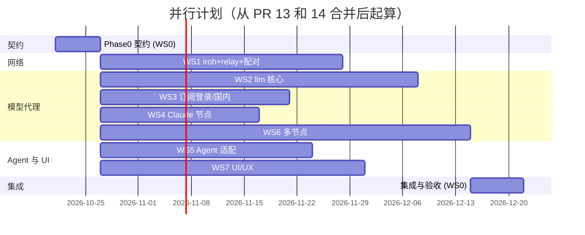

# Cranibox 分工计划（WORKPLAN）

> 配套文件：[ARCHITECTURE.md](./ARCHITECTURE.md)（总体设计）、[tasks/](./tasks/)（每条工作流一份任务书，可以直接交给 Codex、Claude Code 或其他编码 Agent）。
> 仓库：`github.com/fliaping/cranibox`。基线：`main`，**等 #13、#14 合并之后**再切 Phase 0 分支。
> 估算单位：人周，按一名熟练工程师或一个编码 Agent 计。

---

## 0. 总览

| WS | 名称 | 建议执行者 | 主要目录 | 估算 | 依赖 |
|---|---|---|---|---|---|
| **WS0** | **契约、集成与评审（协调者自留）** | **协调者** | `crates/cranibox-contracts`、根 `Cargo.toml`、`.github/`、`docs/`、改动共享热点文件 | Phase 0 约 1，之后每周约 0.5 | — |
| WS1 | iroh 网络、内置 relay 与链接配对 | Codex 或 Claude Code（Rust 网络） | `crates/cranibox-net`（新）、`workspace-node/src/peer/transport_iroh.rs`、`network/invitations.rs`、`workspace-web` 中挂 `/relay` 的那一处 | 4.5 | C1、C2 |
| WS2 | 模型代理核心 `cranibox-llm`（单节点） | Codex（Rust 服务端） | `crates/cranibox-llm/src/{server,proto,catalog,route/local.rs,mgmt.rs,upstream/apikey.rs,upstream/presets.toml}` | 6 | C3 |
| WS3 | 订阅登录与国内厂商 | Claude Code 或 Codex | `crates/cranibox-llm/src/{auth/**,upstream/{codex,kimi,gemini,copilot,cn/**}}` | 3.5（MVP），另 +2.5（Gemini/Copilot） | C3，WS2 骨架（第 1 周末） |
| WS4 | Claude 节点 | Claude Code（需要真实 Claude 账号） | `crates/cranibox-llm/src/upstream/claude/**` | 3（+3 订阅桥，可选，D1） | C3，WS2 骨架 |
| WS5 | Agent 适配层 `cranibox-agents` + DSH 默认 | Codex | `crates/cranibox-agents`（新）、`addons/deepseek-harness/*`、`workspacectl/src/inspect.rs`、`workspace-web/src/actions.rs`、`workspace-runtime/src/peers/{executions.rs,executions/mcp.rs,discovery.rs}` | 4 | C4 |
| WS6 | 多节点：名册、vault 同步、逐节点启用、租约、转发与兜底 | Codex 或 Claude Code（Rust 分布式） | `crates/cranibox-llm/src/{vault/**,route/remote.rs,route/health.rs}`、`workspace-runtime/src/peers/roster.rs`（新）、`workspace-node/src/peer/server/{llm.rs,vault.rs}`（新） | 7 | C1、C2、C3；WS1（iroh 可后接，先跑在现有 Noise 上）；WS2 |
| WS7 | UI/UX：个人 Agent 式界面 + App API | Claude Code（前端 + 少量 Rust） | `addons/control-center/ui/**`、`apps/node-desktop/src/**`、`design-system/**`、`crates/workspace-web/src/app_api.rs`（新）、`apps/node-desktop/src-tauri/src/app_api.rs`（新） | 5 | C6（先用 mock）；后期接 WS1、WS2、WS6 的真实实现 |

**WS1–WS7 合计约 33 人周**，不含可选的订阅桥和协调者自己的工作量。按 7 路并行，**日历时间约 7–8 周**可以做完多节点 MVP。

- 关键路径：Phase 0（1 周）→ WS2 骨架（1 周）→ WS6（7 周）。
- 有两个风险点要尽早验证：
  - WS4 的可行性验证（第 1–2 周，决定 D1）；
  - WS1 在真实 Cloudflare Tunnel 后的验收（开发环境里没法测）。



---

## 1. Phase 0：先定共享契约（WS0，约 1 周，所有人开工前合入 main）

**目标**：让 7 条工作流可以同时写代码，彼此不冲突。

Phase 0 只合入一个 PR：`ws0/contracts`，内容如下。

1. **新建 crate `crates/cranibox-contracts`。** 只放类型、trait、常量和 JSON schema，不写业务逻辑。依赖只有 `serde`、`serde_json`、`http`、`bytes`、`async-trait`、`thiserror`、`futures-core`。
2. **新建三个空骨架 crate**，每个只有 `lib.rs`、`Cargo.toml` 和一个 smoke test，并一次性加进根 `Cargo.toml` 的 `members`：
   - `crates/cranibox-net`
   - `crates/cranibox-llm`
   - `crates/cranibox-agents`

   这样之后谁都**不需要再改根 `Cargo.toml` 的成员列表**。
3. **改共享热点文件**，这些文件只由 WS0 改：
   - `workspace-runtime/src/peers/config.rs`：`Permissions` 增加 `llm: bool`、`vault: bool`（`#[serde(default)]`）；`Endpoint` 增加 `iroh: Option<IrohAddr>`（`#[serde(default, skip_serializing_if)]`）。
   - `workspace-node/src/peer/server.rs`：mesh 路由器上预留两个挂载点，并加一个请求扩展 `Authenticated` 的读取点：
     ```rust
     .nest("/nodes/{node}/llm", llm_routes(app.clone()))
     .nest("/nodes/{node}/vault", vault_routes(app.clone()))
     ```
     这两个函数先返回 501，放在新文件 `peer/server/llm.rs` 和 `vault.rs` 里，之后由 WS6 填实。
   - 抽出 `peer/server.rs` 里构建路由器的函数 `pub fn mesh_router(app) -> Router`，这样 WS1 可以把它挂到 iroh 上，不用改这个文件。
   - 加一个 `Transport` 抽象：`PeerTransport` trait 放在 `cranibox-contracts`；在 `workspace-runtime` 里给现有 HTTP 和 Noise 传输实现这个 trait，只做一层薄封装。
4. **加 mock**：`cranibox-contracts` 的 `mock` feature 提供 `MockRoster`、`MockLlmMgmt`、`MockAppApi`，同时导出 JSON fixtures（`contracts/fixtures/*.json`），给 WS7 的前端 mock 用。
5. **加 CI**：在 `.github/workflows/rust-runtime.yml` 里加上新 crate 的 fmt、clippy 和 test（`cargo test --workspace` 已经覆盖），以及一个契约快照测试：fixtures 的 JSON 必须能和 Rust 类型互相 round-trip。
6. **文档**：`ARCHITECTURE.md` 和本文件已放在 `docs/design/`；Phase 0 再补一份 `docs/design/OWNERS.md`，写明每条工作流拥有哪些文件。

### 契约清单

> Phase 0 已落地：代码见 `crates/cranibox-contracts`，位置、实现方和协调者决定见 [CONTRACTS.md](./CONTRACTS.md)，文件归属见 [OWNERS.md](./OWNERS.md)。fixtures 在 `crates/cranibox-contracts/fixtures/`。

#### C1 名册与身份（`cranibox_contracts::roster`）
```rust
pub type NodeId = String;                 // "node-<32hex>"
pub type EndpointId = [u8; 32];           // = ed25519 签名公钥
#[derive(Serialize, Deserialize, Clone, PartialEq, Eq)] pub enum Role { Hub, Node }
#[derive(Serialize, Deserialize, Clone)]
pub struct RosterMember { pub node_id: NodeId, pub signing_key: String /*hex*/, pub x25519_pub: String /*hex*/,
    pub role: Role, pub priority: u8, pub is_claude_node: bool, pub name: String, pub added_at: u64 }
#[derive(Serialize, Deserialize, Clone)]
pub struct Roster { pub version: u32 /*=1*/, pub owner_pub: String, pub epoch: u64,
    pub members: Vec<RosterMember>, pub sig: String }
pub trait RosterView: Send + Sync + 'static {
    fn current(&self) -> Option<Roster>;
    fn is_owner_node(&self, node: &str) -> bool;
    fn hub(&self) -> Option<RosterMember>;
    fn claude_node(&self) -> Option<RosterMember>;
    fn subscribe(&self) -> tokio::sync::watch::Receiver<u64>; // epoch 变化时通知
}
```
- 签名消息：`b"cranibox-roster-v1\0" ‖ canonical_json(roster 去掉 sig)`。
- 实现方：WS6（`workspace-runtime/src/peers/roster.rs`）。使用方：WS1（relay 白名单）、WS2（llm 访问控制）、WS7（设备页）。

#### C2 传输与 mesh 路由（`cranibox_contracts::net`）
```rust
pub const ALPN_PEER_HTTP: &[u8] = b"cranibox/peer-http/1";
#[derive(Clone, Copy, Serialize, Deserialize)] pub enum TransportKind { Iroh, Direct, Tailscale, EasyTier }
#[derive(Clone, Copy, Serialize, Deserialize)] pub enum PathKind { Direct, Relay, Unknown }
/// 每个传输都必须在把请求交给 mesh_router 之前，注入这个扩展
#[derive(Clone)] pub struct Authenticated { pub node_id: NodeId, pub endpoint_id: Option<EndpointId>,
    pub transport: TransportKind, pub e2e: bool }
#[async_trait] pub trait PeerTransport: Send + Sync {
    fn kind(&self) -> TransportKind;
    /// 发送一个 HTTP 请求到对端的 /api/v1/mesh/*，响应体必须支持流式（SSE）
    async fn request(&self, peer: &NodeId, req: http::Request<BoxBody>) -> Result<http::Response<BoxBody>, TransportError>;
    async fn path(&self, peer: &NodeId) -> Option<PathInfo>; // { kind: PathKind, rtt_ms }
}
pub enum TransportError { Unreachable, Handshake, Unauthorized, Timeout, Other(String) }
```
- mesh 子路由：
  - `/api/v1/mesh/nodes/{node}/llm/v1/{chat/completions,responses,messages,messages/count_tokens,models}`
  - `/api/v1/mesh/nodes/{node}/llm/health` → `{version, hub: bool, accounts: [{id, provider, enabled_here}], models_etag}`
  - `/api/v1/mesh/nodes/{node}/vault/{pull,push,refresh-request,lease}`（body 格式见 C7）
- 授权：`llm/*` 需要 `Permissions.llm && roster.is_owner_node(caller)`；`vault/*` 需要 `Permissions.vault && is_owner_node`。
- iroh ticket（配对用）：
  ```rust
  pub struct PairTicket { pub v: u8 /*=1*/, pub inviter: IrohAddr, pub inviter_node_id: NodeId,
      pub secret: [u8;16], pub expires_at: u64, pub purpose: PairPurpose /*OwnerDevice|Guest*/, pub hub: Option<IrohAddr> }
  pub struct IrohAddr { pub endpoint_id: String /*hex or z32*/, pub relay_url: Option<String>, pub direct: Vec<String> }
  // 编码：cranibox://pair/<base32-nopad(postcard 或 cbor(ticket))>，网页版 https://<hub>/pair#<同一串>
  ```
- 实现方：WS1（iroh），WS0（现有 HTTP 和 Noise 的薄封装）。使用方：WS6、WS7。

#### C3 模型代理（`cranibox_contracts::llm`）
```rust
pub const LLM_ADDR: &str = "127.0.0.1:3424";
pub const LLM_MGMT_SOCKET: &str = "cranibox-llm.sock"; // 位于 <run>/ 下
#[derive(Serialize, Deserialize, Clone, Copy)] pub enum Wire { Chat, Responses, Messages }
#[derive(Serialize, Deserialize, Clone)]
pub struct ModelEntry { pub id: String /*"<provider>/<model>"*/, pub display: String, pub wires: Vec<Wire>,
    pub native: Wire, pub context: Option<u32>, pub reasoning: bool, pub vision: bool,
    pub availability: Availability /*Local|ViaHub|ViaNode(NodeId)|ClaudeNodeOnly|Unavailable(String)*/ }
#[derive(Serialize, Deserialize, Clone)]
pub enum AccountKind { ApiKey, OAuth, ClaudeOAuth }
#[derive(Serialize, Deserialize, Clone)]
pub struct AccountSummary { pub id: String, pub provider: String, pub plan: Option<String>, pub label: String,
    pub kind: AccountKind, pub home_node: NodeId, pub sync: bool, pub enabled_on: Vec<NodeId>, pub all_nodes: bool,
    pub state: AccountState /*Ready|NeedsSignIn|QuotaExhausted{reset_at}|Error(String)*/ }

/// 上游适配器：WS2 定义并实现 apikey；WS3 实现 codex/kimi/gemini/copilot/国内；WS4 实现 claude
#[async_trait] pub trait Upstream: Send + Sync {
    fn provider(&self) -> &'static str;
    fn wires(&self) -> &[Wire];
    async fn send(&self, cx: &UpstreamCx, req: CanonicalRequest) -> Result<UpstreamResponse, UpstreamError>;
    async fn refresh(&self, cx: &UpstreamCx, secret: &SecretBox) -> Result<Refreshed, UpstreamError> { Err(UpstreamError::Unsupported) }
    async fn models(&self, cx: &UpstreamCx) -> Result<Vec<ModelEntry>, UpstreamError>;
}
pub struct CanonicalRequest { pub wire: Wire, pub body: serde_json::Value, pub stream: bool,
    pub session_id: Option<String>, pub client_agent: Option<String>, pub model: String }
pub enum UpstreamError { Auth, RateLimited { retry_after: Option<u64> }, QuotaExhausted { reset_at: Option<u64> },
    Network(String), Status(u16, String), Unsupported }
/// 登录流程：WS3、WS4 实现，WS2 的 mgmt 调用
#[async_trait] pub trait SignIn: Send + Sync {
    async fn start(&self, provider: &str, opts: SignInOpts) -> Result<SignInStart /*Browser{url}|DeviceCode{code,url}|PasteCallback{url}*/>;
    async fn complete(&self, flow_id: &str, input: SignInInput) -> Result<AccountSummary>;
}
```
- **管理 API**：Unix socket，HTTP/1.1 + JSON。
  - `GET /status` → `{mode: "hub"|"local"|"offline", hub_online, models_available, issues: [..]}`
  - `GET /accounts`，`POST /accounts`（apikey 或 custom），`DELETE /accounts/{id}`
  - `POST /accounts/{id}/enable {node | all_nodes: bool, on: bool}`
  - `POST /signin/start {provider, region?}` → `SignInStart`；`POST /signin/{flow}/complete {callback_url? | ...}`
  - `GET /models`
  - `POST /claude/set-node`
  - `GET /presets`（UI 选厂商用）
  - 事件：`GET /events`（SSE：`account_changed`、`mode_changed`、`models_changed`）
- 预设表 schema 用 `presets.toml`：
  ```toml
  [[preset]]
  id = "zhipu-coding"; label = "智谱 GLM Coding Plan"; region = ["cn"]
  chat = "https://open.bigmodel.cn/api/coding/paas/v4"; responses = "https://open.bigmodel.cn/api/v1"
  anthropic = "https://open.bigmodel.cn/api/anthropic"; default_wire = "messages"
  models = ["glm-5.1", "..."]; no_list = false; quirks = ["zhipu_envelope", "zhipu_1113_fallback"]
  key_hint = "Coding Plan 套餐 key"
  ```

#### C4 Agent 适配（`cranibox_contracts::agents`）
- `AgentAdapter` trait 见 `ARCHITECTURE.md` §6.1。
- 辅助类型：`AgentId`（6 个固定值）、`LocalEndpoint{base: "http://127.0.0.1:3424", key: "cbx-<agent>"}`、`ModelPick{default, small_fast, models: Vec<ModelEntry>}`、`Applied{files: Vec<AppliedFile{path, keys, before_hash, after_hash}>}`、`Drift`、`HeadlessTask{prompt, cwd, session_id, json: bool}`、`Launch{program, args, env, stdin}`、`SessionRef`、`AgentCaps`。
- 注册表：`cranibox_agents::registry() -> &'static [&'static dyn AgentAdapter]`，顺序固定：DSH、Codex、Claude Code、Pi、Hermes、OpenClaw。
- **默认 Agent = `deepseek-harness`。**

#### C5 配置 schema 与文件位置
- 网络配置里新增一段（加在 `network/config.rs` 读写的那个文件里，文件名在 Phase 0 PR 里写死）：
  ```json
  "iroh": { "enabled": true, "relays": ["https://hub.example.com/relay"], "n0_fallback": true, "bind_port": 0 }
  ```
- `cranibox serve`（Hub）新增命令行参数：`--relay` / `--no-relay`、`--public-url https://hub.example.com`（用于生成 ticket 和自检）。
- 文件位置统一照 `ARCHITECTURE.md` §9：所有新文件放在 `peers.json` 的同级目录下；`llm/` 和 `agents/` 是子目录。

#### C6 App API（UI 的后端，`cranibox_contracts::app`）
- Web 端走 HTTP `/api/v1/app/*`，由 workspace-web 和 workspace-node 的本机控制面提供；Tauri 走同名的 IPC 命令 `app_*`。两种入口共用一套 JSON。
  - `GET  /api/v1/app/status` → `StatusPill{state: "connected"|"local"|"attention"|"no_models"|"offline", text_key, hub, models_available, approvals_pending}`
  - `GET  /api/v1/app/devices` → `[Device{node_id, name, kind, online, path: PathKind, rtt_ms, badges: ["hub","claude","this"], guest: bool, caps}]`
  - `POST /api/v1/app/pair/invite {purpose}` → `{link, qr_svg, expires_at}`；`POST /api/v1/app/pair/accept {link}` → `{flow_id, sas}`；`POST /api/v1/app/pair/{flow}/confirm {match: bool}`
  - `GET  /api/v1/app/approvals` → `[ApprovalCard]`；`POST /api/v1/app/approvals/{id} {decision: "allow_once"|"allow_always"|"deny"}`
  - `/api/v1/app/models/*` 原样代理 C3 的管理 API（accounts、signin、enable、models、presets）
  - `GET  /api/v1/app/agents` → `[{id, installed, managed, model, recommended}]`；`PUT /api/v1/app/agents/{id} {managed, model}`
  - `GET  /api/v1/app/events`（SSE）：`status`、`approval`、`device`、`account`
- `ApprovalCard`：
  ```rust
  pub struct ApprovalCard { pub id: String, pub kind: ApprovalKind /*Pairing|Message|Capability|AgentTool|ComputerUse|ModelWrite*/,
      pub from_node: Option<NodeId>, pub on_node: NodeId, pub agent: Option<AgentId>, pub title_key: String,
      pub title_args: BTreeMap<String,String>, pub detail: Option<String>, pub risk: Risk /*Low|Medium|High*/,
      pub created_at: u64, pub expires_at: Option<u64>, pub actions: Vec<ApprovalAction> }
  ```
- 文案统一用 `title_key` 加参数，在前端做 i18n。
- 实现方：WS7（`app_api.rs` 聚合层，调用各模块的现有 API）。数据来源：已有的 held messages 和 inbound（#9、#12）、配对（WS1）、llm mgmt（WS2）、名册（WS6）、agents（WS5）。

#### C7 Vault 记录与同步消息（`cranibox_contracts::vault`）
- `Account`、`Enablement`、`Lease` 的字段见 [tasks/06](./tasks/06-multi-node-vault.md) 的数据模型。
- 同步消息：
  - `PullReq{since: BTreeMap<String,u64>}` → `PullResp{records: Vec<SignedRecord>}`
  - `Push{records}`
  - `RefreshRequest{account_id, gen}` → `RefreshResponse{record}`
  - `LeaseMsg{account_id, holder, epoch, expires_at, sig}`
- 签名域分隔串：`cranibox-vault-v1\0`。HPKE 套件：`DHKEM(X25519, HKDF-SHA256) + HKDF-SHA256 + ChaCha20Poly1305`。
- 实现方：WS6。WS2 只通过 `trait AccountStore { fn list(); fn get_secret(id) -> SecretBox; fn put(...); }` 来用。Phase 0 先提供 `MemoryAccountStore`，WS2 用它开发。

#### C8 错误与状态码
llm 返回 503 时，body 统一是：
```json
{"error":{"type":"cranibox_unavailable","code":"<code>","message":"...","node":"..."}}
```
`code` 的取值：`hub_offline`、`claude_node_offline`、`account_disabled_here`、`home_offline`、`all_accounts_exhausted`、`needs_sign_in`。UI 和 Agent 都按 `code` 显示对应的文案。

**Phase 0 的验收标准**：
- `cargo test --workspace` 通过；
- 契约快照测试通过；
- 现有 Python 和 Playwright 测试不回归；
- 所有工作流的负责人在 PR 里点过 approve，或者回复 LGTM。

---

## 2. 文件归属（避免冲突）

| 路径 | 拥有者 | 其他人可以怎么动 |
|---|---|---|
| 根 `Cargo.toml`、`.github/workflows/*`、`crates/cranibox-contracts/**`、`docs/design/**` | WS0 | 只能向 WS0 提需求 |
| `crates/workspace-runtime/src/peers/config.rs` | WS0 | 改字段必须走契约 PR |
| `crates/workspace-node/src/peer/server.rs`（路由器构建） | WS0 | WS1 只调用 `mesh_router()`，WS6 只写 `server/llm.rs` 和 `vault.rs` |
| `crates/cranibox-net/**`、`workspace-node/src/peer/transport_iroh.rs`、`network/invitations.rs`、workspace-web 里挂 `/relay` 的那一处（新文件 `relay.rs` 加一行挂载） | WS1 | — |
| `crates/cranibox-llm/src/{server,proto,catalog,mgmt.rs,route/local.rs,upstream/mod.rs,upstream/apikey.rs,upstream/presets.toml}` | WS2 | WS3 和 WS4 只能在 `upstream/mod.rs` 的注册表里各加一行 |
| `crates/cranibox-llm/src/{auth/**,upstream/{codex,kimi,gemini,copilot}/**,upstream/cn/**}` | WS3 | `presets.toml` 里的国内条目由 WS3 提 PR，WS2 评审 |
| `crates/cranibox-llm/src/upstream/claude/**` | WS4 | — |
| `crates/cranibox-llm/src/{vault/**,route/remote.rs,route/health.rs}`、`workspace-runtime/src/peers/roster.rs`、`workspace-node/src/peer/server/{llm.rs,vault.rs}` | WS6 | — |
| `crates/cranibox-agents/**`、`addons/deepseek-harness/**`、`workspacectl/src/inspect.rs`、`workspace-web/src/actions.rs`、`peers/executions*.rs`、`peers/discovery.rs` | WS5 | — |
| `addons/control-center/ui/**`、`addons/control-center/{web.js,web.css,index.*.html}`（生成物）、`apps/node-desktop/src/**`、`design-system/**`、`*/app_api.rs` | WS7 | 其他人**不要改 UI 源码，也不要重新生成 `web.js`** |
| `Cargo.lock` | 所有人 | 冲突时先合并 `origin/main`，再执行 `cargo update -w`，**禁止手改** |

---

## 3. 分支与 PR 约定

1. **一条工作流一组分支**，都从 `main` 切出：`ws<N>/<slug>`，例如 `ws1/iroh-endpoint`、`ws1/embedded-relay`。
2. **小步 PR**：
   - diff 尽量控制在 600 行以内，生成文件和拷进来的第三方代码除外，但拷贝的代码要单独提一个 PR；
   - 标题格式 `[WS<N>] <动词开头的简述>`；
   - PR 描述里写清楚四项：做了什么、契约有没有变、怎么测的、风险。
3. **CI 必须全绿**：
   - `cargo fmt --all --check`
   - `cargo clippy --workspace --locked --all-targets -- -D warnings`
   - `cargo test --locked`
   - 改了 UI 时，还要跑 `node scripts/build-control-center-ui.cjs && git diff --exit-code`，以及 Playwright。
4. **不改写历史**：
   - 已推送的分支**禁止 force-push、rebase 或 amend**；
   - 跟进 main 时用 `git merge origin/main`；
   - 合并 PR 用 merge commit，和仓库现有习惯一致。
5. **契约变更**只能由 WS0 提 PR（标签 `contract`）。其他工作流如果需要改契约，先在自己的 PR 里加一个 `// CONTRACT-REQUEST:` 注释，并在 issue 里 @协调者。
6. **第三方代码**：
   - 拷贝的文件**保留原版权头**；
   - 移植的文件头部写 `// Ported from magpie <path>@865b618 (MIT)`；
   - 同时更新 `NOTICE`。`NOTICE` 冲突时由 WS0 合并处理。
7. **真实凭据**：测试一律用 mock 上游和假 key，**禁止把真实 token 写进仓库或日志**。需要真实账号的验收（WS3、WS4）在 PR 里写明「人工验收步骤」，由协调者组织执行。
8. **评审**：每个 PR 至少要协调者评审一次；跨工作流的接口改动，还要 @相关工作流的负责人。

---

## 4. 各工作流摘要

> 完整内容见 [tasks/](./tasks/)，下面只列契约和验收要点。

### WS0 契约、集成与评审（协调者自留）
- **负责**：Phase 0（§1）；每周合一次 `integration/weekly` 做端到端联调；评审所有 PR；`NOTICE` 和许可证；文档；组织人工验收（真实 Cloudflare Tunnel、真实 Claude 和 Codex 账号）；跟踪待决策项 D1–D8。
- **提供**：C1–C8、mock、热点文件的修改。
- **验收**：每周集成环境（netns：Hub + 2 个节点）跑通当周已合入的功能；最后一周跑通 [tasks/00](./tasks/00-contracts-integration.md) 里列的端到端清单。

### WS1 iroh 网络、内置 relay 与链接配对（4.5）
- **提供**：`cranibox-net::IrohTransport: PeerTransport`、`serve_mesh(endpoint, mesh_router)`、`relay::router(allowlist)`、`PairTicket` 编解码、iroh 版的 `/api/v1/app/pair/*` 后端函数（供 WS7 调用）。
- **使用**：C1 `RosterView`（白名单）、C2、`mesh_router()`。
- **验收**：
  - netns 里只开放 443 时，经内置 relay 建连并通过 exec、终端和消息的回归测试；
  - 同一网络里能直连；
  - nginx TLS 反代后面的 relay，空闲 95 s 不断；不转发 Upgrade 时，自检报错；
  - 非白名单的 EndpointId 被 relay 拒绝；
  - ticket 过期或重复使用会被拒；SAS 不一致时不改变任何状态；
  - pcap 里看不到明文。

### WS2 `cranibox-llm` 核心（6）
- **提供**：本机 3424 服务、访问控制、直通、协议转换（拷贝或移植）、单账号池和首字节前重试、会话亲和、`presets.toml`（海外 API key 和自定义）、mgmt socket、`Upstream` 注册表、本机路由 `route/local.rs`。
- **使用**：C3、C7 的 `AccountStore`（先用 Memory 实现）、C1（远端访问控制要用，先 mock）。
- **验收**：
  - 回放测试（fixtures）覆盖三种入站协议到三种上游协议的组合，包括流式和工具调用；
  - 访问控制有 403 测试矩阵；
  - 用 mock 上游做 401/429 切换，确认还没写出字节时会换账号；
  - 6 个 Agent 的冒烟测试由 WS5 提供，在集成阶段跑。

### WS3 订阅登录与国内厂商（MVP 3.5，另 +2.5）
- **提供**：实现了 `SignIn` 和 `Upstream` 的 Codex OAuth（loopback 回调或粘贴回调，refresh 轮换）、Kimi OAuth 设备码、国内预设与特殊处理（智谱信封错误和 1113 回退、DeepSeek 和 Kimi 的 schema 修补、火山不拼 `/v1`、内置模型表、区域选择）、吊销判定；第二阶段做 Gemini Code Assist 和 Copilot。
- **验收**：每家都有 mock 上游的契约测试；OAuth 流程有本地假授权服务器的端到端测试；人工验收清单（真实账号，由协调者执行）。

### WS4 Claude 节点（3，+3）
- **提供**：`upstream/claude`：只在 Claude 节点上的登录和本机刷新、额度状态、`never_sync` 约束、「设为 Claude 节点」管理接口；**第 1–2 周给出可行性结论（决定 D1）**。兼容性细节单独维护，由协调者另行提供给负责人。
- **验收**：Claude 凭据不出现在任何同步数据里；其他节点的 `claude/*` 请求经转发可用，Claude 节点离线时返回 503 `claude_node_offline`；人工验收用真实账号跑 3 种客户端（Codex、Pi、DSH）。

### WS5 Agent 适配层 + DSH 默认（4）
- **提供**：`cranibox-agents` 的 6 个 adapter（wire、unwire、drift、headless、sessions、register_mcp），统一的 Agent 目录，默认 Agent 改为 DSH，`addons/deepseek-harness` 锁定版本并校验，executions、discovery 和 MCP schema 改走 adapter，Pi 新接入。
- **验收**：每个 adapter 有 golden 测试（写前和写后的文件快照）；在用户修改过文件的情况下 unwire 只删我们的键；真实 CLI（用 mock 模型）跑一轮 `headless` 能拿到回复；现有 hooks 测试不回归。

### WS6 多节点（7）
- **提供**：名册的签发、校验、同步和 `RosterView`；vault（SQLite、AEAD、HPKE、钥匙串）；`vault/1` 同步；逐节点启用；租约（接管和交还）；`route/remote.rs` 选路；Hub 健康状态机；mesh 子路由 `llm/*` 和 `vault/*`；移除节点时轮换 DEK。
- **验收**：在三节点 netns 上做故障注入：Hub 下线后本机接管，无需 Agent 改配置；回切有防抖；网络分区下租约正确；Claude 请求始终转发到 Claude 节点，离线时返回 503 `claude_node_offline`；访客节点访问 `llm` 和 `vault` 返回 403；pcap 里看不到 key。

### WS7 UI/UX（5）
- **提供**：新的信息架构和页面（§8），App API 聚合层（Web 和 Tauri），删掉 Tauri 的连接表单，审批卡组件，状态胶囊，配对流程（二维码）、模型页和各 Agent 的模型选择，「高级」收纳，双语文案，design-system 新增组件。
- **验收**：Playwright 覆盖引导、配对、添加订阅、选模型、审批、设备、高级共 7 条用户路径（先用 mock，再换真实后端）；截图交给用户评审；现有 130 个 UI 用例中，仍然适用的继续通过，被移到「高级」的那些更新选择器后通过。

---

## 5. 依赖与集成顺序

1. **第 0 周**：Phase 0 合入（WS0）。
2. **第 1 周**：
   - WS2 给出骨架和 `Upstream` 注册表，之后 WS3、WS4 可以直接接入；
   - WS1 先做 Endpoint 加 `serve_mesh`；
   - WS7 用 mock 出页面框架；
   - WS5 先做 DSH 和 Codex 两个 adapter；
   - WS4 做可行性验证。
3. **第 2–3 周**：
   - WS1 relay 和 ticket；
   - WS6 名册和 vault，先跑在现有 Noise 传输上；
   - WS3 Codex 和国内厂商；
   - WS2 协议转换。
   - **第 3 周末做第一次集成**：单节点 DSH → 3424 → API key 或 Codex 订阅，能对话。
4. **第 4–5 周**：
   - WS6 远端选路和租约；
   - WS1 把 iroh 设为默认；
   - WS7 接真实 App API；
   - WS5 补齐其余 4 个 adapter。
   - **第 5 周末做第二次集成**：两节点扫码配对，Hub 代理。
5. **第 6–7 周**：
   - WS6 故障注入；
   - WS4 定稿（或根据 D1 改做本机 Claude Code 桥）；
   - WS3 第二阶段；
   - WS7 打磨并截图评审。
   - **第 7 周末做第三次集成**：Hub 离线兜底、Claude 节点转发。
6. **第 8 周**：WS0 端到端验收，出 release candidate。

## 6. 协调者每周检查清单
- [ ] 本周合入的 PR 是否都通过了集成环境测试
- [ ] 有没有积压的契约变更请求（`CONTRACT-REQUEST`）
- [ ] D1（第 2 周）、D2、D3、D5 是否已经请用户拍板
- [ ] `NOTICE` 和第三方来源表是否已更新
- [ ] 需要真实账号或真实网络的人工验收是否已排期
