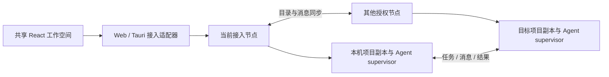
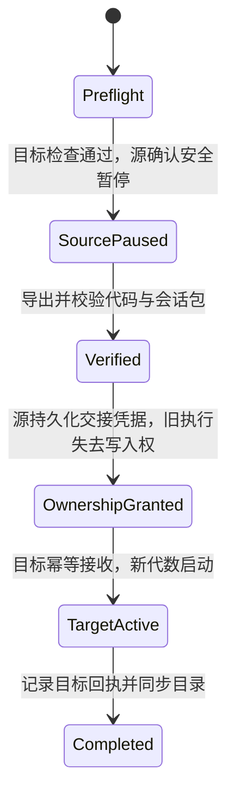

# 多设备项目与 Agent 工作空间

设计日期：2026-10-16。本文是目标架构与交付设计，当前完成范围见第 8 节及[功能、测试与交接记录（2026-10-18）](implementation-handoff-2026-10-18.md)。本文根据维护者的日常使用目标调整优先级，补充[对等节点组网设计](decentralized-node-network-design.md)中的项目、会话、协作与迁移模型；产品与交付顺序以本文为准，底层组网、授权与桌面设计继续沿用原文。

## 1. 先解决自己的日常工作

Cranibox 的首要目标是：**把自己的设备组成同一个项目与 Agent 工作空间，从任意入口查看、协作和接续工作。**

从设备接入开始，逐步获得统一项目目录、跨设备 Agent 消息、任务协作和项目/会话迁移。Windows、macOS、Linux 与 Docker 都是同等节点；已有 Workspace 是可以持续在线的节点和网页入口。继续保持独立客户端发布，不要求个人电脑安装完整容器环境。

第一条日常流程：

1. 将自己的电脑和 Docker 节点加入网络，打开任一客户端或网页，找到同一批已授权项目和 Agent 会话。
2. 在 Mac 打开项目，让 Linux 上的 Agent 执行任务，同时让 Windows 上的另一个 Agent 处理该系统的工作并回传结果。
3. 关闭 Mac 窗口，在另一台设备重新打开同一个会话，查看进度、回复问题或接管终端。
4. 需要更换执行设备时，显式复制项目，或暂停 Agent、迁移工作目录和可恢复上下文，再在目标设备继续。

首期服务个人多设备使用；多人组织、自动资源调度、完整远程桌面和传播计划不阻塞上述流程。Browser Use、Computer Use 和桌面仍按能力提供者接入，优先复用已有实现。

## 2. 当前基础与缺口

以下是 2026-10-16 设计时的代码基线与当时缺口；其中多项现已实现。判断当前状态请看第 8 节和交接记录，不能将后文提案计入已实现功能。

| 能力 | 当前基础 | 本轮需要补齐 |
| --- | --- | --- |
| 设备接入 | Workspace WSS 网关、节点注册、设备组、CLI/MCP 远程命令 | 稳定身份、目标本地授权、节点直接调用与多路径连接 |
| 持久终端 | 客户端原生 PTY；节点与 Shell 存活时支持重连附着 | 与项目、Agent 会话关联；独立 Agent 生命周期和持久执行记录 |
| 用户界面 | Web 是完整 React 控制台；Tauri 是另一套较小的配置界面 | 一套 React 业务界面，Web/IPC 适配不同入口 |
| 数据更新 | Web 通过同源快照、SSE 与轮询更新视图 | 节点之间的目录同步、持久消息与离线补齐 |
| 项目 | 各设备自己的路径与 Git 目录 | 跨节点 ProjectID、工作副本、worktree、快照与迁移任务 |
| Agent | 软件安装管理、终端与命令执行 | 可寻址会话、状态、消息、任务执行尝试、检查点与接续 |

当前普通命令最长超时为一小时，并存在断线清理规则；不能将通用 exec 直接当作长期 Agent 托管器。新增 Agent supervisor 由目标节点持有进程、输出、退出结果和会话日志，生命周期独立于浏览器连接。宿主重启后旧进程死亡，恢复的是记录和可接续上下文。

本地依据：[节点协议](../crates/workspace-runtime/src/protocol.rs)、[网关](../crates/workspace-runtime/src/server.rs)、[Agent CLI/MCP](../crates/workspace-node/src/agent.rs)、[Web 数据入口](../addons/control-center/ui/src/workspace.tsx)、[Web 页面](../addons/control-center/ui/src/main.tsx)、[Tauri 页面](../apps/node-desktop/src/main.tsx)。

## 3. 从 Orca 借鉴什么

2026-10-16 核对 Orca main 快照 `93095c2f67447474c1894e477f6695cdf5e98c16`，提交时间为 2026-10-16 00:59:21 UTC。这里只核对官方文档和源码，没有完成 Orca 的跨平台实机测试。

**Orca 已经超出本地编排。** 官方文档描述 Remote Orca Servers，并提供 `worker-start --on windows` 的 federated worker 示例；当前源码具有联邦启动、消息同步、序列游标、确认和完成结果处理。[O1][O2][O5][O6] 因此不能把“跨设备多 Agent”本身当作我们独有的能力。

| Orca 的设计 | Cranibox 采用的原则 |
| --- | --- |
| Project / worktree / Agent session | 项目、工作副本、逻辑会话分开；路径和运行机器可变化 |
| Run / Task / Dispatch | 协作上下文、任务与一次执行尝试分开；重试生成新 DispatchID |
| Run inbox、线程、ask/reply | 使用持久消息和可追踪的问题/回复，允许异步协作 |
| 完成报告绑定 TaskID + DispatchID | 过期 worker 不能完成新一轮任务；界面空闲不等于任务成功 |
| 联邦序列、导入、确认与结果结算 | 消息可重试、可去重；收到消息与接受任务结果分别记录 |
| 后台 daemon 持有 PTY，UI 重新附着 | UI 是附件；实际运行由目标设备持有，关闭界面不结束任务 |
| 远程主机标签与统一 Agent 看板 | 同一项目查看各设备会话，始终显示实际执行位置 |

Orca 当前的 Run 是持久命名空间与收件箱，本身不负责调度；不要将它误解为全网调度中心。[O1] Cranibox 也允许某个 Agent 协调一次任务，但不把这个临时角色变成所有设备的主节点。协调方离线时 worker 可以继续获准的本地执行，结果排队；依赖协调方的新决策等待其恢复。

不复制 Orca 的完整产品或内部数据库。先实现自己日常使用的 Agent 适配和协作流程，按协议隔离不同 CLI 的细节。

## 4. 所有入口共享的模型

EasyTier/Tailscale 提供网络路径；应用层仍负责身份、授权、消息可靠性和项目语义。原 WSS 网关继续兼容已有客户端，不能因为加了 VPN 就宣称旧协议已支持对等执行。

| 对象 | 稳定标识与职责 | 权威来源 |
| --- | --- | --- |
| Node | NodeID，独立于 IP、主机名和部署形态 | 对应节点 |
| Project | ProjectID，逻辑项目、名称、工作副本索引 | 创建者及显式授权的元数据所有者 |
| ProjectReplica / Worktree | ReplicaID / WorktreeID，节点、本地路径、基准版本和工作树状态 | 持有文件的节点 |
| AgentSession | SessionID，用户可持续打开的逻辑会话；单独记录 harness 及其 native session ID | 当前会话所有者，迁移时显式交接 |
| Execution | ExecutionID，某次本机进程、会话代数、工作目录和运行结果 | 实际执行节点 |
| Run / Task / Dispatch | RunID 是协作上下文；TaskID 是任务；DispatchID 是一次分派尝试，关联 ExecutionID | Run 所在节点管理任务与分派，执行节点报告事实 |
| Thread / Message | ThreadID / MessageID，参与者、回复关系、投递与处理回执 | 发送方内容、接收方回执各自拥有 |
| Artifact / Checkpoint | 内容校验值与来源，指向结果文件、代码快照或可恢复上下文 | 生成或导入该内容的节点 |

同一个 Git URL 不自动代表同一个 ProjectID；相同项目可以有多个有意不同的工作副本。不同 Agent 默认使用独立 worktree，任务结果通过补丁、提交或产物交付，不自动覆盖另一台设备的未提交修改。非 Git 项目也允许注册和按文件清单复制。

SessionID 不等于某个终端 ID，也不等于 Agent 服务商的会话 ID。换窗口继续附着时 SessionID 和 ExecutionID 都保持；迁移生成新的 ExecutionID；分叉产生新的 SessionID 并记录来源。

## 5. 数据同步与统一视图

每个节点保存自己的 SQLite 状态库、事件日志和消息收发记录。同步的是有权限的对象记录和事件，不直接复制运行中的数据库文件。首期采用明确所有者、单调版本、删除标记及增量游标；定期校验摘要，游标历史被压缩时重新取得授权快照。

上述为目标架构。当前项目目录仍使用持久 JSON；授权直连读取通过 ProjectID 和内容摘要比较补齐变化及删除，不保存同步事件历史，也不依赖修订号单调增长。消息和任务沿用各自的持久账本；尚未统一迁移到 SQLite 或通用事件复制。

| 数据 | 默认同步方式 |
| --- | --- |
| 设备、能力、项目索引、会话摘要、任务状态 | 在授权范围内复制元数据，显示来源版本与最后同步时间 |
| 消息、问题、结果报告 | 发送/接收持久化，断线补投，MessageID 去重 |
| 项目文件、未提交修改、选定的会话上下文与产物 | 用户复制、迁移或任务请求触发传输，按清单校验 |
| 终端输出、完整对话和工具事件 | 执行节点保存，按需订阅/分页；主动迁移或保留策略允许时复制 |
| 凭据、SSH 密钥、浏览器登录态、模型账户 | 保留目标设备自己的配置，不随普通项目同步；缺失时引导配置 |
| 主题、语言、常用项目等偏好 | 可选同步；窗口尺寸、当前焦点和托盘设置允许各设备不同 |

进入网络不自动获得项目读取或执行权限；ProjectID、消息中的 Agent 名称都不是凭据。Agent 主体由节点认证并绑定权限，入站消息不会因为内容自称“协调者”就获得更高授权。授权同步和撤销沿用目标本地验证规则。

“视图统一”指相同授权主体在同步后获得相同的资源、会话和任务视图；在线状态可以因入口不同而不同。离线数据显示最后更新时间和未知状态，不能用本地旧快照判断远端任务已停止。首次同步只交换必要索引，完整日志和文件按需获取。

### 一套 React 业务界面

从现有 Web 控制台逐步提取共享业务组件与类型化客户端，Web 使用 HTTP/WSS/SSE 适配器，Tauri 使用本机 IPC/事件适配器。既有 `window.workspaceWeb`、同源认证和路径依赖需要改为接入层约定；不通过关闭浏览器 CSRF 或 Origin 检查来兼容 Tauri。先共用一个真实项目页面，再迁移其他页面，避免一次性重写。

Tauri 是桌面宿主，浏览器运行独立构建的普通 React Web 应用；两者可以共用页面与业务逻辑。浏览器通过 Rust Web 服务访问节点能力，不能直接调用 Tauri IPC、托盘或本机进程。共享界面也不等于数据已经同步：两个入口读取同一授权来源才会看到同一批当前记录，离线目录补齐仍由节点协议负责。

核心入口围绕项目组织：项目下列出各节点工作副本、Agent 会话、协作任务和迁移记录；设备页用于连接与能力诊断。沿用现有浮动终端、最小化和重新附着交互。Tauri 额外提供托盘、自启动和系统权限设置。

项目视图支持同时查看 Mac 的主会话、Linux 的构建 worker 与 Windows 的测试 worker；每个会话有独立目标，不能依赖一个隐含的全局设备切换器。会话卡片显示执行节点、Agent 类型、实际状态与待回复问题。打开其他入口通过稳定 ID 找回对象，不新建同名任务。

## 6. 跨设备多 Agent 交互

通信地址使用 NodeID + SessionID，消息还可绑定 RunID、TaskID、DispatchID 与 ThreadID。支持点对点交流、委托任务、提问/回复、进度、结果和人工接管，不要求所有通信经过同一个 Agent。一次 Run 可以由用户或某个 Agent 协调；不同 Run 的协调者可以在不同节点。

首期交互契约：

1. 发起方在本地事务中写入消息与 outbox，再通过可达路径发送。
2. 目标验证主体、接收者和项目范围，将消息与去重键持久化后确认收到。
3. 适配器在 Agent 支持的输入边界交付；忙碌、等待授权或只支持终端的会话排队并说明原因。
4. 回复和结果报告通过同一线程返回；任务协调方只接受当前 DispatchID 的结果。
5. 断线恢复从已确认游标继续；重发不重复建任务，未知执行结果先查询，不能直接再跑一遍命令。

界面区分“本地排队、目标已保存、已交付 Agent、已回复、失败/过期”。传输采用至少一次投递与去重；不能把持久收件回执当作 Agent 已处理，也不能承诺外部工具副作用恰好执行一次。

每个 harness 适配器声明支持的 start、status、send、cancel、events、checkpoint、resume 能力与版本范围。优先使用其官方结构化接口、事件或明确的 CLI 恢复能力；只能接 PTY 的 Agent 标记为终端兼容模式，不靠 ANSI 输出或暂时安静推断任务完成。

消息不能直接变成向任意活动 Shell 注入按键。受管 Agent 的输入边界、消息邮箱和人工控制权分开；任务分派需要目标明确许可。当前独立 CLI/MCP 已能按 NodeID 与可选 Agent 会话 UUID 发消息、筛选收信、回复和明确确认；原有直连 MCP 仍提供命令与项目等五个工具。独立 device_tasks 已提供持久 Task/Dispatch、目标本机 Agent 明确领取、进度、持久提问与回复、最终结果与合作取消，不需要反向连接；详见[协作任务](device-tasks.md)。主动 AgentSession 登记、租期和 UUID 定向领取也已实现，见[Agent 会话](agent-sessions.md)。[明确启动的多设备后台执行](agent-executions.md)支持本机或已授予 exec 权限的远端设备，由执行节点持有进程、持久输出、退出结果、停止和重启后的中断记录；远端按提交方及凭据代次限制运行 API，撤权会停止相关活动进程。经确认启动的 Codex / Claude Code 适配、持久协作 Run 和基于成功回执的依赖派发已实现；自动进程发现、未经确认的 harness 自动交付与复杂编排仍需实现。

协作范围默认绑定 Run 和项目；批量消息只发给明确成员，不对所有节点 Agent 广播。设置任务深度、截止时间、重试次数和预算，避免循环委托。由业务工具或模型产生的自动决策仍受目标权限约束。

## 7. 三种不同的“换设备”

| 用户动作 | 实际发生什么 | 原执行是否继续 |
| --- | --- | --- |
| 在另一设备打开会话 | 新入口附着原节点的同一会话 | 继续，不搬项目或进程 |
| 复制到另一设备 / 从此分叉 | 创建项目工作副本，可创建新 Agent 会话并保留来源 | 原执行可继续；两个会话明确区分 |
| 迁移并继续 | 源 Agent 到达安全暂停点，传输代码与检查点，交接所有权后在目标新建执行 | 源执行保持暂停/结束；不允许自动双跑 |

### 项目传输

迁移清单记录基准提交、已暂存/未暂存差异、选定未跟踪文件及内容校验值。可以用 Git 对象传输加文件包实现，但不能只 clone 远程仓库而丢掉本地修改。非 Git 项目使用明确的目录和文件清单。

先检查磁盘、工具链、Agent 版本、目标路径、大小写冲突、符号链接和依赖；目标已有修改时建立新目录或 worktree。Git worktree 的绝对路径元数据需在目标重建，不能整体照搬 `.git` 指针。`.env`、凭据和大体积生成文件默认不随项目复制；确需的配置由清单明确选择或在目标重新配置。

传输支持分块、断点续传与完整性校验。完成代码传输不代表项目已可运行；目标的安装、构建和必要验证结果单独展示，失败不删除源副本。

### Agent 会话接续

分两级实现：同一 harness 的受支持版本，验证官方会话导出/恢复能否跨路径与平台使用；不支持时使用可移植交接包，包括目标、约束、对话摘要、关键决策、代码版本、相关文件、已验证结果与待办。换 Agent 类型属于上下文接力，不能声称完整恢复原 harness 的内部状态。

进程内存、Shell、进行中的工具调用和已连接浏览器不会随会话包自动迁移。先等待工具结束，或明确记录中断及未知副作用；目标不能盲目重放原调用。迁移时如果存在活跃 Dispatch，需同时交接其执行绑定，或结束旧尝试并创建新尝试，拒绝旧执行的迟到完成报告。

首期只做源设备配合的显式迁移。迁移操作有稳定 MigrationID 和持久进度；交接凭据绑定目标 NodeID、新会话代数与快照。源 supervisor 在授权目标启动前持久化禁止旧代数恢复的状态；源重启也必须遵守。目标重复收到交接请求时查询同一次执行，不重复启动。

交接凭据发出之前失败，可以终止迁移并恢复源。发出之后网络中断，源保持暂停，先查明目标是否已经启动；不能因超时自行恢复。目标未激活也需要协商撤回凭据后才能恢复源；无法联系时保留待解决状态。这种有意阻塞避免把网络分区误判为节点死亡。

首期迁移 AgentSession 的执行位置，不自动迁移活跃 Run 的协调状态。协调方仍在原节点时，目标继续向原 Run 回报；源节点整体关机前，应先结束该 Run，或明确提示协调与决策将等待其恢复。迁移协调方需要额外的邮箱、分派与权限交接协议，后续独立实现。

不引入全网选主或自动故障接管。将来如要求“源设备失联后也能自动接管且绝不双跑”，需要额外的租约/仲裁与隔离机制，不能仅用目录同步解决。

## 8. 按日常可用的纵向流程交付

| 顺序 | 可用结果 | 验收 |
| --- | --- | --- |
| A：项目模型与共享入口 | 注册本地/远端项目，关联已有持久终端；Web 与 Tauri 共用项目/会话视图 | 同一主体从两个入口看到同一项目；换入口重新附着，原 Shell 不重建；缺少权限不泄露项目 |
| B：身份与最小对等链路 | 持久 NodeID、目标本地授权、目录同步；EasyTier 对等命令/会话，保留旧网关兼容，再加入 Tailscale 并行路径 | 缓存信任且有可达路径时，停止原 Workspace 后仍能新建节点间调用；明确不可达与过期状态 |
| C：两个日用 Agent 跨机协作 | supervisor、版本明确的适配器、持久消息、Task/Dispatch 与结果；先覆盖实际日用的两个 harness | A 节点发任务，B 节点回复/提问；断网补投不重复开 worker；旧 Dispatch 结果不能覆盖重试 |
| D：复制项目与手动接续 | 未提交代码快照、目标检查、传输与校验，先实现复制；再实现源配合的单会话迁移 | 源暂停后目标继续；缺少凭据可解释；交接中断不双跑；不支持原生恢复时明确上下文接力 |
| E：补全能力与发布体验 | VNC/Browser/Computer Use 提供者、平台安装、恢复与资源优化 | 以实际日常阻塞决定次序；不为这些扩展推迟 A–D 的可用闭环 |

A 可以先利用现有网关交付；B 紧接验证脱离固定中心，不能把经网关的演示算作对等验收。C 的消息和任务契约与 B 的传输实现隔离，以便在现有连接上验证，再接入对等路径。

2026-10-17 起已交付范围，更新至 2026-10-18：

- **统一入口与项目目录**：Web/Docker、Tauri 和独立节点使用持久 NodeID；旧网关身份可显式迁移，保留凭据、分组、项目和原 Shell。共享 React 项目页面并行汇总授权来源，按 ProjectID 合并工作副本；写入归属节点。直连目录的私有离线快照跨入口进程重启保留，标明同步时间并禁用写入和 Shell 操作；重连以 ProjectID 和内容摘要增量拉取新增、修改与删除，确认撤权或更换凭据后清除。可明确选择设备启用节点后台同步，关闭页面后继续，默认关闭。见[项目与会话目录](project-session-catalog.md)。
- **独立节点与终端**：目标本地能力授权、直连 HTTP/WebSocket、CLI/MCP 和共享浮动终端已实现。Tauri 无需配置网关也能使用本机项目及原生 Shell；已建立对等连接的节点在 Workspace 关闭后仍可执行命令、创建或附着 Shell。最小化、切换页面和传输重连不重建原会话。原生 Shell 仍依赖目标节点进程存活。见[直连能力](direct-node-peers.md)。
- **对等组网**：EasyTier 有固定版本校验安装、用户态托管、自动发现、保存目标授权和节点重启恢复。多个入口避免把重新入网绑定到单个在线节点；Workspace 地址加 15 分钟单次邀请可以填充网络配置，邀请支持撤销、重启保留及哈希保存；原领取设备可凭私有恢复凭据在原有效期内重试响应丢失或配置写入失败，不授予目标能力。系统 Tailscale 可并行运行，支持状态、官方登录，按在线设备和指定端口核对 NodeID 并保存目标授权，以及显式开启后按统一端口持续发现在线节点、后台刷新和重启恢复；保存前重新检查在线状态和身份，不覆盖已有连接。见[设备网络](device-networks.md)。
- **跨设备桌面**：Web/Tauri 共用 noVNC 查看器，支持本机、直连和仅出站节点的 WebSocket 中继；目标授权、单控制者、连接中途取消、撤销和退出清理均已接入。Linux/X11 有 x11vnc 托管，兼容 wlroots 的 Wayland 会话有 wayvnc 托管；两者支持异常重试及无界面节点恢复，其余环境接入现有 VNC 服务。见[远程桌面](remote-desktops.md)。
- **虚拟空间**：环境检测、平台安装计划确认、创建与自动接入、停止、归档及保留身份的数据恢复已实现；创建资源前检查镜像协议兼容性。Web/Tauri 汇总已授权直连管理节点的只读空间目录，记录归属与检查时间，读取不触发 Docker 或返回凭据；独立空间权限、撤销和连接变更校验已接入。见[虚拟空间](virtual-spaces.md)。
- **工作文件复制**：本机与授权直连节点之间可双向复制，也支持两个直连远端；准备固定快照、检查清单并确认复制，包括未提交修改。本机无需开启监听或连接网关。目标只创建新目录，保留 ProjectID、生成新 ReplicaID；暂存与回执持久化，断网后显式查询或使用原 ID 继续。新版节点使用磁盘暂存和 1 MiB 分块，上限 2 GiB、单文件 1 GiB，可在准备或传输中断及进程重启后显式续传；旧节点保留 16 MiB 协议。不迁移 Git 历史、运行 Shell 或 Agent 状态。Web、Tauri 和 CLI 共用 Rust 实现。见[项目文件复制](project-session-catalog.md#经确认的项目文件复制)。
- **持久设备消息**：Web、Tauri、CLI 和独立 MCP 共用按 NodeID 与可选 Agent 会话 UUID 寻址的收发箱；关闭页面或中继不影响节点后台投递。支持断线退避重试、原 MessageID 幂等、按会话筛选、保留原发件会话的线程回复、显式确认和归档去重；消息权限独立、默认关闭，更换目标连接或凭据会阻止旧消息继续投递。MCP 无需网关或独立守护进程，也可在其存活期间投递与查询确认。收件不自动执行命令，不代表 Agent 已完成任务。见[设备消息](device-messages.md)。

- **协作任务与可选自动接单**：Web/Tauri 共享页面，CLI/MCP 共用持久任务账本；通过已有授权路径投递，由目标本机 Agent 领取并报告进度和结果。TaskID、DispatchID 和执行方会话分开，旧报告不能覆盖新尝试；断网不自动重跑，取消须确认停止；执行方可提问，发起方可离线回复，问题回复和结果均无需反向连接。可指定已主动登记的会话 UUID，首次领取校验当前登记。设备级任务可由接收方逐项检查并确认启动 Codex / Claude Code，或明确启用默认关闭的自动接单策略，固定可信发送设备、工作目录、权限与并发；当前尝试绑定唯一运行，已有进程记录不自动重跑。默认人工报告，也可明确选择在进程停止且没有未答问题后回报 Agent 提案。指定会话保留原归属，尚不提供进程自动发现。见[协作任务](device-tasks.md)。

- **主动 Agent 会话目录**：Web/Tauri 共享页面同时汇总本机与已连接授权设备的公开登记，按设备显示来源与独立错误，可查找并显式选择会话填写委托；提交前重新确认登记，标题与说明草稿保留。Agent 通过本机 CLI/MCP 使用稳定 UUID、修订号与五分钟租期报告；过期或目录失败不自动改投，失败清除该来源的上次登记。UUID 是路由标识，尚未绑定到 harness 进程或认证身份；此视图不包含全网发现或离线数据同步。见[Agent 会话](agent-sessions.md)。

- **持久协作 Run（2026-10-18）**：发起节点用 NodeID + RunID 管理固定目标及参与设备，具体委托携带相同上下文，接收方 MCP 和经确认的 Agent 启动可读取。Web/Tauri 共用创建、进度与结果汇总、待回复提示、筛选、统一取消、核对总结及整次归档。统一取消持久保存全部意图，必须收到全部最终回执才可结束；连接与凭据绑定避免原工作被改投。同一协作的委托可依赖最多 8 项前置任务；所有当前回执明确成功后才持久放行，尚未发送的委托可本机取消。是否自动接单由接收设备独立配置，不复制协调者状态；原节点离线后新派发与协调决策等待其恢复。见[多设备协作](device-tasks.md#将多项委托放入同一次协作)。

当前回归：Rust 工作区 **114 项通过、3 项默认忽略**，严格 Clippy 和两个前端构建通过；Web 浏览器回归 **78 项**、Tauri 模拟 IPC **29 项**、设备消息真实 HTTP/CLI/MCP **11 项**、协作任务真实双节点 HTTP/CLI/MCP **12 项**、直连 Web API **16 项**、网络 Web API **13 项**、独立节点 **8 项**、网关/节点 **14 项**、桌面服务生命周期 **7 项**、桌面直连与中继 **13 项**、空间目录 **5 项**通过。默认忽略项是流量测量及两项真实 EasyTier 用例；双节点授权/重启和三节点首入口离线后的重新接入已另行运行通过。真实 x11vnc + 隔离 Xvfb 用例也通过，包含密码认证、像素、键鼠、Web 重启、无界面节点恢复和授权撤销。这些真实后端测试已配置到 Linux CI；此处不代表远端 Actions 已执行。

真实 wayvnc 0.9.1 + 隔离的无显示器 Sway 1.11 用例已通过，验证 ARD 用户名/密码与错误凭据拒绝、像素、键盘、进程崩溃恢复、关闭 Workspace 后独立节点恢复、直连授权及撤销。CI 已增加独立 Ubuntu 26.04 容器检查；此处不代表远端 Actions 已执行。

后续构建及验收已转到 admin@192.168.217.6:22022 的同镜像容器，完成 Linux Tauri 原生构建与 KDE 运行，以及独立空间管理容器中的真实 Docker、Selkies 和编辑器验收。主验证容器没有挂载宿主 Docker socket。逐轮测试、部署和实际验证边界见[远端验证记录](remote-workspace-validation-2026-10-18.md)；Windows/macOS 原生安装包、系统权限及桌面托管仍需对应实机验收。

**仍未完成**：公钥身份与配对、Tailscale 能力广播及自动路径切换、目录自动分发与离线编辑、自动会话发现与 Run 内复杂自动调度、大规模目录增量传输及运行会话迁移、Windows/macOS 和非 wlroots Wayland 的 VNC 服务托管。已配置授权来源支持增量拉取与重连补齐；尚不提供全网自动分发和离线编辑。阶段 B/D 已部分实现；阶段 C 已落地持久消息、任务协作、主动会话登记与定向领取、非交互进程托管及默认关闭的接收端自动接单。任务专用 MCP 可读取回复、报告进度、提问并保存候选结果；最终报告默认由操作者核对，可另行明确配置提案自动回报。输入接续、复杂编排和运行状态迁移仍待实现。

Rust 逻辑职责包括身份/路由、项目目录、Agent supervisor/适配、协作消息和迁移；先放入当前合适模块，再按实际依赖拆分。React 复用发生在真实页面与客户端契约上，不提前铺大量空 crate、空页面或全网 CRDT。

每日验收优先记录：找回会话需要几步、跨设备委托是否可见、断线是否丢消息、迁移是否丢修改、是否误在错误设备执行、哪些等待没有明确解释。先连续用于自己的真实任务，再决定公开发布叙事。

## 9. Orca 一手资料

以下链接固定到本次核对的提交，描述设计依据，不代表 Cranibox 已经实现。

- [O1：编排模型、收件确认、Task/Dispatch 与 federated workers](https://github.com/stablyai/orca/blob/93095c2f67447474c1894e477f6695cdf5e98c16/docs/site/content/docs/cli/orchestration.mdx)
- [O2：Remote Orca Servers、目标主机运行与配对客户端](https://github.com/stablyai/orca/blob/93095c2f67447474c1894e477f6695cdf5e98c16/docs/site/content/docs/remote-servers.mdx)
- [O3：Agent session、状态和跨主机看板](https://github.com/stablyai/orca/blob/93095c2f67447474c1894e477f6695cdf5e98c16/docs/site/content/docs/model/agents-sessions.mdx)
- [O4：后台 PTY、热附着和宿主重启边界](https://github.com/stablyai/orca/blob/93095c2f67447474c1894e477f6695cdf5e98c16/docs/site/content/docs/model/session-restore.mdx)
- [O5：联邦运行与兼容性检查](https://github.com/stablyai/orca/blob/93095c2f67447474c1894e477f6695cdf5e98c16/src/main/runtime/runtime-orchestration-federation.ts)
- [O6：联邦分页同步、身份检查、游标与结果确认](https://github.com/stablyai/orca/blob/93095c2f67447474c1894e477f6695cdf5e98c16/src/main/runtime/orchestration/federation-sync.ts)
- [O7：消息导入事务与重复消息处理](https://github.com/stablyai/orca/blob/93095c2f67447474c1894e477f6695cdf5e98c16/src/main/runtime/orchestration/db/federation/federation-relay-import.ts)
- [O8：联邦启动、任务身份与协议版本参数](https://github.com/stablyai/orca/blob/93095c2f67447474c1894e477f6695cdf5e98c16/src/shared/rpc-contract/orchestration-federation-start-params.ts)
