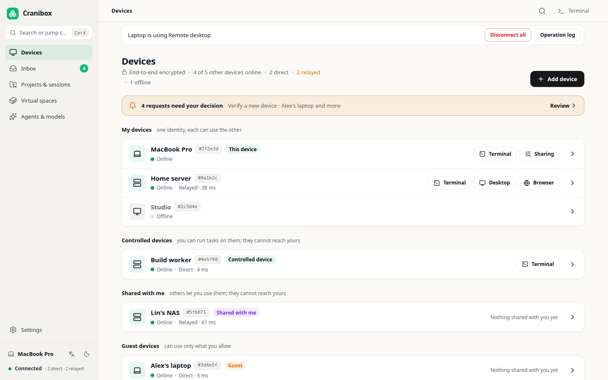
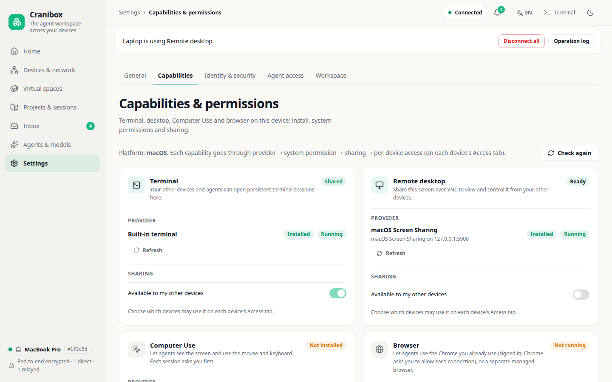
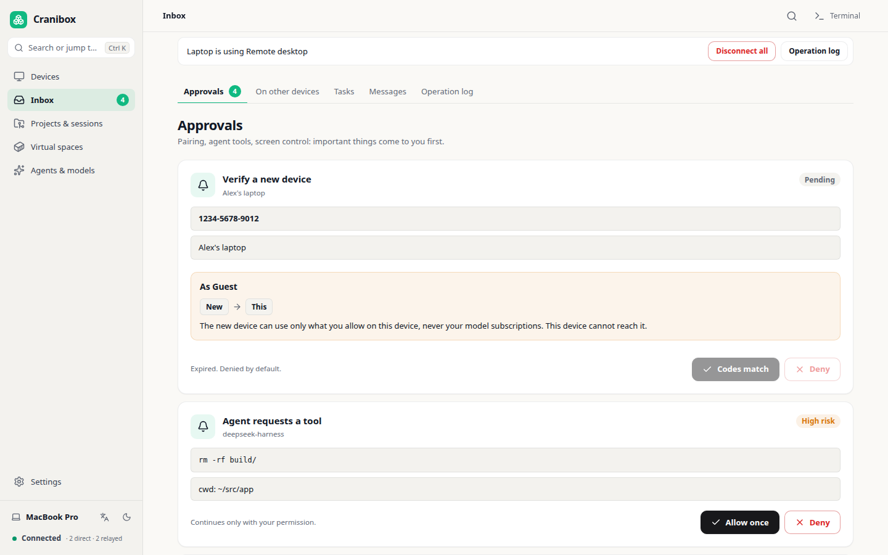

# Example: let an agent run your test suite on another OS

This walkthrough uses a Mac and a Windows PC. The same steps work with any two paired devices (for example a Linux machine and Windows). You stay in charge: Windows will ask before a command runs.

## 1. Pair a Mac and a Windows PC

1. Install Cranibox on both devices. Download the desktop app from [Releases](https://github.com/fliaping/cranibox/releases/latest), or install the CLI with `npm install -g @fliaping/cranibox@latest` (Node.js 22+).
2. Start Cranibox on each device (`cranibox`, or open the app). The interface is at `http://127.0.0.1:7377`.
3. On one device, open **Devices** and choose **Add device**. Open the `cranibox://` link or scan the QR code on the other device. Confirm that the pairing codes match.

<p align="center">
  <a href="../../images/screenshots/app/en/devices.png"></a>
</p>

A newly paired device can only send messages and tasks. Commands, file copies, terminals and the desktop stay off until you turn them on.

## 2. On Windows, allow commands from the Mac — ask every time

Do this **on the Windows PC**, because the device that will run the command decides what is allowed.

In the app: open **Settings → Capabilities**, select the Mac, and set **Terminal and commands** to **Ask every time**. That covers running commands, opening a terminal, and project folders.

Or in a terminal on Windows:

```bash
cranibox access set "<Mac name or Node ID>" commands=ask
cranibox access list
```

<p align="center">
  <a href="../../images/screenshots/app/en/capabilities.png"></a>
</p>

Leave it on *ask every time* for this example so you see the approval prompt. You can later allow it for 30 minutes or 8 hours if you prefer fewer prompts.

## 3. Hand the devices to your agent on the Mac

On the Mac, connect your agent to Cranibox. The desktop app can write the MCP config with one click, or do it yourself:

```bash
claude mcp add cranibox -- cranibox mcp     # Claude Code
codex mcp add cranibox -- cranibox mcp      # Codex
```

Other agents (Cursor, Gemini CLI, OpenCode, Hermes) are in [docs/agents.md](../agents.md). Make sure the `cranibox` command is on `PATH` in the environment the agent uses.

Then ask, for example:

> Run `npm test` in `C:\src\app` on my Windows PC and pull the JUnit report back here.

Adjust the folder and the report path to match your project (for example `C:\src\app\junit.xml` or whatever your test runner writes).

## 4. What you should see

The agent lists your devices, starts the command on Windows, waits for you, then copies the report back. The MCP tools it uses are `workspace_nodes`, `workspace_exec` / `workspace_job`, and `workspace_pull`. A typical sequence looks like this:

1. **List devices** — `workspace_nodes` (or `cranibox nodes` in a terminal) so it can pick the Windows PC's Node ID.
2. **Start the tests** — `workspace_exec` with that Node ID, program `npm`, arguments `["test"]`, and `cwd` set to `C:\src\app`. The first call comes back with `approval_required` and a request ID, because Windows is set to ask every time.
3. **Approve on Windows** — a prompt appears in the **Inbox** (and as a system notification in the desktop app): the Mac wants to run a command. Choose **Allow: this session only** (or 30 minutes / 8 hours). On a headless Windows machine you can approve from a terminal: `cranibox access list`, then `cranibox access approve <request-id> --for session`.

<p align="center">
  <a href="../../images/screenshots/app/en/inbox.png"></a>
</p>

4. **The agent retries**, gets a job ID, and polls `workspace_job` until `npm test` finishes. Check the exit code and the output.
5. **Pull the report** — `workspace_pull` copies the JUnit file from Windows to a path on the Mac. File copies also need the command (`exec`) permission, so they use the same grant you just approved, or they ask again if that approval was only for the test process.

If the tests fail, the job still completes: you get the output and can still pull the report. If you deny the request, the command does not run.

### The same steps from a shell

You can do this without an agent, once you know the Windows Node ID (`cranibox nodes`):

```bash
# On the Mac, after Windows has approved the command if it asks
cranibox exec --node <Windows-NodeID> --cwd 'C:\src\app' -- npm test
cranibox pull --node <Windows-NodeID> 'C:\src\app\junit.xml' ./junit.xml
```

## If something does not work

| What you see | What to try |
|---|---|
| The agent cannot find a Windows device | Confirm both devices are online on the Devices page, and that they finished pairing. |
| `capability_off` / a hint to allow exec | On Windows, set **Terminal and commands** to Ask or Allow for the Mac. |
| `approval_required` and nothing happens | Look at the Inbox **on Windows**. The request expires after two minutes; ask the agent to try again after you approve. |
| The report was not copied | Check the path your test runner actually writes, and that the approval (or a follow-up prompt) covers the file copy. |
| `cranibox` is not found by the agent | See [docs/agents.md](../agents.md) — GUI apps may need the full path to the `cranibox` program. |

More on what a device may allow, and how approvals work: [device access control](../device-access-control.md).
