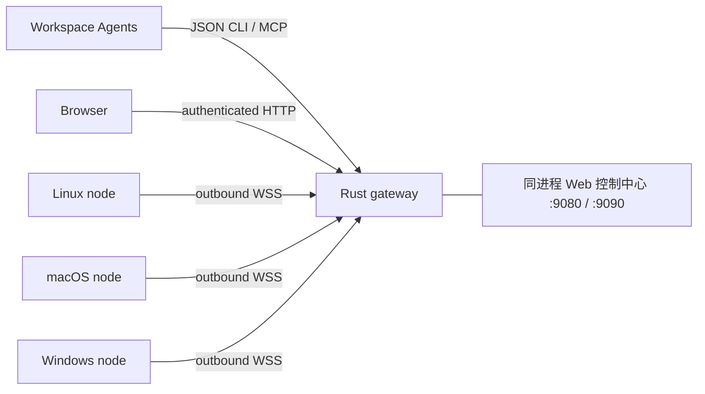

# Rust 核心与 WebSocket 远程节点

正式部署提供 `cranibox` 统一服务端和独立的 `cranibox-node` 节点客户端。
服务端包含 Web、HTTP/WebSocket 网关、CTL、用户服务管理和 MCP；节点执行代码
只在独立客户端中。详见 [统一服务端与终端](web-terminal-and-unified-server.md)。
节点不需要安装 Webtop、Node.js 或 Python；客户端主动连接 Workspace，无需开放入站端口。
Workspace 中任意 Agent 可通过 CLI 或 MCP 使用节点。
各终端系统可安装独立托盘客户端，让本机 Agent 使用节点凭据访问同组设备；见
[客户端与设备组网](node-desktop-and-device-mesh.md)。无界面客户端继续单独发布。

## 当前迁移范围

| 部分 | 实现与状态 |
| --- | --- |
| 节点注册、鉴权、连接、心跳、重连 | Rust，协议 v1 |
| 远程命令、输出、退出状态、超时、取消 | Rust；直接传递程序和参数 |
| Agent 节点 CLI、MCP | Rust |
| 原生托盘客户端、登录自启动 | Rust + Tauri 2；React 设置界面，独立安装包 |
| 同组设备的 Agent 互访 | Rust；节点独立凭据、显式设备组、Workspace 中继 |
| HTTP/WebSocket 统一入口 | Rust；可选转发现有 Web 控制中心 |
| Web 控制中心及 IDE 扩展 | Web 后端 Rust，浏览器前端 React/TypeScript；IDE 扩展仍为 JavaScript |
| workspacectl 状态、配置与控制命令 | 已迁入 Rust，详见 [构建与迁移范围](workspacectl-rust.md) |
| 用户服务管理与监督 | Rust 管理器 + s6；安装器、浏览器启动器、桌面桥保留原实现 |
| Webtop、code-server、Agent、浏览器等第三方程序 | 保持各自运行时 |

当前约定仅迁移控制命令，不进行全项目重写。启用 Rust 网关不会自动
降低 Webtop、浏览器、IDE 或第三方 Agent 的资源占用。客户端独立运行；完整控制中心和节点网关由同一个 Rust 服务端提供。不保证未实测的内存降幅。

2026-10-11 在本地 Linux x86_64 上测得 release 二进制为 5.22 MiB；
一个已连接节点、无任务时，独立网关 RSS 约 6.6 MiB，客户端约 6.1 MiB。
这是启动后的空闲快照，不包含旧 Web 服务、桌面或 IDE，也不是负载峰值或跨平台指标。



## 默认启动与构建

节点网关是 Workspace 内置服务。镜像构建时分别编译服务端和节点客户端，放在镜像的
`/usr/local/lib/agent-workspace`，不受 `/config` 数据卷覆盖。首次启动由 init
初始化持久化二进制、网关凭据和 Web 用户服务，随后启动默认启用的统一服务端。
不需要手动点击安装，也不在容器启动时编译 Rust 或下载依赖。重复启动保留已有
二进制、凭据、服务配置及用户设置的禁用状态；缺失的程序文件会补齐。

旧镜像升级需要重建容器镜像；仅拉取源码不会替换镜像中的启动脚本。既有环境
可以用下面的安装命令补齐或修复网关。

构建要求 Rust 1.89 或更新版本；部署编译后的二进制不需要 Rust 工具链。
可选托盘客户端要求 Rust 1.90 或更新版本以及对应平台的 Tauri 构建依赖。

```bash
cargo build --release --locked -p cranibox
cargo build --release --locked -p cranibox-node
./target/release/cranibox --help

# 仅用于旧环境补齐或修复；新镜像默认提供
workspacectl runtime install
# 或 agent-workspace-manager install runtime
workspacectl runtime status
```

统一服务端默认监听回环 9080 和兼容入口 9090，同一进程同时提供 Web 与节点网关。
`--no-start` 仅安装，
不启动或重启服务。`--ensure --no-start` 保留现有二进制和 unit，仅补齐缺失文件及凭据。
可通过 `CRANIBOX_BIN` 指定预编译服务端，镜像中优先使用内置程序。
正常重新安装会重启网关，使当前远程任务断开，不会自动重放。

独立网关无需安装现有 Workspace：

```bash
workspace-runtime init --credentials ./runtime.json
workspace-runtime serve --credentials ./runtime.json --listen 127.0.0.1:9090
```

`init` 不覆盖现有凭据。Workspace 默认凭据位置为
`/config/.config/agent-workspace/runtime.json`，包含控制端 token 和每个节点独立的 token。
token 不出现在 URL、程序参数或正常日志里，Unix 文件权限为 `0600`；Windows 上请把
凭据放在当前账户私人目录，并用 NTFS ACL 限制访问。

## 同一域名接入 HTTP 与 WebSocket

统一服务端的 9080 与 9090 都可接收 HTTP 与 WebSocket，继续保留公开域名的
Host/Origin 校验、会话与 CSRF。已有指向 9090 的 TLS 代理可继续使用：

```bash
workspacectl web configure --public-url https://workspace.example.com
workspacectl proxy add workspace.example.com 127.0.0.1:9090
```

代理必须允许 WebSocket Upgrade，并保留 Authorization、Host 和 Origin。机器端
`/ws/nodes/*` 与 `/api/v1/*` 使用运行时 token；其他 Web 路由继续使用现有网关登录。
外层交互式登录网关应透传这两组机器接口，避免重定向到登录页面；透传请求仍由 Rust
运行时鉴权。Caddy 的 reverse_proxy 可转发 WebSocket。两个回环端口均通过认证代理或隧道访问。

Docker 端口映射不能访问容器回环的网关。可以使用容器内 Caddy 或 SSH 隧道；独立容器
发布时显式 `serve --listen 0.0.0.0:9090`，在外层终止 TLS。远程客户端默认要求
`wss://`，Agent API 要求 `https://`；回环允许明文。`--allow-insecure` 仅用于明确
可信的私有网络。二进制不自行签发 TLS 证书。

## 注册并启动客户端

在 Workspace 上生成仅对应节点可用的 token 文件：

```bash
workspace-runtime enroll linux-box --token-file ./linux-box.token
workspace-runtime enroll macbook --token-file ./macbook.token
workspace-runtime enroll win-pc --token-file ./win-pc.token
```

独立网关上追加 `--credentials ./runtime.json`。通过可信渠道把 token 私下传给对应
机器，并删除不再需要的转交副本。部署与目标 OS/CPU 一致的二进制。
GitHub Actions 配置了 Linux、Windows、macOS 原生构建、测试和二进制 artifact。

Linux/macOS：

```bash
./cranibox-node --server wss://workspace.example.com \
  --id macbook --name 'My MacBook' --token-file ./macbook.token
```

Windows PowerShell：

```powershell
.\cranibox-node.exe --server wss://workspace.example.com `
  --id win-pc --name 'Windows PC' --token-file .\win-pc.token
```

客户端只需一个二进制，不依赖 herdr。浏览器创建的远程终端由客户端直接持有
PTY 和 Shell；关闭网页、网络断开或服务端重启均不会结束 Shell。客户端重连后
可列出并接回原来的会话，网页连接意外中断时会自动重试。每个会话在内存中保留
最近 256 KiB 输出；断线期间持续读取输出，避免任务被输出缓冲区堵住。
主动结束会话或退出客户端会结束其 Shell；客户端重启后创建新的会话。

同一 ID 只允许一个在线会话。断线指数退避重连，上限 30 秒，加随机抖动；重连时
重新读取 token 文件。没有命令重放或离线队列。可把命令交给 Linux 用户 systemd、
macOS LaunchAgent 或 Windows 任务计划程序，用普通账户运行。权限等于该账户权限。

旋转凭据使用新的输出路径，再替换客户端 token 文件；撤销示例：

```bash
workspace-runtime enroll macbook --token-file ./macbook-new.token
workspace-runtime revoke win-pc
```

无需重启网关。旧凭据连接最迟在下一次鉴权心跳（约 10 秒）关闭，其任务标记为
`disconnected`；客户端收到断线后终止当前非交互命令任务。交互终端会话保留在
客户端中；撤销凭据后无法通过 Workspace 重新接入，需要恢复有效凭据。

## Agent CLI 与 MCP

```bash
workspacectl nodes --json
workspacectl node exec --node linux-box -- uname -a
workspacectl node exec --node macbook --cwd /Users/me/project -- git status --short
workspacectl node exec --node win-pc -- powershell.exe -NoProfile -Command 'Get-Process'
workspacectl node exec --node linux-box --timeout-secs 120 --detach -- sh -lc 'make test'
workspacectl node job <job-id>
workspacectl node cancel <job-id>
```

独立 Rust 命令为 `workspace-runtime nodes|exec|job|cancel`。总是输出 JSON；等待模式
exec 仅在正常完成且退出码 0 时返回 0，其余结果返回 1。默认不经过 shell；需要管道、
重定向或内建命令时显式指定 shell。工作目录和环境变量均是节点机器上的值。
远程控制端追加 `--url https://workspace.example.com --token-file ./controller.token`。
controller.token 内容为凭据 JSON 的 controller_token，请私下导出；节点 token 不可代替。
支持环境变量 `AGENT_WORKSPACE_RUNTIME_URL` 和 `AGENT_WORKSPACE_RUNTIME_TOKEN_FILE`。

MCP stdio 配置：

```json
{"command":"/config/bin/workspace-runtime","args":["mcp"]}
```

也可复用现有 MCP 管理器：

```bash
workspacectl mcp add workspace-nodes --transport stdio \
  --command-line '/config/bin/workspace-runtime mcp' --agents codex
```

工具为 `workspace_nodes`、`workspace_exec`、`workspace_job`、`workspace_cancel`。
exec 异步返回任务 ID；job 查询输出和终态。既有浏览器与桌面 MCP 保持独立。

## HTTP API 与任务生命周期

| 方法与路径 | 作用 |
| --- | --- |
| GET /healthz | 无凭据健康检查 |
| GET /ws/nodes/{id} | 节点 Bearer token；WebSocket Upgrade |
| GET /api/v1/nodes | 控制端 Bearer token；节点列表 |
| POST /api/v1/nodes/{id}/exec | 提交任务，返回 202 和 job ID |
| GET /api/v1/jobs | 最近 128 条任务元数据，不包含输出 |
| GET /api/v1/jobs/{id} | 状态、输出、退出码 |
| POST /api/v1/jobs/{id}/cancel | 请求取消；查询 job 确认完成 |

请求示例：

```json
{"program":"git","args":["status","--short"],"cwd":"/home/me/project","env":{},"timeout_secs":60}
```

终态为 exited、failed、timed_out、cancelled、disconnected。默认超时 60 秒，范围
1–3600 秒；每节点最多 4 个并行任务；最多 128 个驻留任务和 128 个注册节点。
stdout/stderr 合计保留 64 KiB，持续读走并丢弃溢出部分，truncated 标记截断。
文本以 UTF-8 有损显示；stdout_base64、stderr_base64 保留已捕获的原始字节。
WebSocket 帧、命令和通道队列均有限额。

活跃任务状态保存在内存；完成后十分钟可释放其驻留对象。任务元数据和保留的
stdout/stderr 同时写入凭据文件旁的 runtime.history 私有目录（若凭据名为 runtime.json）。
最多保留 128 条记录，容量满时淘汰最早完成的任务，不淘汰正在运行的任务。
任务提交前、终态时保存，运行输出每 2 秒批量保存；强制杀进程可能丢失最近约 2 秒输出。
重启后的未完成任务标记为 interrupted，不自动重放。节点失联约 35 秒会关闭连接，正在执行的任务标记为断线。
断线、超时、取消或命令正常退出时清理进程树：Unix 用进程组，Windows 用 Job Object。
主动逃离 Unix 进程组的程序不受此机制隔离；Windows 先挂起启动、加入 Job Object，再恢复。
客户端是可信账户的远程执行器，不是恶意程序沙箱；浏览器已支持交互式 PTY，
目前不提供文件传输或跨平台原生桌面鼠标键盘控制。

## 验证与后续迁移

```bash
cargo fmt --all --check
cargo clippy --locked --all-targets -- -D warnings
cargo build --locked
cargo test --locked
python3 -m unittest discover -s tests -p test_rust_runtime.py -v
```

集成测试启动真实网关和两个节点，覆盖鉴权分离、CLI/MCP、参数/环境/工作目录、
二进制输出与截断、并发、超时取消、断线重连、凭据撤销和不重复执行。
本地 Linux 验证不能代替 Windows/macOS 原生验证；跨平台 CI 应通过后再发布。

本地 workspacectl、Web 后端和用户服务管理器均已使用 Rust；浏览器界面继续使用
React，监督任务交给 s6，桌面桥与软件安装器保留现有实现。启动时 oneshot 调整需重建
镜像后生效，详见 [服务实施说明](native-services-and-web.md)。


## 浏览器中的节点管理

「远程节点」页支持注册、下载一次性 Token 文件、轮换和撤销凭据、在线状态查询，
以及指定程序、JSON 参数、工作目录和超时执行任务。Token 只在注册/轮换响应中出现，
不会进入状态快照、操作历史或日志。注册同一 ID 需要显式选择轮换。节点任务在
「操作历史 → 节点任务」中读取增量输出、查询退出码或取消，Web 重启不会清除网关历史。

统一服务端通过内存路由访问网关，不再向另一个进程发送 HTTP 请求。
兼容的独立 Web 程序仍默认通过 http://127.0.0.1:9090 访问网关并读取控制端 Token。
自定义网关端口可运行 workspacectl web configure --runtime-url http://127.0.0.1:9190，
此配置仅允许 HTTP 回环 origin。它不是远程节点使用的 WSS 地址；节点客户端应连接
允许 WebSocket Upgrade 的外部网关入口。Windows/macOS/Linux 需要各自原生二进制。
